# Guidance Agent 2.14.0：伪代码与系统流程

代码基准：[d72a92dd8f208b430c5cc352aec3bc564a3a756d](https://github.com/H-Dw/EvoMolSteer/commit/d72a92dd8f208b430c5cc352aec3bc564a3a756d)。文档日期：2026-11-06。

本文描述该提交中 `uniguide_early_path_search.json` 对应的实际分支。伪代码中的模块名是便于阅读的抽象，具体入口见文末映射。后续提出的“后缀更新立即触发早期回访”等建议，不作为本版本已经实现的规则。

系统通过一个 Guidance Agent 搜索六窗 scale 配置；程序负责标定、审计、分子推理和排名。三个英文技能模块是同一 Agent 的提示组成部分，不是三个 Agent。该分支不调用 box Selection 或 synthesis Agent。

## 固定输入、记号与结果

| 记号 | 含义 |
|---|---|
| F_θ | 权重冻结的 FLOWR 生成模型；坐标可反传，权重不更新。 |
| C=(Y, H, T_P) | condition：K个受控重原子的目标坐标Y、受控化学特征H、冻结的蛋白坐标系变换T_P。 |
| E、I | 原生口袋与生成上下文E、已冻结的初始先验和随机流I。 |
| s=[s₁,…,s₆] | 完整六窗scale数组；每次测量都重新执行完整推理。 |
| G、D | 逐窗合法网格G、绑定教师/condition/采样和评价口径的搜索domain D。 |
| H_r、F_r | 第r轮之前全部兼容的有效测量，以及失败/不可排名记录。 |
| b₀、b* | 标定根，以及包含标定在内的当前最佳完整配置。 |
| J(s) | 完整50候选的终态condition对齐RMSD算术均值，越低越好。 |
| π_r | 搜索焦点：`window_id`、`operation`、`source_id`。它是参数搜索状态，不是中间分子。 |

六窗按人类步数描述为 **1–10、11–20、21–30、31–40、41–50、51–99**。首窗存储为`[0,10]`，其余按配置存储。额外坐标引导和化学状态约束实际作用于步骤1–98；步骤0和99保留原生处理。末窗只使用一个scale。

- B1网格：`[0,1,2,5,10,20,…,400]`；B2–B6网格：`[0,10,20,…,400]`。首窗使用constant形状。
- 每次完整测量50候选，身份为5个固定种子各10个槽位。种子为`[42,100045,200048,300051,400054]`。各配置共享冻结初始条件及对应随机流；这是配对测量，不是新的独立验证集。
- 每教师标定最多10个配置/500候选，正式搜索5轮，每轮最多5个配置，正式上限1250候选。两类预算分开，失败不返还、不补样。
- 网格距离按各窗网格索引计算，相对当前最佳：focused为1–2，expanded为3–8，bold为9–243；总距离上限243，单窗上限43。距离类别不等于时间方向。
- 输出包括最佳**完整配置**、逐seed/slot挑选的50个留存条目、原始测量/失败/决策回执和质量诊断。逐槽位留存可来自不同配置，不是某一scale数组的新测量。

以下算法中，`▷`后为中文逻辑注释；`NumericalFailure`指已记录的数值失败，`ContractFailure`包括身份、预算、配置或回执不一致。正常五轮结束不代表已经找到全局最优，也不代表分子已通过所有化学和物理验收。

## Algorithm 1 — 教师级 Guidance 搜索闭环

以下只展开单个教师的主要搜索过程，输入准备和运行门禁作为前置条件。

**Require:** 已准备的教师τ及condition C，冻结模型F_θ、原生上下文E与初始条件I，合法网格G，运行配置Γ及skills 2.14.0。

**Ensure:** 返回最佳完整scale配置s*及其完整50候选的condition对齐RMSD均值J(s*)；没有有效标定根时明确返回失败。

```text
 1  D, H, F ← CalibrateTeacher(τ, C, G, Γ)                        ▷ 测量两个背景与八个早期邻居，建立标定证据和搜索域
 2  if H = ∅ then return Failure(F)                              ▷ 没有有效标定测量时，不进入正式搜索
 3  b₀ ← ArgMinEligible(H, J); b* ← b₀; R ← ∅                   ▷ 用标定最优配置初始化最佳，建立空的决策路径记录
 4  for r = 1, …, 5 do                                          ▷ 每轮最多提出五个未测的完整scale配置
 5      context ← BuildSearchContext(H, F, b₀, b*, R)             ▷ 汇总实测路径与前缀；两轮无改善时提示回看早期和旁支
 6      P, π ← GuidanceAgent(context)                            ▷ 从B1/B2起步，结合证据前移、细化或回溯，提出不同早期方向
 7      RequireValidPortfolio(P, D, H, F, context)                ▷ 程序核对网格、证据、去重、早期方向和预算，不改写提案
 8      M, F_new ← ExecuteAllSchedules(P, F_θ, C, E, I, count=50) ▷ 按原顺序执行全部合法配置，每项完整推理50候选
 9      H ← H ∪ M; F ← F ∪ F_new                                ▷ 保留新测量与数值失败，已测配置直接引用，不重新占用名额
10      b* ← StrictImproveOrKeep(b*, M)                          ▷ 只按完整50候选的对齐RMSD均值更新最佳，同分则保留
11      R ← R ∪ {(π, P, M, F_new, b*)}                           ▷ 将实际调整、结果与改进状态作为下一轮路径探索的反馈
12  end for                                                      ▷ 完成五轮搜索，标定根和全部历史仍可用于比较
13  return b*.schedule, J(b*)                                    ▷ 返回最佳完整配置，不把跨配置留存当成一次新测量
```

**模块的含义：**

- **CalibrateTeacher：** 对应算法2，返回domain及标定的有效/失败记录；八个邻居均相对同一个固定背景生成。
- **BuildSearchContext / GuidanceAgent：** 结合当前最佳、真实祖先路径、不同前缀和历史反馈提出下一批完整配置；所有兼容的已测父节点仍可使用。焦点与早期方向的具体约束见算法3。
- **RequireValidPortfolio / ExecuteAllSchedules：** 程序审计完整组合后执行全部提案。每个新配置执行完整50候选；数值失败保留且不补样，具体执行和评分见算法4–5。
- **StrictImproveOrKeep：** 仅在完整均值严格下降时替换最佳；五轮结束后的候选留存另见算法6。

## Algorithm 2 — 两背景与八个早期邻居的确定性标定

**Require:** 当前教师τ，冻结输入，合法网格G，标定预算500，每配置候选数50。

**Ensure:** 返回由所有有效标定测量确定的根b₀与domain；没有有效测量时返回`NoValidRoot`。邻居均相对同一个固定参照生成。

| 教师 | 背景一 | 背景二 |
|---|---|---|
| 6pyy | `[50,70,70,50,50,70]` | `[50,100,40,40,30,50]` |
| 3w54 | `[30,40,40,40,60,80]` | `[30,40,110,110,200,200]` |

```text
 1  if a compatible frozen calibration exists then return VerifyAndReuseDomain() ▷ 完整标定可复用，不再消耗候选
 2  if a prior SEARCH_CLAIM exists then StopWithEvidence()          ▷ 中断或失败的标定不自动重启
 3  FreezeCalibrationPlanAndClaim(); H_cal, F_cal, Seen ← ∅         ▷ 先绑定计划和采样语义，再启动测量
 4  for s in DeclaredTwoBackgrounds(τ) do                          ▷ 每个背景各执行完整50候选，没有10候选筛选
 5      MeasureOnceAndRecord(s, stage=calibration, count=50)        ▷ 核对预算和重复；数值失败消耗保留，不补样
 6  end for                                                       ▷ 只有完整、有限且口径一致的结果进入H_cal
 7  if H_cal = ∅ then return NoValidRoot(F_cal)                    ▷ 没有有效背景时，不编造邻居参照
 8  ref ← ArgMinEligible(H_cal, J); FreezeNeighbourReference(ref)   ▷ 在两个背景中选定参照，此后不随邻居成绩改变
 9  for i = 1, …, 4 do                                           ▷ B1、B2、B3、B4分别作为独立变量
10      doses ← TwoNearestOtherGridValues(G_i, ref.s_i)            ▷ 内部为相邻低/高值；边界取同侧最近两个合法值
11      for d in doses do                                         ▷ 相同距离先较低索引，规则确定且可复核
12          s ← Copy(ref.s); s_i ← d                              ▷ 每次只改变一窗，其余五窗来自同一个ref
13          MeasureOnceAndRecord(s, calibration, 50)              ▷ 新数组才测量；最多累计10配置/500候选
14      end for                                                   ▷ 失败不触发替代剂量或额外测量
15  end for                                                       ▷ 完成最多八个独立早期邻居
16  b₀ ← ArgMinEligible(H_cal, J)                                 ▷ 在两个背景及八邻居的全部有效测量中选根
17  D ← SealDomain(b₀, H_cal, G, six_open_boxes, evaluation_policy) ▷ 同时绑定教师、condition、采样协议、网格和评价标识
18  return D                                                      ▷ 标定剩余预算不转入正式搜索
```

**模块的含义：**

- **MeasureOnceAndRecord：** 调用算法4；已见完整数组不再次占用标定测量。可保留的数值失败单独记入`F_cal`，其他协议/执行异常传播。最终根不要求是原背景，也不要求化学构建全部成功。
- **SealDomain：** 六窗全部开放，scale=0是合法值；标定确认的剂量是证据，不是禁止探索未测剂量的白名单。domain不宣称全局最优或未知配置的稳定性。

## Algorithm 3 — 单个 Guidance Agent 的证据、提案与程序审计

**Require:** 全部兼容历史H、失败F、domain D、路径上下文L，冻结的三个英文技能模块，轮次模型调用/输出预算，以及`final`标志。

**Ensure:** 返回通过验证且保持原顺序的全部提案，或明确的hold/会话失败；程序不静默删除或改写提案。

```text
 1  A ← AllCompatibleMeasuredParents(H)                            ▷ 包括历史非赢家；回溯时仍保留全部合法父节点
 2  registry ← VerifyAndBindEvidence(H, D)                         ▷ 核对原始测量、候选身份与文件哈希，生成可引用证据
 3  context ← Compose(H, F, b₀, b*, BestPath, PrefixFamilies, L, Budget) ▷ 提供真实背景及剩余预算，不提供未测成绩
 4  system ← HistoryAndEvidence + PathExplorationAndProposal + EvidenceComputation ▷ 三模块拼成同一个提案角色的系统提示
 5  repairs ← 0                                                  ▷ 配置保留一次最终提交修正机会
 6  while model-call and output-token budget remain do             ▷ 单个角色可有多次工具交互，不等于只调用一次LLM
 7      response ← GuidanceLLM(system, context, registered_tools)  ▷ 模型读取反馈并决定下一项只读计算或最终提案
 8      if response requests registered evidence tools then        ▷ 工具包括总体摘要、配对比较和action batch审计
 9          result ← ExecuteReadOnlyTools(response, registry)      ▷ 保存确定性计算回执；没有分子采样或改参数副作用
10          AppendToolFeedback(context, result); continue          ▷ 工具错误也返回模型，所有调用受轮次预算限制
11      decision ← ParseExplicitFinalSubmission(response)          ▷ 提交decision、proposals、reason、search_focus完整字段
12      checks ← ValidateSchemaAndFocus(decision, L, A, final)     ▷ 首轮B1/B2且start；之后按编号关系验证advance/refine/backtrack
13      checks ← checks ∧ ValidateParentsEvidenceTarget(decision) ▷ 父节点真实；证据已观察；目标绑定根、当前最佳及路径哈希
14      checks ← checks ∧ ValidateGridNoveltyDistances(decision)  ▷ 六维整数数组合法；拒绝已测/已登记/失败数组和同批重复
15      if not final then                                         ▷ 正常轮次还需通过组合层级的约束
16          checks ← checks ∧ AuditPortfolio(decision, D, Budget)  ▷ 最多五项、累计候选成本、bold及改变窗口集合多样性
17          checks ← checks ∧ AuditEarlyDirections(decision, H)   ▷ 至少两个不同的真实父节点相对早期符号方向，例外须可核验
18      if checks pass then break                                 ▷ 整个组合合法后才进入执行，不只挑出其中合法项
19      if repairs = 1 then return SessionFailure(saved_evidence) ▷ 修正额度用尽即保留失败；不自动重新开始一个会话
20      AppendValidationFeedback(context, field="proposals")       ▷ 要求完整重交；不要求synthesis的selected字段
21      repairs ← repairs + 1                                    ▷ 格式/动作修正不允许凭空补出测量
22  end while                                                     ▷ 预算耗尽、返回不完整或不可恢复API错误同样停止并留证
23  if no valid decision then return SessionFailure(saved_evidence) ▷ 不从自然语言解释猜测执行数组
24  ids ← [a.id for a in decision.proposals]                       ▷ 执行ID列表由程序确定，顺序等于提交顺序
25  FreezeDecision(decision, ids, source="deterministic_all_proposals") ▷ 兼容下游DECISION.json，不生成虚构的synthesis回执
26  return decision with actions=decision.proposals                ▷ final=true时仅允许hold和空数组，不再采样
```

**模块的含义：**

- **ValidateSchemaAndFocus：** `window_id`是0–5，文中B1–B6是1–6。首轮必须关注B1或B2；后续`advance`只要求编号增大，可跨窗；`refine`为同窗，`backtrack`为较早窗。当前程序没有强制提案实际改变焦点窗，也没有强制逐窗依次前进。
- **AuditEarlyDirections：** 对每个提案相对其真实父节点，取前四窗网格变化的符号`σ=(sign Δ₁,…,sign Δ₄)`；去掉全零，至少有两个不同σ。相同窗口同符号仅幅度不同不算第二方向；B4提高与B4降低是两个方向，所以本约束不等于每轮必须调整B1/B2。预算或可用方向不足时，程序精确检查剩余合法机会并记录降额理由。
- **AuditPortfolio：** 在存在可执行建议且预算允许时要求一个至少改两窗的bold方向；配置数不少于3时，要求至少3种相对当前最佳的改变窗口集合。允许固定其余窗口的同背景剂量比较，不要求所有方向具有固定强度配额。
- **历史复用：** 证据引用、父节点引用和配对对照不消耗候选。正式提案中的完全相同数组被拒绝，不能换一个父节点或名称重新提交。底层测量登记可复用已有完整结果，但该能力不豁免提案的新颖性约束；不同后缀形成的未测完整数组仍需测量。
- **只读能力范围：** 本分支注册`summarize_population`、`compare_paired_runs`、`audit_action_batch`；严格提交模式额外提供`submit_final_response`。它没有让Agent直接读取任意trace或操作中间分子的工具。窗口证据由程序整理进上下文。

## Algorithm 4 — 一个 scale 配置的完整50候选推理

**Require:** 冻结F_θ、condition C、原生E和I，合法完整数组s，阶段预算；原生100个积分区间，网格端点0.999、坐标噪声设置0.2。

**Ensure:** 返回50个原始终态候选及算法5的几何测量；失败保留身份与预算，不降低scale、补样或用目标标签覆盖终态。

```text
 1  identity ← BindTeacherConditionScheduleSamplingEvaluation(s)    ▷ 完整绑定生成和评价语义，不能混用历史口径
 2  if a verified complete measurement exists then return Reuse() ▷ 底层完整测量复用不算独立测量，也不新增候选
 3  ReserveUniqueCandidateSlots(identity, stage, count=50)          ▷ 先登记候选身份和预算；失败不返还
 4  S, c, streams ← RestoreFrozenInitials(I, E)                    ▷ 加载固定5种子×10槽位先验；不从父配置中间态续跑
 5  Y, H, T_P ← DecodeCondition(C); Δt ← 0.999 / 100              ▷ Y是目标condition点；H只供过程中的化学约束
 6  for n = 0, …, 99 do                                          ▷ 保持原生积分顺序及网络时间t_n
 7      t ← nΔt; α ← WindowScale(s, n) if 1≤n≤98 else 0           ▷ B1覆盖1–10，B6覆盖51–98；0/99无额外引导
 8      x ← Detach(S.coords); EnableInputGradient(x, α≠0)          ▷ 只对当前步坐标建图；自条件输入截断，模型参数不更新
 9      out, Ŷ ← NativePredict(F_θ, S with coords=x, c, E, t)     ▷ 取得原生输出与预测clean终态，不额外调用评价模型
10      Ŷ_A ← ToAngstrom(Ŷ.coords); Ŷ_P ← T_P(Ŷ_A)                ▷ 单位转换及固定蛋白坐标系变换包含在坐标目标链条中
11      A_n ← StopGradient(Hungarian(Y, Ŷ_P, valid_slots))         ▷ 每步按几何距离作一对一匹配；不对离散分配反传
12      L_n ← (1/(2K)) Σ_j ||Ŷ_P[A_n(j)] − Y_j||²                ▷ guidance仍用蛋白坐标系下的绝对误差，不先作condition自对齐
13      if α ≠ 0 then                                             ▷ 只有有效引导步骤计算输入坐标VJP
14          g ← ∂L_n/∂x; g ← ApplyConfiguredAtomScope(g)           ▷ 默认all；loss只用condition点不等于输入梯度只作用于这些点
15          γ ← NativeNoiseSchedule(t)                            ▷ 使用原生噪声调度；坐标单位链式因子已在VJP中
16          δ ← −Δt·α·((1−t+10⁻⁶)/t + γ)·g·valid_mask             ▷ 加入明确的引导位移；本协议不裁剪或归一化该增量
17      else δ ← 0                                                ▷ α=0仍保留原生转移；有效阶段的化学约束不因此关闭
18      if n = 99 then terminal_raw ← Detach(Ŷ)                   ▷ 保存末轮未覆盖预测，它将成为实际返回终态
19      S_native, c_next ← NativeTransitionAndSelfCondition(out, S, c, streams, Δt) ▷ 沿用原生漂移、噪声与类别抽样
20      S_next ← S_native with coords=S_native.coords+δ           ▷ 原生坐标转移后加入一次引导增量
21      if 1≤n≤98 then S_next ← InpaintConditionChemistry(S_next, A_n, H) ▷ 共用本步匹配；只改受控化学状态及内部键
22      RecordTrace(n, S, Ŷ, A_n, g_or_zero, δ, streams)           ▷ 保存中途状态、对应关系、增量和随机流审计
23      S, c ← Detach(S_next), Detach(c_next)                     ▷ 提交一步并截断跨步图；不把化学投影写入self-conditioning
24  end for                                                       ▷ 步骤99的原生转移不改变已保存的返回预测
25  output ← NativeFormat(terminal_raw)                            ▷ 不追加terminal forward，不对输出补投影坐标或化学类别
26  records, J ← EvaluateTerminalPopulation(output, C)            ▷ 调用算法5，几何测量不以构建成功筛样
27  FreezeMeasurement(records, J, trace, terminal, provenance)      ▷ 保存完整终态、轨迹、候选记录、总体统计及校验回执
28  EnqueueQualityDiagnostics(10_of_50, cpu_async)                 ▷ PLIP/PoseBusters抽样诊断异步执行，不改变J或阻塞搜索
29  return records, J, completion_receipt                          ▷ 推理完成和质量诊断完成是不同状态
```

**模块的含义：**

- **NativePredict / NativeTransitionAndSelfCondition：** 逻辑上展开了原生采样器的前向与转移钩子。实际代码按固定物理批次和分片执行，保持候选seed/slot及原生随机流身份；伪代码不意味着另写solver或改变类别抽样。
- **Hungarian：** 只按有效生成槽位与condition点的几何成本匹配，没有增加按原子元素/化学类型限制的终态重新分配策略。过程中的化学约束共用对应关系，但终态化学身份并非由几何评价保证。
- **InpaintConditionChemistry：** 在原生转移和坐标引导之后，对匹配槽位上的元素、形式电荷、可用的杂化特征及受控点之间的键施加条件化学状态。它不覆盖坐标，不覆盖原生self-conditioning，也不在终态强制投影。scale=0仅关闭额外坐标引导。
- **raw999：** 网格到0.999，共100个积分区间；第99次循环的网络时间约为0.98901。实际输出是这一循环的预测clean终态，不是积分后S₁₀₀，也不是时间1.0的额外模型读取。
- **数值失败：** 非有限坐标、梯度或评价不能通过删去候选形成有效总体；程序保留失败证据，正式搜索可继续其他假设。协议/来源错误按算法1停止并留证。

## Algorithm 5 — condition对齐评价与总体排名

**Require:** 50候选的实际返回坐标X及mask，目标condition点Y，冻结的T_P，现有终态Hungarian策略。

**Ensure:** 返回候选级对齐RMSD与完整均值J，或不可排名/失败证据。

```text
 1  require exactly 50 distinct seed/slot identities               ▷ 缺失候选不能靠删样或补样形成完整总体
 2  for candidate b = 1, …, 50 do                                 ▷ 每个候选均保留一条记录，与化学构建结果解耦
 3      X_P ← T_P(Float64(X_b)); Y_d ← Float64(Y)                 ▷ 在双精度测量中使用同一目标坐标系
 4      A_b ← ExistingTerminalHungarian(X_P, Y_d, valid_b)         ▷ 在拟合之前确定现有对应关系，随后固定不变
 5      P ← X_P[A_b]; Q ← Y_d                                    ▷ 只取condition对应点；非condition点不参与以下拟合
 6      require finite nonempty P,Q of equal shape                ▷ 非有限或缺失测量不能跳过
 7      P_c ← P−Mean(P); Q_c ← Q−Mean(Q)                         ▷ 中心化也只使用condition点
 8      U, Σ, Vᵀ ← SVD(P_cᵀQ_c)                                 ▷ 行向量约定；退化点集不重新挑点或重新匹配
 9      R ← U·diag(1,1,sign(det(UVᵀ)))·Vᵀ                       ▷ proper rotation，det(R)=+1，禁止反射和缩放
10      r_b ← sqrt((1/K)Σ_j ||P_c[j]R−Q_c[j]||²)                 ▷ 单个候选先得到condition对齐RMSD
11      pose_b ← sqrt((1/K)Σ_j ||P[j]−Q[j]||²)                   ▷ 保留蛋白坐标系下未自对齐的位姿误差作诊断
12      mol_b, build_report_b ← NativeBuildAndDiagnose(X_b)        ▷ 不用构建成功、PLIP或PoseBusters筛除几何记录
13      SaveCandidate(r_b, pose_b, A_b, mol_b, build_report_b)      ▷ 构建失败但几何合法者仍有r_b并计入J
14  end for                                                       ▷ 必须得到全部50个有限测量
15  J ← (1/50)Σ_b r_b; BindEvaluationPolicyAndCompleteness(J)      ▷ 无截尾、无恢复率阈值，也不回退到旧位姿排名
16  return J, candidate_records                                   ▷ 将完整总体成绩交给标定、工具、checkpoint与最终选择
```

**模块的含义：**

- **ExistingTerminalHungarian：** 与原有终态匹配一致，先在蛋白统一坐标系下按位置确定对应点，再固定这些点做Kabsch。没有通过“对齐后再次匹配”进一步降低RMSD；这一边界必须随报告保留。
- **BindEvaluationPolicyAndCompleteness：** 同时保存候选指标`condition_aligned_rmsd_angstrom`、总体指标`mean_condition_aligned_rmsd_angstrom`及`condition-kabsch-mean-v1`。只有全部50候选完整、有限且无过滤的总体可排名；标定、工具比较、checkpoint和最终选择统一使用该均值。

## Algorithm 6 — 按seed/slot保留候选

**Require:** 全部兼容且完成的有效历史总体H，以及根据完整总体均值确定的最佳完整配置b*。

**Ensure:** 返回50个逐槽位留存条目及可构建分子的SDF；不把跨配置留存当成一次新的完整推理。

```text
 1  VerifyUniformEvaluationPolicy(H, b*)                          ▷ 留存不混用对齐策略与旧位姿策略
 2  Pool ← ∅                                                     ▷ 以原始seed/slot作为比较身份
 3  for each distinct measured group h in H do                    ▷ 同一测量来源只读一次
 4      for each original candidate c in h.records do             ▷ 读取候选自身的指标，而非复制总体均值
 5          require finite c.condition_aligned_rmsd_angstrom       ▷ 同时核对评价标识；缺失或非有限不能参与留存
 6          Pool[c.seed, c.slot] ← Pool[c.seed, c.slot] ∪ {(c,h)}  ▷ 来源、数组和候选ID随条目保存
 7  for each seed/slot k in Pool do                               ▷ 跨已测配置比较相同候选身份
 8      retained[k] ← ArgMin(Pool[k], candidate_RMSD, max_scale, source_id) ▷ 同分再按最大scale和来源ID确定顺序
 9  require exactly 50 retained entries                           ▷ 每个槽位有一个条目；不是要求50个均可构建
10  SaveJSON(retained); SaveSDF(built members of retained)          ▷ 构建失败条目仍留在JSON，不用较差分子替换它
11  FreezeRetentionReceipt(b*, preserved_sources)                  ▷ 绑定代表完整配置的终态与trace，保留全部原始来源
12  return retained                                               ▷ 不调用生成模型，不消耗新的分子候选
```

**模块的含义：**

- **ArgMin：** 对应`d72a92dd`修复的真实retainer。候选级记录不能交给要求完整50总体的`choose/primary_score`接口；候选自身的对齐RMSD与完整总体的均值是不同层次的指标。

## 系统工作流程图

蓝色表示冻结输入/配置，紫色表示同一个Guidance Agent，绿色表示程序或生成计算，灰色表示证据/存储，红色表示明确失败。

### 图1：系统总流程



可编辑源：[system-workflow.mmd](system-workflow.mmd)；位图：[system-workflow.png](system-workflow.png)。图中的“真实GPU验收”是已有代码的启动前提，本次合并和文档编写没有启动新的GPU实验。

### 图2：scale初始标定流程



可编辑源：[scale-calibration.mmd](scale-calibration.mmd)；位图：[scale-calibration.png](scale-calibration.png)。每教师最多测量10个完整配置、500候选，全程由确定性程序完成。图中的B1–B4分支表示相对同一个参照独立生成配置，不表示同时执行推理；邻居成绩不会改变参照。两个背景及八个邻居的全部有效测量共同决定最终标定根。

### 图3：Agent工具与提案闭环



可编辑源：[agent-round.mmd](agent-round.mmd)；位图：[agent-round.png](agent-round.png)。程序的提交验证与执行前复核是两个阶段；后者不合格时停止，不触发静默删项。

### 图4：分子推理与终态评分



可编辑源：[inference-evaluation.mmd](inference-evaluation.mmd)；位图：[inference-evaluation.png](inference-evaluation.png)。虚线表示保存原始末轮预测或异步诊断，不是额外的模型推理。

## 代码对应关系与版本边界

以下路径相对于`agenticgen/`，均对应所列固定提交中的实现。

| 文中模块 | 代码入口 |
|---|---|
| 配置、准备、验收门禁 | [absolute_runtime.py](../../../src/agenticgen/uniguide/absolute_runtime.py)：`validate_config / prepare / require_acceptance`；[absolute_acceptance.py](../../../src/agenticgen/uniguide/absolute_acceptance.py) |
| 六窗实验配置 | [uniguide_early_path_search.json](../../../configs/uniguide_early_path_search.json)（overlay，不是包含所有路径的独立主机配置） |
| 确定性标定 | [path_calibration.py](../../../src/agenticgen/uniguide/path_calibration.py)：`plan / neighbours / run / derive_domain` |
| 教师级闭环、最终只读分析 | [linear_runtime.py](../../../src/agenticgen/uniguide/linear_runtime.py)：`history / run_version` |
| 单Agent提示、schema、确定性执行ID | [linear_council.py](../../../src/agenticgen/uniguide/linear_council.py)：`advise`的path-search分支 |
| 证据工具、一次有界提交修正 | [analysis_tools.py](../../../src/agenticgen/uniguide/analysis_tools.py)：`EvidenceTools`；[deepseek_tools.py](../../../src/agenticgen/providers/deepseek_tools.py)：`call_with_tools` |
| 焦点、前缀分组、早期方向 | [path_search.py](../../../src/agenticgen/uniguide/path_search.py)：`context / validate_focus / audit_early` |
| 身份、新颖性、距离、多样性与预算 | [diverse_profiles.py](../../../src/agenticgen/uniguide/diverse_profiles.py)：`resolve / require_portfolio`；[linear_admission.py](../../../src/agenticgen/uniguide/linear_admission.py)：`audit_actions` |
| 最佳真实路径与无改善回溯 | [checkpoint_learning.py](../../../src/agenticgen/uniguide/checkpoint_learning.py)：`best_from_calibration / decision_path / rooted_context` |
| 原生前向、VJP、状态提交 | [sampler.py](../../../src/agenticgen/uniguide/sampler.py)：`Control.forward / after`；[condition.py](../../../src/agenticgen/uniguide/condition.py)：`guidance_delta` |
| 逐步绝对坐标匹配和loss | [absolute_coordinate.py](../../../src/agenticgen/uniguide/absolute_coordinate.py)：`match / CoordinateObjective / AssignmentState` |
| raw999、端点、过程化学约束 | [geometry_dynamics.py](../../../src/agenticgen/uniguide/geometry_dynamics.py)：`Raw999Sampling`；[joint_endpoint.py](../../../src/agenticgen/uniguide/joint_endpoint.py)：`compile_endpoint`；[guidance_endpoints.py](../../../src/agenticgen/uniguide/guidance_endpoints.py)；[geometry_chemistry.py](../../../src/agenticgen/uniguide/geometry_chemistry.py) |
| 测量身份、候选终态记录 | [geometry_sampling.py](../../../src/agenticgen/uniguide/geometry_sampling.py)：`terminal_records / execute`；[geometry_batch.py](../../../src/agenticgen/uniguide/geometry_batch.py) |
| 终态对齐与严格完整均值 | [condition_evaluation.py](../../../src/agenticgen/uniguide/condition_evaluation.py)：`fit / evaluate / summarize / score`；[geometry_protocol.py](../../../src/agenticgen/uniguide/geometry_protocol.py)：`choose / primary_score` |
| 候选留存修复与无采样恢复 | [absolute_runtime.py](../../../src/agenticgen/uniguide/absolute_runtime.py)：`retain`；[recover_guidance_214_retention.py](../../../scripts/recover_guidance_214_retention.py) |
| 异步CPU质量诊断 | [quality_queue.py](../../../src/agenticgen/uniguide/quality_queue.py)：`enqueue / snapshot` |
| 核心行为测试 | [test_early_path_search.py](../../../tests/unit/test_early_path_search.py) |

本版本允许前向、停留和回溯，但只按焦点编号关系审计操作名称；它没有强制“焦点窗必须被提案实际改变”，也没有实现“每次后缀更新就必须回访B1/B2”的规则。前四窗的符号方向约束不保证最早两窗每轮都被探索。历史非赢家可作父节点，但不等于程序已为每个前缀预留续测配额。本文不将后续设计建议或2.15及以后版本写入上述伪代码。

本次文档验证范围见[validation.json](validation.json)。CPU回归、图形渲染和文档一致性检查不构成新的科学收益验证。
