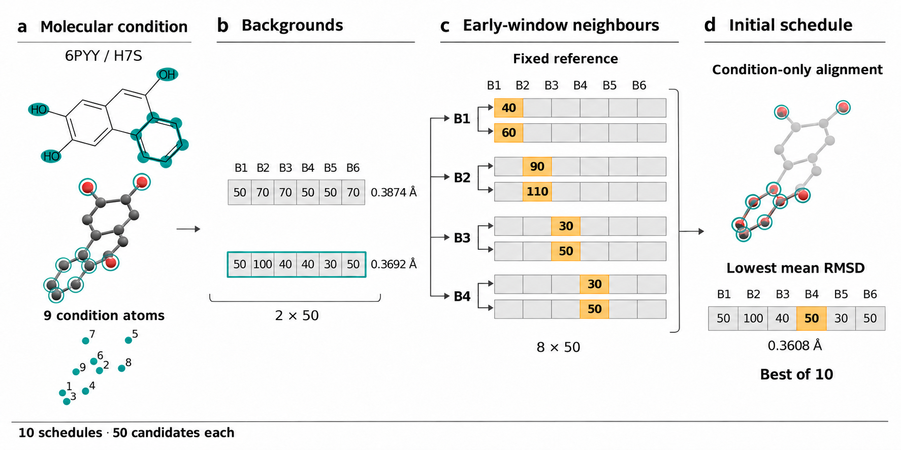

# Scale 初始标定：分子案例示意图

本图说明一条主线：**比较两个背景 → 固定参照生成八个早期邻居 → 从全部有效测量选择初始 scale 配置**。

## 图注

**Deterministic initialization of guidance scales.** **a**, The 6PYY/H7S input example is represented by its atom graph, reference conformer and nine selected condition atoms. **b**, Two six-window backgrounds are evaluated with 50 candidates each; the lower condition-aligned mean RMSD determines the fixed reference. **c**, Two neighbouring doses are evaluated independently for each of B1–B4. Amber marks the changed window; blank cells inherit the fixed-reference values. **d**, The initial schedule is selected from both backgrounds and all eight neighbours using the unfiltered mean of 50 candidate-level condition-only proper-Kabsch RMSDs. The example winner is `[50,100,40,50,30,50]`, with mean 0.360842 Å. The alignment overlay is conceptual, not a new molecular simulation.

## 案例与数据

- 输入分子共有17个重原子；9个condition原子为所标出的六个芳香碳与三个氧。原子图连接、参考三维坐标和condition选择来自同一实际输入，已核对结构坐标一致。
- 背景一为`[50,70,70,50,50,70]`，完整均值0.3874246 Å；背景二为`[50,100,40,40,30,50]`，完整均值0.3692251 Å。第二个背景作为八个邻居的固定参照。
- 图中均值保留四位小数。全部10个配置的原始读数保存在[example_data.json](example_data.json)。没有为绘图生成新的候选或性能测量。
- condition对齐使用原有终态Hungarian确定的对应点，之后不再重匹配；拟合与误差计算只使用condition点。空白邻居格不是零scale。

## 文件与生成记录

- [最终PNG](api_minimal/scale_calibration_schematic.png)：通过指定服务的`gpt-image-2.6-sunburst`生成并修正，保持API返回图像原始字节。
- [原子图SVG](atom_graph.svg)、[分子SDF](example_molecule.sdf)、[真实输入参考图](molecular_reference.png)：用于追溯分子连接、坐标及condition高亮。
- [绘图约定](figure_contract.json)、[最终修正提示](api_minimal/prompt.md)、[请求元数据](api_minimal/request_metadata.json)、[生成回执](api_minimal/generation_receipt.json)：记录模型、输入哈希和输出哈希，不含凭据。
- [生成客户端](generate_schematic.py)使用`nature-figure`的提示构建助手，并适配[指定服务的图片接口](https://sui-xiang.com/docs/?cat=api-examples&page=image)。密钥仅从`SUIXIANG_API_KEY`进程环境读取。

初始输出及后续修正的请求记录保留，用于核查批次数、condition原子高亮和邻居表简化的修正。最终文件以本页所链接的PNG为准。

## 图形性质

这是以实际结构和实测读数为依据的AI栅格示意图；生成的分子绘制与对齐叠图用于解释流程，不代替原始结构证据。图中已减少长句、重复数字和装饰框，采用白底、简短英文标签、统一condition高亮与剂量变化配色。

[Nature图形规范](https://research-figure-guide.nature.com/figures/preparing-figures-our-specifications/)要求正式稿中的文字和线条可编辑，并核对最终尺寸与分辨率。本次保留模型原生PNG，不通过放大像素或包装SVG声称实现真正矢量化；可编辑的原子图及源数据另附，供投稿定稿使用。

原生输出为1774 × 887像素。投稿排版时，建议将分面标题、B1–B6列标题、数值和箭头置为矢量层，并与各格中心精确对齐。
