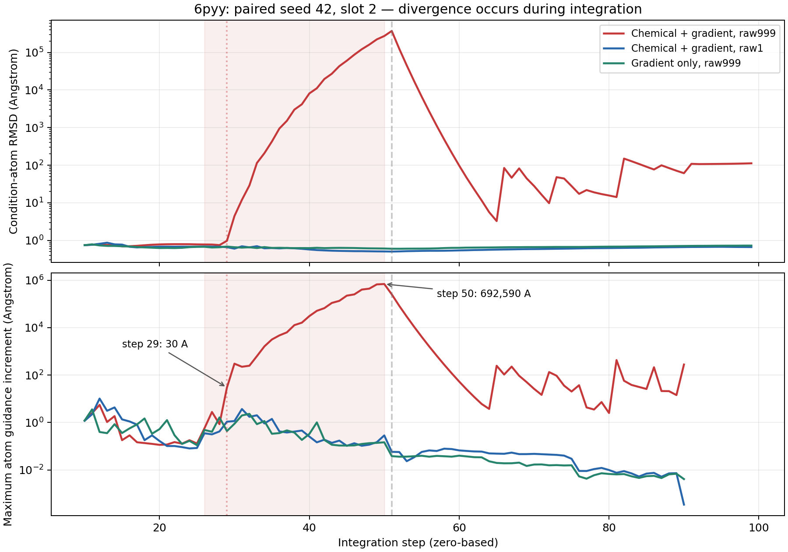

# 两教师特征保持差异、6pyy异常轨迹与FLOWR.MULTI协议核对

分析日期：2026-10-28，Asia/Shanghai。只读取已完成实验、冻结实现和官方源码，没有启动推理、排除记录、修改运行目录或恢复UG05。数据证据见同目录`evidence.json`，来源与提交绑定见`source_binding.json`。原始26份被读取的教师结构、逐步记录和终态文件前后哈希一致。

## 1. 结论与指标范围

3w54在这些指定配置下的条件原子几何误差和部分化学保持指标更好，但不能解释为“3w54分子天生更容易引导”。已有证据指向三项同时存在的差异：无引导基线更贴近其条件几何；采用的早、中期实际强度较低；约束子图及几何匹配的稳定性不同。不同口袋、教师几何、模型先验与配置选择相互混杂，尚无控制这些因素后的因果实验。

本报告的几何误差是历史协议的**九个PLIP控制原子、每步几何Hungarian匹配后的坐标均方根偏差**，不是整个配体对齐后的均方根偏差，也不是新内部距离协议的指标。化学保持另从保存的终态张量计算，不能用几何误差代替。

| 已完成实验，每组50次 | 6pyy条件原子坐标均方根偏差（Å） | 3w54条件原子坐标均方根偏差（Å） |
|---|---:|---:|
| 无引导R0 | 0.59701 | 0.42859 |
| 历史最佳平均pIC50配置，gradient，native1 | 0.58326 | 0.35805 |
| 化学inpainting＋gradient，native1 | 0.49137 | 0.25068 |
| 化学inpainting＋gradient，raw1 | 0.49220 | 0.25200 |
| 化学inpainting＋gradient，raw999 | 2.71989 | 0.20782 |

R0到gradient/native1的相对改善分别约2.3%和16.5%。说明3w54的优势在inpainting前已经存在；也提示当前配置按平均pIC50选出，并不是按最小几何误差或最大位移稳定性选出的最优配置。

## 2. 化学保持与教师差异

新增只读诊断：按终态坐标重新匹配九个控制原子，检查其元素、形式电荷和36个无序原子对的键类别（含无键）。不考虑核心之外的键、整体化学身份或立体化学。所有50条张量均纳入，构建失败不被丢弃。

| raw999终态诊断 | 6pyy gradient | 3w54 gradient | 6pyy 化学＋gradient | 3w54 化学＋gradient |
|---|---:|---:|---:|---:|
| 控制原子元素匹配率（450个原子槽） | 88.22% | 92.67% | 97.56% | 99.56% |
| 控制原子形式电荷匹配率 | 94.22% | 100% | 97.33% | 100% |
| 核心全部原子对键类别匹配率 | 88.72% | 96.89% | 99.11% | 99.61% |
| 教师已有核心键匹配率 | 38.00% | 70.67% | 97.33% | 96.00% |
| 全部核心元素、电荷、键类别同时匹配的分子数 | 2/50 | 5/50 | 28/50 | 42/50 |

这里有两个限制。第一，3w54并非所有化学指标都更优：化学raw999的已有核心键匹配率略低于6pyy。第二，6pyy核心有6条键，3w54只有3条；“全部同时匹配”及包含大量无键的匹配率不能无条件跨教师比较难度。Kekulé键类别采用实验原始编码，没有再做芳香共振等价化。

native1化学组的上述核心匹配均为100%，因为输出后做了硬覆盖，并不能证明模型自己保持住了条件。即使100%覆盖，6pyy仍有6个构建失败，3w54有4个；已有价态审计表明这些错误涉及核心原子与核心外的连接。例如6pyy的O被保留为中性，但外部键级合计超过其允许价态。核心一致、整个分子合法是两件事。

支持解释差异的事实：

- **强度差异。** 四窗口实际强度分别为6pyy `[181.0193,724.0773,181.0193,64]`，3w54 `[90.5097,181.0193,181.0193,181.0193]`。6pyy第一窗口为2倍、第二窗口为4倍。raw999化学组各样本最大引导位移的中位数分别为5.95与2.99 Å；6pyy只有一个样本超过50 Å，却足以破坏组均值。
- **约束结构差异。** 6pyy为17个重原子、3环、0个可旋转键；3w54为22个重原子、2环、4个可旋转键。二者都控制9个原子，覆盖比例分别为52.9%和40.9%。6pyy核心包含一个六元环加3个在核心诱导子图中孤立的O；3w54核心为一个4原子链状组分和5个孤立原子。前者需要同时满足更多环内键关系，且孤立O的外部价态没有被覆盖约束。认为这些差异影响修复自由度是合理假设，尚非独立因果证明；不能笼统认为“更柔性一定更好”。
- **身份更不稳定。** steps10–90中，raw999化学组的控制槽位切换率均值为6pyy 2.54%、3w54 0.91%；最后9步分别0.12%与0%。当前匹配仅看坐标，不看元素、键或持久原子身份。几何匹配切换会使下一次化学覆盖写入不同生成槽位。这是风险路径，但切换率与误差共同变化，不足以证明切换是唯一原因。

## 3. 6pyy异常在何时、何处发生

定位：`chemical_raw999`，seed=42，logical_slot=2，tensor_row=2，node_id=`ug_b000_final_002`。原组路径`/workspace/agenticgen_joint_inpainting_20261027/groups/6pyy_H7S_A_402/chemical_raw999`。

| step（从0计数） | 网络时间 | 实际强度 | 预测控制原子坐标均方根偏差（Å） | 最大单原子引导增量（Å） | 9个控制匹配槽位变化 |
|---|---:|---:|---:|---:|---:|
| 25 | 0.24975 | 181.02 | 0.781 | 0.131 | 0/9 |
| 26 | 0.25974 | 724.08 | 0.777 | 0.574 | 0/9 |
| 27 | 0.26973 | 724.08 | 0.774 | 2.786 | 0/9 |
| 28 | 0.27972 | 724.08 | 0.747 | 0.855 | 0/9 |
| 29 | 0.28971 | 724.08 | 0.973 | 29.983 | 4/9 |
| 30 | 0.29970 | 724.08 | 4.426 | 303.018 | 7/9 |
| 40 | 0.39960 | 724.08 | 8,119.58 | 30,772.34 | 9/9 |
| 50 | 0.49950 | 724.08 | 273,592.33 | 692,589.75 | 9/9 |
| 51 | 0.50949 | 181.02 | 372,735.98 | 253,715.06 | 8/9 |
| 99 | 0.98901 | 关闭 | 112.242 | 0 | 0/9 |

明确的中段发散转折在step29–30。step29的完整输入坐标梯度范数从上一时刻0.0307上升为1.2905，引导位移范数是原生更新的170.84倍。当前坐标仍处于约2.6 Å的核心中心半径内，却施加了近30 Å的单原子更新；下一步进入分布外状态，误差与梯度相互放大。step50是峰值，不能将它写成异常首次出现的位置。step27已经存在较大更新，且尚未切换匹配，进一步说明不能武断归因于Hungarian切换单一因素。

代码链条：`condition.py::condition_map`重新计算纯几何匹配；`sampler.py::Control.forward`对预测端点损失执行完整坐标VJP；`condition.py::guidance_delta`乘以该步实际强度、时间因子及步长；`Control.after`把增量加到原生更新；`joint_endpoint.py::EndpointControl.after`随后按本步匹配覆盖化学信息。有限性检查阻止NaN/Inf，但当时不会因极大**有限**位移中止，也不含信赖域或回溯。不是亲和力梯度误入，也不是硬替换坐标：该组无坐标inpainting。

配对反证：相同seed/slot的化学raw1在step29增量1.084 Å、step50仅0.286 Å，最终误差0.66233 Å；仅gradient的raw999也没有该发散（该样本全程最大3.586 Å）。raw1与raw999在step29的标量更新系数只相差约0.015%，而化学raw999的梯度范数约为raw1的38.7倍。因此，不能解释为0.1%的步长改变直接造成同等比例的误差；更符合“网格改变了累计状态和离散化学轨迹，强引导与动态匹配在该轨迹上放大了局部不稳定”。缺少冻结状态下分别替换时钟、匹配、化学投影的模型回放，不能判定最初触发来自哪一项。

最终输出只计算最匹配的9个原子，不能描述所有原子。该样本最后预测中，最远原子距核心中心仍约70,535 Å，且分子是17个不连通单原子碎片（含异常I）；最终112.24 Å已低估整个生成结构的崩坏程度。全部张量有限，RDKit能够构建碎片，不代表结构可用。固定10/50质量抽查未选中slot2，也不能据抽样通过率排除异常。

这与另一个“steps1–99全程引导”的异常必须分开：此样本来自历史steps10–90，前9步未引导，故不能归咎于steps1–9。全程引导组则确有早于inpainting开始的巨大更新。正在运行的10–99实验针对晚期guidance的贡献；它不能单独消除或解释已在step29出现的这个中段不稳定。

剔除敏感性分析仍沿用先前报告：50条均值2.71989 Å；仅剩49条为0.48474 Å，但配对删除同一seed/slot后，native1也是0.48787 Å，差仅−0.00313 Å。不能通过删异常宣布raw999更优。

## 4. raw999与FLOWR.MULTI究竟哪些一致

实际查阅官方`jule-c/flowr`提交`bbb8bfb4e8d8dd16bff1d56a7f96246920e643ba`。官方实现与论文的理论端点需要区分：论文写条件片段时间为1，代码用0.999。[论文](https://www.nature.com/articles/s43588-026-00998-8)；[固定提交源码](https://github.com/jule-c/flowr/blob/bbb8bfb4e8d8dd16bff1d56a7f96246920e643ba/flowr/models/fm_pocket.py)。

| 项目 | 当前raw999历史实验 | 官方FLOWR.MULTI代码（默认无额外corrector） |
|---|---|---|
| 线性网格、100区间 | 0–0.999，步长约0.00999 | 相同设计 |
| 返回值 | 最后循环内、更新和覆盖之前的模型预测 | 相同设计 |
| 自由原子最后前向时间 | 约0.98901 | 100区间时同为约0.98901 |
| 条件原子前向时间 | 与自由原子相同，逐步变化 | 条件片段坐标和原子类型时间固定0.999 |
| 原子对应 | 每步纯几何Hungarian重新分配 | 固定fragment mask及先验中的对应原子 |
| 条件状态 | step10起外部覆盖化学；本组坐标用梯度 | 原生片段坐标和类型覆盖；保留核心已有键 |
| 键、形式电荷处理 | 覆盖核心所有原子对，包括无键；覆盖形式电荷 | 此原生例程只固定核心非零键，不硬覆盖电荷 |
| 模型与动力学 | FLOWR.root v2，附加坐标VJP与SDE引导 | 原FLOWR.MULTI协议；并非同一checkpoint和引导动力学 |

源码定位：网格2033–2034；模型前向及预测2094附近；状态覆盖2105–2118；返回循环预测2196–2216；条件时钟1014–1016、1388–1403；覆盖范围1018–1067。官方corrector若设为正数会改变最后预测来源，故比较必须声明其为0。当前使用torch网格，官方用NumPy网格，浮点表示和实现亦不能声称逐位等同。

本地FLOWR.root代码`739a33c2aab74d074dd24605b9a2e34dc809ae9c`的原生`_inpaint_times`填1.0，与原FLOWR的0.999不同。但当前`prepare.load_model`要求原生inpainting/graph_inpainting关闭，化学条件由外部插件实施，因而并没有进入这一条件时钟路径。保存的`NETWORK_TIMES`证明step50所有原子坐标/原子类型时间均为0.4995，step99均为0.98901；没有条件原子单独停在1或0.999。

checkpoint的训练元数据包含`mixed_uncond_inpaint=True`及多种片段任务。因此不能说所用模型从未学习inpainting；准确的问题是**当前推理没有启用与训练条件形式相对应的原生固定片段和分离时钟契约**。端点重评分0.9999只是评分过程，也没有改变实际生成条件时间。

## 5. 下一步应优先验证的因素

1. 先把“网格端点”和“条件原子的网络时间”作为独立因素。固定映射后，化学-only实验只把原子类型条件时间设为0.999/1作配对比较；坐标仍按生成时间前进，不把未固定的坐标冒充已知端点。联合条件才对坐标和化学同时使用条件时间。
2. 对6pyy第二窗口单独做强度稳定性实验，先用该教师、该条件、该输出协议的预实验界定安全范围，不能直接跨教师平均或沿用旧协议标定。保留极大有限位移与失败，不自动限幅或减弱重试。
3. 用固定、化学兼容的原子映射对照动态Hungarian，记录条件身份切换；分别分析已有键恢复、无键保持及核心外价态。若改覆盖规则，需要独立协议，不能覆盖现有结果。
4. 在任何后续优化中，同时报告最大单原子位移、整个分子的最大空间偏离、连通性和数值失稳；只优化选中9个原子的误差会漏掉其余原子崩坏。

这些是后续实验建议，本次没有启动。现有10–99后台实验不受本次分析影响。
