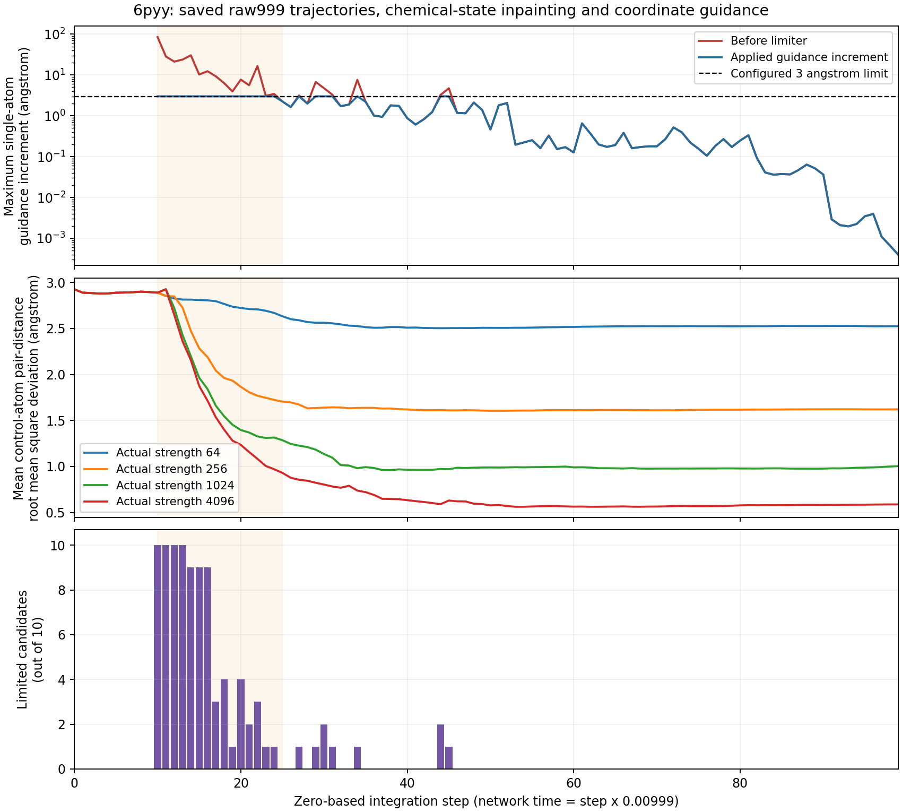

# 条件距离指标、坐标RMSD及逐步限幅分析

本报告分析固定提交`4ffd6e4c63bba17f9ae68eaf185a48f0d80a4985`产生的已保存数据。只读取13组6pyy粗筛终态和轨迹，没有加载生成模型、增加候选或调用LLM。分析输入53个文件的哈希与终态归档一致，数学定义以远端冻结实现为准。

## 1. 集合、坐标与统计单位

- \(b\)：候选分子编号；本次每个粗筛配置有\(B=10\)个候选。
- \(i,j\)：配体重原子编号；\(a\)：靶点原子编号。
- \(C\)：condition控制原子集合，两个教师均有9个原子。
- \(O\)：模板中其余已映射配体重原子集合，与\(C\)不相交；6pyy有8个，3w54有13个。
- \(\mathbf{x}_{bi}\in\mathbb{R}^3\)：候选\(b\)中配体原子\(i\)的预测坐标，单位Å；\(\mathbf{x}^{\rm ref}_i\)为模板中该原子的固定参考坐标。
- \(\mathbf{y}_a\in\mathbb{R}^3\)：显式PLIP记录对应的固定靶点原子坐标，单位Å。
- \(\|\cdot\|_2\)：三维欧氏长度；\(|P|\)表示集合\(P\)中的原子对数量。

固定原子标识到生成槽位的映射贯穿全部步骤；不重新匹配、不交换等价原子。三个原子对集合为：

\[
P_{CC}=\{(i,j):i,j\in C,\ i<j\},\qquad
P_{CO}=\{(i,j):i\in C,\ j\in O\},\qquad
P_{\mathrm{int}}=\{(i,a):\text{原PLIP记录明确指定的配体—靶点原子对应}\}.
\]

\(i<j\)只用于对无序原子对去重，不是几何约束。

| 原子对集合 | 6pyy | 3w54 |
|---|---:|---:|
| 控制原子内部\(P_{CC}\) | 36 | 36 |
| 控制原子到外围\(P_{CO}\) | 72 | 117 |
| 全部指定分子内部\(P_{CC}\cup P_{CO}\) | 108 | 153 |
| 显式配体—靶点\(P_{\mathrm{int}}\) | 44 | 10 |

当前组件协议的“外围”是全部模板已映射非控制原子，不是默认两键邻域；“全部指定分子内部”不含外围—外围原子对，也不含蛋白原子。PLIP环接触展开后的44/10个原子对不是44/10次独立互作事件。

## 2. 三类距离指标

定义分子内部原子对的有符号距离误差：

\[
e_{b,ij}=\|\mathbf{x}_{bi}-\mathbf{x}_{bj}\|_2
-\|\mathbf{x}^{\rm ref}_i-\mathbf{x}^{\rm ref}_j\|_2.
\]

控制原子内部原子对距离均方根偏差为：

\[
D_{CC,b}=\sqrt{\frac{1}{|P_{CC}|}\sum_{(i,j)\in P_{CC}}e_{b,ij}^2}.
\]

\(D_{CC,b}\)衡量候选\(b\)的控制区域内部形状，移除整体平移和旋转对距离的影响；它不是逐原子坐标偏差。

定义显式互作原子对的距离误差及指标：

\[
h_{b,ia}=\|\mathbf{x}_{bi}-\mathbf{y}_a\|_2
-\|\mathbf{x}^{\rm ref}_i-\mathbf{y}_a\|_2,
\qquad
D_{\mathrm{int},b}=\sqrt{\frac{1}{|P_{\mathrm{int}}|}
\sum_{(i,a)\in P_{\mathrm{int}}}h_{b,ia}^2}.
\]

\(h_{b,ia}\)为候选与模板在同一配体—靶点原子对上的距离差；\(D_{\mathrm{int},b}\)衡量已声明互作距离保持程度。它不重新运行PLIP，也不直接判定互作类型恢复。

为了说明第三项指标，先定义控制原子到外围原子对距离均方根偏差：

\[
D_{CO,b}=\sqrt{\frac{1}{|P_{CO}|}\sum_{(i,j)\in P_{CO}}e_{b,ij}^2}.
\]

全部指定分子内部原子对距离均方根偏差为：

\[
D_{\mathrm{all},b}=
\sqrt{\frac{\sum_{(i,j)\in P_{CC}\cup P_{CO}}e_{b,ij}^2}
{|P_{CC}|+|P_{CO}|}}
=\sqrt{\frac{|P_{CC}|D_{CC,b}^2+|P_{CO}|D_{CO,b}^2}
{|P_{CC}|+|P_{CO}|}}.
\]

\(D_{CO,b}\)和\(D_{\mathrm{all},b}\)分别为上述外围及全部指定分子内部距离误差。这里的加权恒等式对单个候选成立。报告中的组值先对每个候选开平方，再取10个候选平均：

\[
\overline D=\frac{1}{B}\sum_{b=1}^{B}D_b.
\]

\(D_b\)可以代表上述任一距离指标，\(\overline D\)是其组平均；不能把已平均的三项数值直接代回平方恒等式。

4096组结果为：控制内部0.587027 Å，显式互作0.375440 Å，控制到外围1.987059 Å，全部指定分子内部1.662455 Å。

## 3. 两种损失确实同时开启

两个教师均满足\(C=\texttt{interact\_atoms}\)对应的配体原子集合。4096组全部100步、10候选的实际trace权重均为内部1、外围0、互作1。总损失是两个分别按对数平均的组件之和：

\[
\mathcal L_{b,k}=\frac{1}{2\ell_{b,k}^{2}}
\left(w_{CC}D_{CC,b,k}^{2}+w_{CO}D_{CO,b,k}^{2}
+w_{\mathrm{int}}D_{\mathrm{int},b,k}^{2}\right),
\quad(w_{CC},w_{CO},w_{\mathrm{int}})=(1,0,1).
\]

\(k\)为积分步骤，\(\mathcal L_{b,k}\)为当前端点预测的无量纲损失；三个\(w\)分别为内部、外围、互作开关。\(\ell_{b,k}\)为以当前采样状态的全部有效配体原子对平均距离构建的长度分母，单位Å；它被限制在模板基准长度的1到4倍，基准至少1 Å，且停止求导。距离报告本身不除以\(\ell_{b,k}\)。

内部和互作针对同一批配体原子，但参照集合不同：一个约束配体内部形状，一个约束该配体原子相对于指定靶点原子的距离。外围距离会记录统计，但本次不进入总损失。当前配置排序首先使用控制原子内部距离偏差，不以三项指标相加排序。

## 4. 条件区域的坐标RMSD

本次补算9个控制原子的同坐标系坐标均方根偏差：

\[
Q_b=\sqrt{\frac{1}{|C|}\sum_{i\in C}
\|\mathbf{x}_{bi}-\mathbf{x}^{\rm ref}_i\|_2^2}.
\]

\(Q_b\)保留位置和方向差异。另计算仅在这9个原子上做最佳刚体对齐后的诊断：

\[
Q_{\mathrm{aligned},b}=\min_{R\in SO(3),\,\mathbf v\in\mathbb R^3}
\sqrt{\frac{1}{|C|}\sum_{i\in C}
\|R\mathbf{x}_{bi}+\mathbf v-\mathbf{x}^{\rm ref}_i\|_2^2}.
\]

\(R\)为行列式+1的三维旋转矩阵，\(SO(3)\)为这些旋转矩阵的集合，\(\mathbf v\)为平移向量；不允许镜像或改变原子对应。\(Q_{\mathrm{aligned},b}\)仅为形状诊断，不代替同坐标系位置保持指标。

| 4096组，10个候选 | 组平均 | 最小值 | 最大值 |
|---|---:|---:|---:|
| 同坐标系条件区域坐标RMSD | 1.143279 Å | 0.553982 Å | 1.796072 Å |
| 条件区域最佳刚体对齐后坐标RMSD | 0.857205 Å | 0.453323 Å | 1.498412 Å |
| 控制原子内部原子对距离偏差 | 0.587027 Å | 0.267015 Å | 0.949860 Å |

这些指标均由相同的raw999最终返回坐标得到；终态与保存的步骤99覆盖前端点逐位相同。它们衡量不同量，不能都称作“条件RMSD”。3w54没有标定样本，不能给出其本轮实测RMSD。

## 5. 3 Å限幅为何可以伴随更小误差

令\(\mathbf u_{bki}\)为候选\(b\)、步骤\(k\)、原子\(i\)未经限制的引导增量，单位Å；\(r=3\,\text{Å}\)为配置半径：

\[
m_{bk}=\max_i\|\mathbf u_{bki}\|_2,\qquad
\alpha_{bk}=\min\left(1,\frac{r}{m_{bk}}\right),\qquad
\Delta\mathbf x^{\rm guidance}_{bki}=\alpha_{bk}\mathbf u_{bki}.
\]

\(m_{bk}\)为该候选所有有效原子中最大原始增量，\(\alpha_{bk}\)为整个候选共用的缩放系数；当\(m_{bk}=0\)时定义\(\alpha_{bk}=1\)。实际实现对已限幅分子额外留出浮点舍入裕量。其余原生漂移和噪声不受这个半径限制。

缩短更新仍保留修正方向，所以“未限幅更新过大”和“限幅后最终误差更小”可以同时成立。3 Å约束只作用于单步引导增量，不限定最终RMSD或整条轨迹总位移。现有数据比较的是强度与限制器的联合策略，没有无限制器对照，不能单独给限制器或强度作因果归因。

13个强度在首次引导步骤10的当前坐标、预测端点和完整输入梯度逐位相同。64、256、1024、4096的步骤10最大原始增量依次为1.329795、5.319178、21.276713、85.106851 Å，严格对应强度倍数。最大单原子输入梯度范数为0.114852；该步骤大增量来自强度和时间系数放大，并非不同强度产生了不一致的计算图反传。

4096组步骤10的引导系数为−741.011，步骤99降至−0.454736。最严重事件是步骤10、seed300051、logical_slot0、`geometry_b003_final_000`的控制碳原子`atom_0012`；缩放系数0.0352498，将85.106851 Å缩到3 Å以内。引导早期平均损失也非严格单调：步骤10为0.415868，步骤11为0.420211，之后明显下降。

## 6. 限幅具体发生在哪里

步骤按代码从0编号，网络时间约为\(t_k=0.00999k\)，\(t_k\)为步骤\(k\)的网络时间；步骤10对应0.0999，而不是第10个一基编号区间。

| 步骤范围 | 限幅候选—步骤事件 | 最大未限幅单原子增量 | 最大实际单原子引导增量 |
|---|---:|---:|---:|
| 0–9 | 0 | 0 Å | 0 Å |
| 10–25 | 86 | 85.106851 Å | 小于3 Å |
| 26–50 | 9 | 7.607083 Å | 小于3 Å |
| 51–75 | 0 | 2.055704 Å | 2.055704 Å |
| 76–99 | 0 | 0.335216 Å | 0.335216 Å |

有至少一个候选触发限幅的步骤为：**10–24、27、29、30、31、34、44、45**，共22个不同步骤、95次候选—步骤事件。90.5%的事件在10–25；步骤10–13每步10个候选均触发，步骤14–16每步9个候选触发。步骤46开始没有新的限幅。

95次事件中，84次最大增量来自控制原子，11次来自外围原子。损失对完整模型坐标回传，因此即使外围损失权重为0，外围输入坐标仍可能通过模型耦合获得非零梯度；候选统一限幅会同时缩小其控制与外围原子的引导向量。

较低强度的限幅更少：256仅在10、12、16步累计4次，1024在10–16步累计29次。4096下控制内部距离偏差从步骤10的2.890069 Å降到25步0.929939 Å、50步0.576404 Å，最终0.587027 Å；后半程误差没有持续单调改善。

化学inpainting同样从步骤10启动，但执行顺序是模型预测/VJP、原生更新及坐标引导、最后化学状态注入。因此步骤10的VJP尚未使用本步注入后的化学状态。现有轨迹不能把早期限幅归因为化学注入错误，亦不能证明从更晚步骤启动会更好；这些需要明确的配对对照。当前只完成只读分析，原正式任务与巡检均未恢复。

可复核文件：`condition_steps_analysis.json`、`condition_step10_comparison.json`、`guidance4096_steps.csv`、`condition_coordinate_rmsd.csv`及独立只读脚本`analyze_condition_steps.py`。
