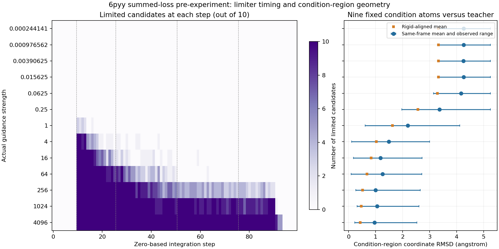

# 新求和损失预实验：逐步限幅与condition区域坐标RMSD复核

复核对象是固定执行提交`4d7b870d056cc8f5163571f29aae595c4e7c3de0`下6pyy的13档预实验，每档10个候选。原13个终态文件和13份steps记录的哈希均与终态归档一致；本次没有新增候选、模型前向或LLM调用。3w54尚未开始本轮标定，因此没有本轮推理样本的坐标RMSD。

限幅判断直接读取每候选、每步骤的`guidance_increment_limited`。下列范围表示该步骤至少一个候选触发，不能解读为范围内所有候选均触发。计数单位为“候选×步骤”：同一个候选在两个步骤触发计为2次。

| 实际强度 | 至少一个候选触发限幅的精确steps | 限幅事件数 | condition区域同坐标系坐标RMSD平均值 |
|---:|---|---:|---:|
| 0.000244140625 | 无 | 0 | 4.265081 Å |
| 0.0009765625 | 无 | 0 | 4.266823 Å |
| 0.00390625 | 无 | 0 | 4.256207 Å |
| 0.015625 | 无 | 0 | 4.261034 Å |
| 0.0625 | 无 | 0 | 4.163294 Å |
| 0.25 | 无 | 0 | 3.366745 Å |
| 1 | 10–13、16 | 11 | 2.194808 Å |
| 4 | 10–20、22–24、26–27、30、34–35、43 | 71 | 1.490685 Å |
| 16 | 10–31、36–41、44、47–48、59 | 139 | 1.182808 Å |
| 64 | 10–50、63 | 256 | 1.263466 Å |
| 256 | 10–90 | 513 | 1.000910 Å |
| 1024 | 10–91 | 779 | 1.055403 Å |
| 4096 | 10–93 | 829 | 0.965147 Å |

steps从0编号，总积分区间100个，网络时间约为`step×0.00999`；步骤10对应时间0.0999，步骤93对应0.92907。

## 4096组的限幅分布

| 窗口 | 限幅候选×步骤数 | 窗口全部候选×步骤数 |
|---|---:|---:|
| 10–25 | 160 | 160 |
| 26–50 | 250 | 250 |
| 51–75 | 250 | 250 |
| 76–99 | 169 | 240 |

前三个窗口所有候选在所有步骤均限幅；76–93中仍有限幅，94–99均未触发。最大未限幅单原子引导增量46315.976681 Å出现在步骤10；最大实际引导增量2.999998808 Å，小于配置3 Å。该上限只约束引导增量，不约束原生漂移、噪声、最终坐标误差或整条轨迹的累计位移。raw999的步骤99更新不进入返回端点；本表仍按代码保存的步骤范围列示。

## condition区域相对teacher的坐标RMSD

9个固定condition原子逐一对应原teacher，不做原子重新匹配。每个候选在原参考坐标系计算：

\[
Q_b=\sqrt{\frac{1}{9}\sum_{i\in C}
\|\mathbf x_{bi}-\mathbf x_i^{\mathrm{teacher}}\|_2^2},
\qquad \overline Q=\frac1{10}\sum_{b=1}^{10}Q_b.
\]

其中\(C\)为9个condition原子集合，\(b\)为候选编号，\(i\)为条件原子编号，\(\mathbf x_{bi}\)为生成终态坐标，\(\mathbf x_i^{\mathrm{teacher}}\)为固定teacher参考坐标；坐标单位均为Å。组统计保留每档全部10次尝试，不因构建失败而删除几何可测候选。

4096组：同参考坐标系坐标RMSD平均0.965147 Å，最小0.229279 Å，最大2.534240 Å。仅在9个条件原子上作最佳正旋转和平移对齐后的坐标RMSD平均0.429195 Å；后者只描述对齐后的形状，不作为原坐标系的位置保持结果。此前的0.152521 Å是控制原子内部原子对距离均方根偏差，不是逐原子坐标RMSD。

完整原始复核记录见`evidence/terminal/limiter_ranges_verified.json`；合并统计见`condition_rmsd_and_limiter_ranges.csv`，坐标来源与哈希见`coordinate_diagnostics.json`及`limiter_condition_source_verified.json`。
