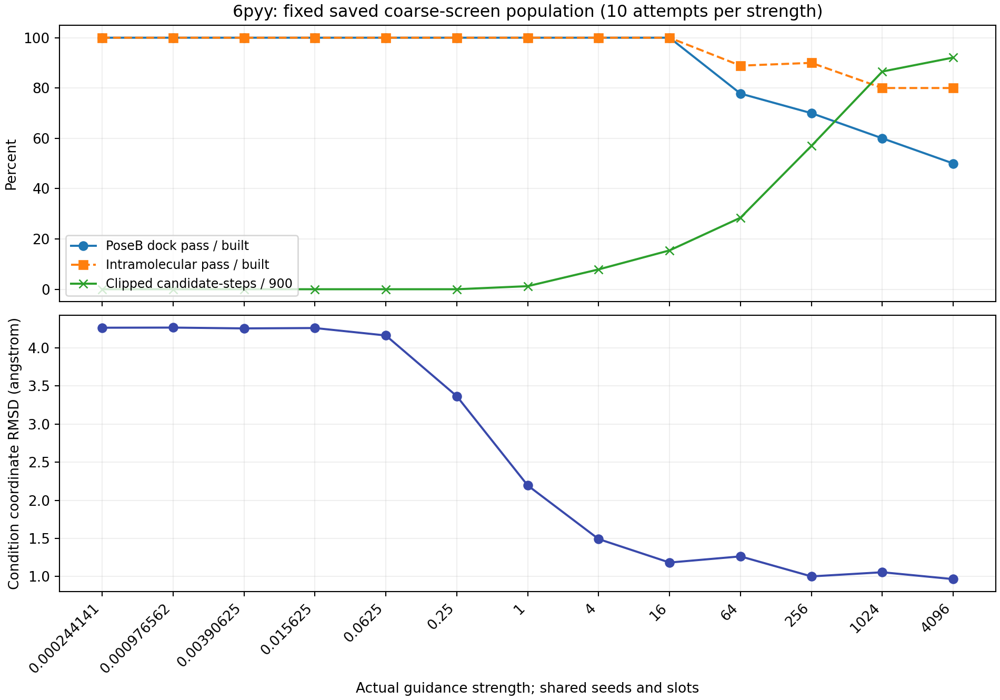

# 求和距离损失：限幅与PoseBusters结构质量复核

2026-10-29，Asia/Shanghai。结论来自现有终态的并行CPU评价，没有新增分子采样、模型前向或LLM调用。

## 结论

**频繁限幅的高强度组伴随更多质量问题，但不能把所有限幅候选都判成异常。** 强度1、4、16的30个候选全部通过当前PoseBusters；256、1024、4096合计30个候选仅18个通过。4096档原PoseB判定5/10失败，其中1个是对自动加氢位置敏感的能量失败；另4个存在明确的蛋白碰撞，其中1个同时有异常键长和键角。证据支持高强度下物理质量风险增加，不能说明限幅器本身导致了这些缺陷，也不能概括为多数分子自身均已解体。

3w54尚未进入本轮新损失标定，没有本轮生成候选可供质量统计。其原teacher只作为评估链对照。

## 数据、并行任务与来源保护

- 固定科学提交：`4d7b870d056cc8f5163571f29aae595c4e7c3de0`。
- 6pyy共有13档、每档10次尝试，共130次；125个成功构建，5个构建失败。3个成功构建的分子不连通。
- 4个CPU进程评估全部125个已构建结构，另检查两位teacher及各自人为拉坏的副本，共129个评价任务。这不是129组独立实验。
- 每档均实际检查10/10现有尝试中的全部已构建分子；本轮不存在每档50个人口，不能伪造50/10/40回执。构建失败不当作PoseB测量失败。
- 125个结构均得到全部20项布尔回执，没有缺失项或评价异常；所有受测重原子坐标在PoseB调用前后逐位不变。SDF坐标与原raw999终态最多相差约0.00005 Å，符合SDF四位小数舍入，没有优化或修复提交给PoseB的重原子结构。
- 799个冻结原产物复核无变化；52个候选输入文件及4个teacher/蛋白参考文件的哈希也未变。原任务继续保持停止，不恢复原UG05或正式GD01。
- 服务器后处理目录：`/workspace/uniguide_diagnostics/chemical-interact-sum-poseb-20261029`；没有覆盖固定执行目录或采样产物。

四路进程分配及各调用、原始完整检查值见[机器结果](evidence/RESULTS.json)、[实现与配置绑定](evidence/PROVENANCE.json)、[完成证据](evidence/COMPLETE.json)。原能量模块在自身构象参考生成中使用RDKit线程参数0；四个进程不应被描述为整个评估期间仅使用四个物理线程。它没有消费采样器随机流。

## 逐档结果

PoseB总通过包含分子内部检查及蛋白/辅因子环境检查。分母为成功构建且实际评价的结构；条件区域坐标RMSD则按每档全部10个可测终态计算，不删除构建失败终态。限幅比例的分母是10候选×90个引导步骤。

| 实际强度 | 构建成功/尝试 | 分子内部通过 | PoseB总通过 | 限幅候选×步骤比例 | 条件区域同坐标系坐标RMSD均值 |
|---:|---:|---:|---:|---:|---:|
| 0.000244140625 | 9/10 | 9/9 | 9/9 | 0% | 4.2651 Å |
| 0.0009765625 | 9/10 | 9/9 | 9/9 | 0% | 4.2668 Å |
| 0.00390625 | 9/10 | 9/9 | 9/9 | 0% | 4.2562 Å |
| 0.015625 | 10/10 | 10/10 | 10/10 | 0% | 4.2610 Å |
| 0.0625 | 10/10 | 10/10 | 10/10 | 0% | 4.1633 Å |
| 0.25 | 9/10 | 9/9 | 9/9 | 0% | 3.3667 Å |
| 1 | 10/10 | 10/10 | 10/10 | 1.22% | 2.1948 Å |
| 4 | 10/10 | 10/10 | 10/10 | 7.89% | 1.4907 Å |
| 16 | 10/10 | 10/10 | 10/10 | 15.44% | 1.1828 Å |
| 64 | 9/10 | 8/9 | 7/9 | 28.44% | 1.2635 Å |
| 256 | 10/10 | 9/10 | 7/10 | 57.00% | 1.0009 Å |
| 1024 | 10/10 | 8/10 | 6/10 | 86.56% | 1.0554 Å |
| 4096 | 10/10 | 8/10 | 5/10 | 92.11% | 0.9651 Å |

全部125个已构建结构中，111个通过原PoseB、14个未通过。各检查失败次数可重叠：蛋白最小距离12、蛋白体积重叠6、不连通3、键角2、分子内碰撞2、内部能量2、键长1。失败并非主要来自普遍的键长崩坏，而更多来自与蛋白环境的不相容。

同一随机种子与槽位在各强度之间配对，4096档的5个原PoseB失败在16档均通过，涉及5个种子中的4个种子；剔除能量敏感案例后仍有4个候选、4个种子出现蛋白碰撞。每档只有5种子×2槽，跨强度复用共同随机数，不能将130个条目当作130份独立验证，也没有据此进行显著性或因果检验。

## PoseB结果是否合理

实际加载的是`/opt/MolSteer/flowr_root/posebusters`，版本0.3.1，使用`dock`配置；不是当前上游最新版本。配置与实际源码按哈希归档，不能用最新文档中的默认值冒充本次配置。

本次配置包括：键长和键角相对界限容差0.25、芳香环/双键平面最大偏离0.25 Å、能量比上限100，以及蛋白距离和体积碰撞检查。[FLOWR原配置](https://github.com/jule-c/flowr/blob/main/posebusters/config/dock.yml)也可核对这些设置。官方文档将分子自身几何检查、蛋白环境检查和参考分子身份检查分开；本次没有把生成分子与teacher化学身份不同误作几何失败。[PoseBusters检查说明](https://posebusters.readthedocs.io/en/latest/cli.html)

两位teacher在原样坐标下均20/20通过；各自将一个重原子平移5 Å的人为错误副本均被键长、键角和能量检查检出。因此检查链没有整体失效。已有`profiling.quality`只保留布尔输出、遇到缺失值可能漏掉检查的问题在代码层面存在，但本次125个结构均有全部20项布尔结果，没有发现由该过滤导致的假通过。能量数据也全部有限，没有将无法计算当成真实不通过。

能量比阈值100很宽松。例如4096档一个原能量比69.57的分子仍通过。仅把同一批原能量比按7作敏感性筛查，4096档总通过从5/10降为4/10，但这不能直接作为更准确的结论，因为旧模块的自动加氢也影响了能量结果。

### 加氢敏感性核验

对全部13个原能量比大于7的候选及两位teacher，仅在副本上优化新增氢，全部原重原子固定，未改原结构或原PoseB回执。14个副本得到能量不增且收敛的结果；1个副本虽然返回收敛码0，能量反而大幅增加，已标为`unusable_optimization`并保留，不能作为修复成功。

最关键的是4096、seed100045、slot0：

| 测量 | 原PoseB加氢 | 仅优化氢、重原子固定 |
|---|---:|---:|
| UFF能量（实现原单位） | 2,269,613.89 | 127.55 |
| 相同构象参考分母下的能量比 | 70,995.20 | 3.99 |
| 条件区域坐标RMSD | 0.2822 Å | 完全不变 |

此分子原PoseB仅内部能量失败，其余19项均通过。其极端能量对加氢位置敏感，不能单凭70,995的值断定重原子结构发生灾难性变形。上游新版已明确加入新增氢位置优化，可作为后续评价器升级的依据，但升级须另行绑定版本，不能追改本次原回执。[上游更新说明](https://github.com/maabuu/posebusters/releases)

相对地，1024、seed100045、slot0在仅优化氢后能量比仍为16.87，原先还存在键角与内部碰撞失败，不能把所有能量异常一概归为评估器效应。完整原始及可用性标注见[氢敏感性结果](evidence/HYDROGEN_ENERGY_SENSITIVITY.json)。

## 4096档中可直接确认的问题

| seed/slot | 条件区域坐标RMSD | 原PoseB问题 | 解读 |
|---|---:|---|---|
| 100045/0 | 0.2822 Å | 仅内部能量 | 对氢位置敏感，单列，不当作已确认重原子畸变 |
| 100045/1 | 2.4753 Å | 键长、键角、蛋白距离与体积碰撞 | 最大键长2.4467 Å，为该档明确的分子内部几何异常 |
| 200048/1 | 2.4974 Å | 蛋白距离与体积碰撞 | 8个冲突原子对，最小蛋白距离1.3991 Å |
| 400054/1 | 2.5342 Å | 蛋白距离 | 2个冲突原子对，最小距离1.9514 Å |
| 42/1 | 0.2660 Å | 蛋白距离 | 条件坐标很接近teacher仍可发生冲突；不是只筛高RMSD即可解决 |

蛋白距离检查采用原子半径比例判定，不能把所有失败都简单解释为距离小于1.2 Å。上述2.4467 Å由实际键两端坐标计算，并非仅凭条件距离误差推断。

按原SDF的零起始槽位，100045/1与400054/1的最严重碰撞均涉及控制槽14；200048/1与42/1分别涉及外围槽6和16。因此，冲突既可发生在控制区，也可发生在未约束外围；不能只检查9个控制原子的平均坐标误差。

## 为什么限幅不能保证结构合理

4096档在steps10–93触发，前三窗口10–75全部候选、全部步骤限幅。原始最大单原子增量约46,316 Å，经过限制后小于3 Å。raw999的step99更新不影响输出；本次最高强度在94–99也未触发限幅。

当前限制只保证单步引导向量满足

\[
\max_i\|\Delta\mathbf x_i^{\mathrm{guidance}}\|\le3\ \mathrm{Å}.
\]

它不约束两个原子的相对更新；由三角不等式，相对更新范数仍可达6 Å。候选统一倍率保持整条梯度方向，并不使更新变成刚体运动；3 Å也不是最终键长、总位移或结构RMSD的上限。连续很多步都用满该半径，可能持续改变未受控部分。

损失只覆盖选定的控制内部距离及原PLIP互作距离，外围组件权重为0；它没有直接约束整个生成图的所有键角、扭转、分子内排斥或所有蛋白原子排斥。因此，控制距离与条件区域坐标变好，同时外围结构或蛋白碰撞变差，在当前优化目标下是可能的，不构成“反传必然算错”的证据。

观察到的是高强度、长期限幅和质量退化共同出现。本次没有同强度关闭限幅、改限幅大小等新生成对照，无法区分限制器保护作用与高强度本身的作用。把限制器去掉也不能根据这些数据推断会更好。

## 条件化学保持与后续选择

PoseB通过不等于满足teacher的化学条件。固定9个槽位的元素、电荷和控制区域内部键图全部吻合：强度16仅2/10，256、1024、4096各10/10。raw999返回未覆盖网络预测，化学inpainting作用于积分状态，不是输出端硬替换；低强度的物理质量通过率高，仍可能没有保持指定化学特征。详见[固定槽位化学核验](evidence/CHEMISTRY.json)。

因此不能因为16档PoseB全过就直接将它宣布为最佳λ，也不能因为4096条件误差最低就宣布其综合效果最佳。后续标定应同时展示：条件距离/坐标保持、固定区域化学保持、连通性、内部几何、蛋白冲突及限幅频率，并把加氢敏感能量与确定的重原子/碰撞缺陷分开。筛选规则和评价器升级需作为新协议审计，不能自动扩界、追改旧排名或抹掉失败。此处没有更改任何运行代码、标定λ或已冻结结果。
