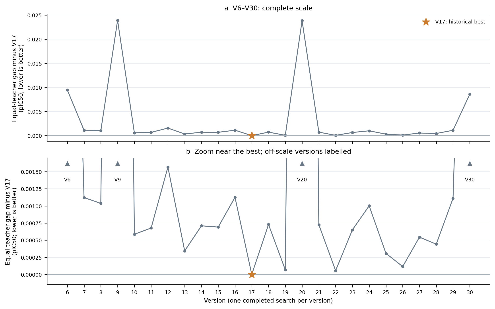
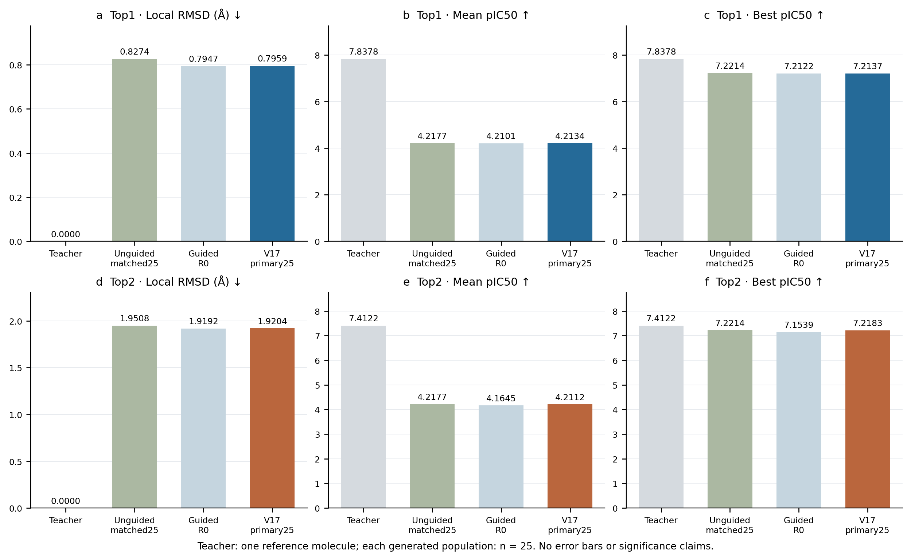
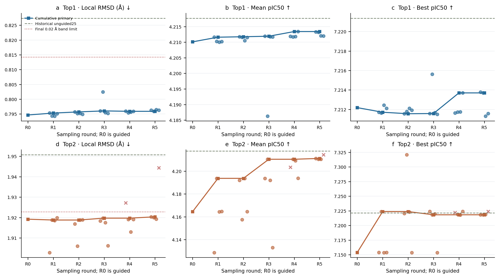
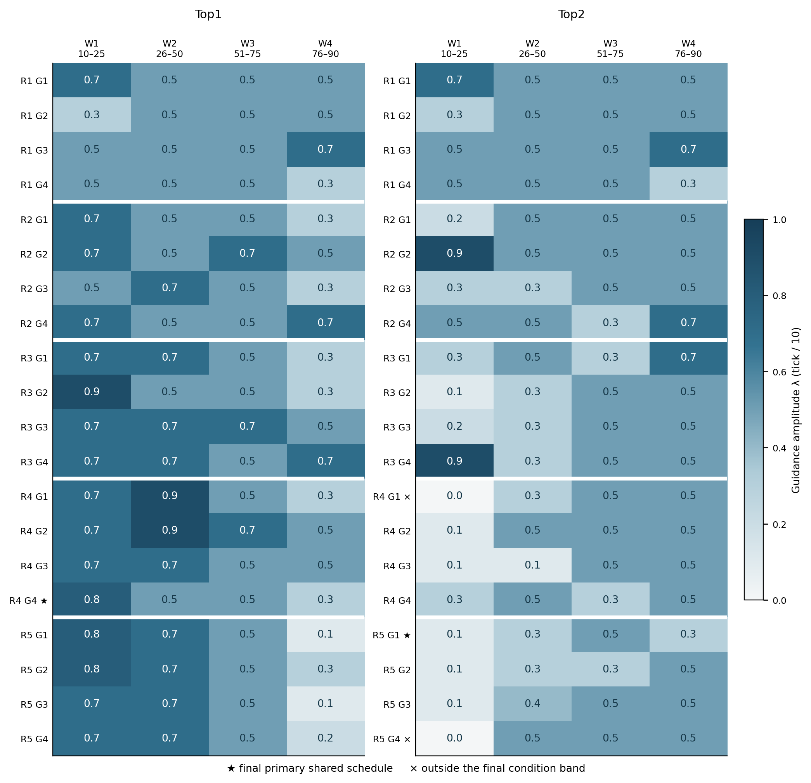
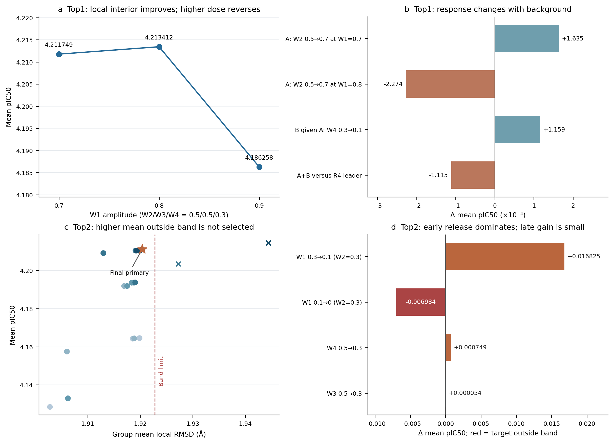

# LLM协助gradient guidance实验总结与V17逐轮行为报告

**结论：V6–V30实验执行完成，但科学目标未达成；V17是既定条件优先规则下的历史最好版本。** V17的Top1主要通过R4早段内侧0.8取得收益，Top2主要通过降低早段指导及R5末段释放取得收益。相对同初始槽位历史unguided25，两位teacher的区域RMSD均降低约0.03Å，但平均pIC50分别仍低0.004284325和0.006465616，且仍大幅低于teacher参考值。这里的“最好”不等同于已优于所有基线或证明LLM具有因果收益。

## 1. 范围、证据与阅读方法

- 本报告总结25个已完成版本，重点展示V17两位teacher各R1–R5，共40组、1000条正式结果。V17是版本，R1–R5是该版本内部采样轮次。
- 全轮行为依据已执行四窗口数组与真实组统计重建；直接私有/汇总理由来自已缓存的Top1 R4G4及Top2 R5G1，共四上下文。此次远端11762连接失败，未补取其余轮次提案；没有虚构其思考或补作全会话审计。`full_review_completed=false`。
- 表中G1–G4是当轮执行组，不能据相同编号认定跨轮是同一私有agent谱系。每轮四私有各提两案，汇总从合法提案中选四个供下一轮执行；R1由bootstrap产生。R5之后的提案只归档，无R6。
- 五轮间模型、奖励、代码与skills冻结。变化的是四窗口的指导幅度，不是模型权重。每个调度从同一guided R0的第10步更新前状态恢复，不是把上一轮生成分子继续优化。
- 数据源为已完成版报告及冻结收据；本次只计算统计、绘图和写文档，无采样、重评分、部署、自动化测试或定时任务恢复。

## 2. 算法与评价口径

四窗口W1–W4依次为步骤10–25、26–50、51–75、76–90；数组以tick表示，1 tick=0.1强度。例如[8,5,5,3]表示[0.8,0.5,0.5,0.3]。每组25候选，来自五种子各五槽；同轮四组共享随机流。

内层奖励为teacher核心加一跳区域与当前一步模型**预测终态坐标**的几何Hungarian匹配pseudo-Huber损失的负值（delta=1Å），通过当前模型前向图回传至当前坐标；模型权重冻结，匹配离散选择不求导，未展开后续整条轨迹。指导叠加于原生积分结果，单原子单步指导位移上限0.025Å。没有pIC50梯度、PLIP距离/角度梯度或流场一致性惩罚；pIC50参与外层调度选择。

主指标C为真实终态、蛋白固定坐标系中，指定区域逐分子RMSD再取25个候选的平均值。Top1区域2原子，Top2区域8原子。无配体独立平移/旋转拟合；几何匹配不强制元素或键身份一致。因此C同时含位置、朝向与局部形变误差，不等同纯内部构象差异，也不证明interaction位点恢复。PLIP恢复为单列诊断。

每teacher的20组以最小组均C锚定0.02Å带，带内按Mean pIC50到teacher绝对差选优，Best只作次级评价。V17带上界分别为0.814247352Å、1.922795711Å。0.02Å是资格/排序规则，不是噪声阈值。所有pIC50均为模型预测分数，不是实验测定值。

**R0是四段均0.5的guided基线，不是unguided。** unguided取历史100结果中与本实验相同的25初始槽位；未执行当前路径的严格配对零指导重跑，不能将其视为完整因果对照。旧100样本均值仅作历史描述，不用于本报告判断指导效果方向。

## 3. 全部版本的主要结果

V6–V30共25版，正式25,000结果，加一次共享R0的50条；历史失败2,000条独立排除。正式结果全部评分有效，记录PB通过率100%，严重clash为0；这些质量指标不能代替条件重构成功。

V17相对V16两teacher的Mean分别增加0.001504755、0.000746431，等权功能gap下降0.001125593；相对先前最好V13，等权gap下降0.000343704。最终V30仍未超V17，末版连续退步规则只报告结果，没有执行V31或额外恢复采样。

**图1｜版本表现。** 每点为一个已完成版本两teacher主代表的等权Mean–teacher绝对差，相对V17作差；低值更好。上图完整尺度，下图局部放大并明确标出超出显示范围的版本。每组25个固定候选，不是独立重复实验；没有置信区间或显著性检验。来源：[版本数据](campaign_version_trend.csv)。

## 4. V17、teacher与unguided的表现

| Teacher | 对象 | n | 区域RMSD均值 Å | 区域RMSD最小值 Å | Mean pIC50 | Best pIC50 |
| --- | --- | --- | --- | --- | --- | --- |
| top1 | Teacher | 1 | 0.000000000 | 0.000000000 | 7.837828636 | 7.837828636 |
| top1 | Unguided25 | 25 | 0.827377102 | 0.351855293 | 4.217696476 | 7.221372604 |
| top1 | GuidedR0 | 25 | 0.794650575 | 0.353215741 | 4.210111961 | 7.212181091 |
| top1 | V17 | 25 | 0.795886259 | 0.329360433 | 4.213412151 | 7.213694572 |
| top2 | Teacher | 1 | 0.000000000 | 0.000000000 | 7.412205219 | 7.412205219 |
| top2 | Unguided25 | 25 | 1.950790770 | 0.874751892 | 4.217696476 | 7.221372604 |
| top2 | GuidedR0 | 25 | 1.919191134 | 0.878002516 | 4.164478493 | 7.153899193 |
| top2 | V17 | 25 | 1.920351192 | 0.880183772 | 4.211230860 | 7.218332291 |

teacher行是单个参考分子，自比坐标误差为0；不能把n=1当作生成群体。RMSD最小值与Best pIC50可能来自不同候选，不能拼成一条“最佳分子”。V17主代表为Top1 R4G4=[8,5,5,3]与Top2 R5G1=[1,3,5,3]。

**图2｜绝对性能。** 三列分别为区域RMSD组均值、pIC50均值和最大值。teacher为单一参考；其余每组25候选。图展示绝对差距，小幅变化见下表与逐轮图。来源：[对照数据](baseline_comparison.csv)。

| Teacher | 比较 | ΔRMSD均值 Å（负好） | ΔMean pIC50（正好） | ΔBest pIC50 |
| --- | --- | --- | --- | --- |
| top1 | V17 − Unguided25 | -0.031490843 | -0.004284325 | -0.007678032 |
| top1 | V17 − GuidedR0 | +0.001235683 | +0.003300190 | +0.001513481 |
| top2 | V17 − Unguided25 | -0.030439578 | -0.006465616 | -0.003040314 |
| top2 | V17 − GuidedR0 | +0.001160058 | +0.046752367 | +0.064433098 |

V17相对匹配unguided25的区域RMSD分别降低3.8061%和1.5604%，但Mean及Best均略低。相对guided R0，V17功能Mean提高，C却略增，这是条件带内选择功能更优调度的取舍。两teacher平均分仍分别低于teacher 3.624416485和3.200974360；V17全部正式组的最高Best也仅7.215617657、7.320987701，均低于teacher。不能将恢复部分功能称为完成teacher重构。

## 5. V17五轮搜索概览

**图3｜逐轮性能。** 圆点为当轮四个共享调度的25候选统计，红叉为最终主条件带外调度。实线是累计最优共享调度，R0点为guided基线；累计线用最终版条件带回顾重建，不暗示agent当时已知未来C最小值。Best列是该累计主代表的Best，不是全池最大Best；虚线为同槽位历史unguided25。来源：[40组数据](v17_group_metrics.csv)、[逐轮汇总](v17_round_summary.csv)。

| Teacher | 轮次 | 当轮100结果Mean | 当轮Best | 累计主代表 | 代表C Å | 代表Mean | 代表Mean较前轮变化 |
| --- | --- | --- | --- | --- | --- | --- | --- |
| top1 | R1 | 4.210521863 | 7.212426186 | R1G1 | 0.795293748 | 4.211600580 | +0.001488619 |
| top1 | R2 | 4.211343715 | 7.212115288 | R2G1 | 0.795695771 | 4.211748848 | +0.000148268 |
| top1 | R3 | 4.205410979 | 7.215617657 | R3G1 | 0.796031525 | 4.211912374 | +0.000163527 |
| top1 | R4 | 4.212185667 | 7.213694572 | R4G4 | 0.795886259 | 4.213412151 | +0.001499777 |
| top1 | R5 | 4.212620559 | 7.213782787 | R4G4 | 0.795886259 | 4.213412151 | +0.000000000 |
| top2 | R1 | 4.162814562 | 7.223793983 | R1G2 | 1.918777449 | 4.193721142 | +0.029242649 |
| top2 | R2 | 4.176895189 | 7.320987701 | R1G2 | 1.918777449 | 4.193721142 | +0.000000000 |
| top2 | R3 | 4.182257013 | 7.223906517 | R3G2 | 1.919705598 | 4.210481548 | +0.016760406 |
| top2 | R4 | 4.204228375 | 7.223894119 | R3G2 | 1.919705598 | 4.210481548 | +0.000000000 |
| top2 | R5 | 4.211677995 | 7.224056244 | R5G1 | 1.920351192 | 4.211230860 | +0.000749311 |

当轮100结果是四组探索方案的混合统计，不是100个独立起点；其中包含有意探测但失败的方案。累计主代表上升与当轮探索池均值下降可以同时出现。R1变化以R0为参照；后续变化以此前累计主代表为参照。

**图4｜全部已执行调度。** 每行一组25候选，颜色与格内数值均为实际λ；星号是最终主代表，叉号是最终条件带外组。四列对应四个控制窗口，组间白线区分R1–R5。全部数组来自执行结果，无预测方案混入。来源：[动作台账](agent_action_ledger.csv)。

## 6. Top1：每轮行为与效果

### R1：分别改变早段与末段，先比较两个窗口的方向

四组为早段0.7、早段0.3、末段0.7、末段0.3，其余保持0.5。早段0.7的Mean最高；末段减弱有小幅功能收益，末段增强得到更低C但Mean更低。该轮体现条件与功能的取舍。

| 执行组 | ticks [W1,W2,W3,W4] | 动作描述 | C均值 Å | C最小值 Å | Mean pIC50 | Best pIC50 | 主带 |
| --- | --- | --- | --- | --- | --- | --- | --- |
| G1 | [7, 5, 5, 5] | 早段增强至0.7 | 0.795293748 | 0.354832511 | 4.211600580 | 7.211706638 | 内 |
| G2 | [3, 5, 5, 5] | 早段减弱至0.3 | 0.794287187 | 0.351800072 | 4.210281076 | 7.211638451 | 内 |
| G3 | [5, 5, 5, 7] | 末段增强至0.7 | 0.794247352 | 0.352862170 | 4.209988918 | 7.212426186 | 内 |
| G4 | [5, 5, 5, 3] | 末段减弱至0.3 | 0.795070855 | 0.353545264 | 4.210216875 | 7.212100029 | 内 |

**取得的效果：**累计主代表为R1G1 [7, 5, 5, 5]，Mean=4.211600580，相对此前代表变化+0.001488619。这些是已执行数组及结果支持的行为描述；未取得本轮完整提案理由，不能声称agent已确定了具体物理机制。

### R2：在早段0.7方向上组合末段释放，同时考察中间窗口

执行[7,5,5,3]、[7,5,7,5]、[5,7,5,3]和[7,5,5,7]。G1把早段增强与末段释放组合，成为累计领先；第三窗口增强的G2与R1G1相比Mean几乎不变。

| 执行组 | ticks [W1,W2,W3,W4] | 动作描述 | C均值 Å | C最小值 Å | Mean pIC50 | Best pIC50 | 主带 |
| --- | --- | --- | --- | --- | --- | --- | --- |
| G1 | [7, 5, 5, 3] | 早段0.7背景释放末段 | 0.795695771 | 0.355150978 | 4.211748848 | 7.211554527 | 内 |
| G2 | [7, 5, 7, 5] | 早段0.7背景增强第三窗口 | 0.795116645 | 0.354557072 | 4.211598587 | 7.211791039 | 内 |
| G3 | [5, 7, 5, 3] | 末段0.3背景增强第二窗口 | 0.795196253 | 0.353013638 | 4.210517921 | 7.212115288 | 内 |
| G4 | [7, 5, 5, 7] | 早段0.7背景增强末段 | 0.794874510 | 0.354446596 | 4.211509504 | 7.211924553 | 内 |

**取得的效果：**累计主代表为R2G1 [7, 5, 5, 3]，Mean=4.211748848，相对此前代表变化+0.000148268。G3与G1背景不同，不能将二者差直接归因于第二窗口。这里可以确认搜索沿已有较好方向推进，但不能从数组反推未保存的私有推理。

### R3：探索早段高侧，并把第二窗口增强迁移到多个背景

G1在[7,5,5,3]背景把第二窗口0.5→0.7，Mean增加0.000163527；G2把早段0.7→0.9，Mean反而降低0.025490618，尽管Best升高。G1成为累计领先，G2的更高单分子Best没有替代组均目标。

| 执行组 | ticks [W1,W2,W3,W4] | 动作描述 | C均值 Å | C最小值 Å | Mean pIC50 | Best pIC50 | 主带 |
| --- | --- | --- | --- | --- | --- | --- | --- |
| G1 | [7, 7, 5, 3] | 第二窗口增强至0.7 | 0.796031525 | 0.354591822 | 4.211912374 | 7.211572647 | 内 |
| G2 | [9, 5, 5, 3] | 早段继续增强至0.9 | 0.802443985 | 0.329981771 | 4.186258230 | 7.215617657 | 内 |
| G3 | [7, 7, 7, 5] | 第二、第三窗口均0.7 | 0.795461992 | 0.354038367 | 4.211769791 | 7.211675644 | 内 |
| G4 | [7, 7, 5, 7] | 第二窗口与末段均0.7 | 0.795212382 | 0.353889699 | 4.211703520 | 7.211503983 | 内 |

**取得的效果：**累计主代表为R3G1 [7, 7, 5, 3]，Mean=4.211912374，相对此前代表变化+0.000163527。这一轮四组混合Mean下降主要由高侧探索的坏组拉低，不能据此说保留的最佳共享调度退步。早段0.8此时尚未出现在已执行数组中。

### R4：细化早段内侧0.8，并检查第二窗口继续增强

G4执行[8,5,5,3]，得到全版Top1主代表。相同背景早段0.7→0.8使Mean提高0.001663303、C增加0.000190487Å；0.8→0.9则Mean降低0.027153921。另两条第二窗口0.7→0.9边均不利。

| 执行组 | ticks [W1,W2,W3,W4] | 动作描述 | C均值 Å | C最小值 Å | Mean pIC50 | Best pIC50 | 主带 |
| --- | --- | --- | --- | --- | --- | --- | --- |
| G1 | [7, 9, 5, 3] | 第二窗口继续至0.9 | 0.795957476 | 0.354001966 | 4.211846752 | 7.211624146 | 内 |
| G2 | [7, 9, 7, 5] | 第三窗口0.7背景下第二窗口至0.9 | 0.795403582 | 0.353521901 | 4.211685419 | 7.211728096 | 内 |
| G3 | [7, 7, 5, 5] | 第二窗口0.7背景回到末段0.5 | 0.795612933 | 0.354239660 | 4.211798344 | 7.211741924 | 内 |
| G4 | [8, 5, 5, 3] | 细化早段内侧0.8 | 0.795886259 | 0.329360433 | 4.213412151 | 7.213694572 | 内 |

**取得的效果：**累计主代表为R4G4 [8, 5, 5, 3]，Mean=4.213412151，相对此前代表变化+0.001499777。本轮有获胜G4私有和汇总直接证据：正确保留共享调度领先者，区别逐槽TOP1拼接结果；汇总选出G4:H1=[8,7,5,3]及H2=[8,7,5,1]作为下一轮主要挑战，并明确两者共享“第二窗口收益可迁移”的风险。

### R5：检验第二窗口迁移A与A加末段释放B，并保留两条较弱替代

G1为AB=[8,7,5,1]，G2为A=[8,7,5,3]，G3/G4在早段0.7背景继续末段释放。A相对R4领先者Mean降低0.000227394；B在A背景增加0.000115862；AB仍低于原领先者0.000111532。四组均未超越R4G4。

| 执行组 | ticks [W1,W2,W3,W4] | 动作描述 | C均值 Å | C最小值 Å | Mean pIC50 | Best pIC50 | 主带 |
| --- | --- | --- | --- | --- | --- | --- | --- |
| G1 | [8, 7, 5, 1] | 第二窗口迁移+末段释放AB | 0.796297738 | 0.329251111 | 4.213300619 | 7.213782787 | 内 |
| G2 | [8, 7, 5, 3] | 第二窗口迁移A | 0.795887220 | 0.329002065 | 4.213184757 | 7.213697433 | 内 |
| G3 | [7, 7, 5, 1] | 旧早段0.7背景末段降到0.1 | 0.796447505 | 0.354974579 | 4.212030363 | 7.211302757 | 内 |
| G4 | [7, 7, 5, 2] | 旧早段0.7背景末段降到0.2 | 0.796240775 | 0.354730328 | 4.211966496 | 7.211575985 | 内 |

**取得的效果：**累计主代表为R4G4 [8, 5, 5, 3]，Mean=4.213412151，相对此前代表变化+0.000000000。执行结果反证了该背景下A的有利迁移预期，却没有否定B的条件收益。缺少[8,5,5,1]的单独B对照，不能识别完整交互或断言联合失利就是非加性。未读取本轮新会话，不声称agent事后如何修订；R5后没有R6。

## 7. Top2：每轮行为与效果

### R1：与Top1相同的初始窗口探测，却出现相反的早段偏好

早段0.3的G2 Mean为4.193721142，相对guided R0增加0.029242649；早段0.7的G1得到全版最低C=1.902795711Å，但Mean降至4.128502283。两者均在主带内，累计功能领先者为G2。

| 执行组 | ticks [W1,W2,W3,W4] | 动作描述 | C均值 Å | C最小值 Å | Mean pIC50 | Best pIC50 | 主带 |
| --- | --- | --- | --- | --- | --- | --- | --- |
| G1 | [7, 5, 5, 5] | 早段增强至0.7 | 1.902795711 | 0.876523282 | 4.128502283 | 7.153847694 | 内 |
| G2 | [3, 5, 5, 5] | 早段减弱至0.3 | 1.918777449 | 0.878974390 | 4.193721142 | 7.223793983 | 内 |
| G3 | [5, 5, 5, 7] | 末段增强至0.7 | 1.918543672 | 0.877791285 | 4.164385223 | 7.153689861 | 内 |
| G4 | [5, 5, 5, 3] | 末段减弱至0.3 | 1.919836861 | 0.878219686 | 4.164649601 | 7.154026031 | 内 |

**取得的效果：**累计主代表为R1G2 [3, 5, 5, 5]，Mean=4.193721142，相对此前代表变化+0.029242649。此处“更低C”与“更接近teacher的Mean”存在实际取舍，不能用Top1早段增强的结论直接替代Top2。

### R2：比较早段内侧0.2与高侧0.9，并探测第二、第三窗口

执行[2,5,5,5]、[9,5,5,5]、[3,3,5,5]、[5,5,3,7]。早段0.2没有胜过0.3；0.9虽给出全版最高Best=7.320987701，但Mean仅4.157487688。第二窗口减弱近乎持平，累计领先仍为R1G2。

| 执行组 | ticks [W1,W2,W3,W4] | 动作描述 | C均值 Å | C最小值 Å | Mean pIC50 | Best pIC50 | 主带 |
| --- | --- | --- | --- | --- | --- | --- | --- |
| G1 | [2, 5, 5, 5] | 早段内侧0.2 | 1.916899436 | 0.878873792 | 4.191969042 | 7.220615864 | 内 |
| G2 | [9, 5, 5, 5] | 早段高侧0.9 | 1.906037015 | 0.875857089 | 4.157487688 | 7.320987701 | 内 |
| G3 | [3, 3, 5, 5] | 早段0.3背景降低第二窗口 | 1.918788423 | 0.879286810 | 4.193657036 | 7.223068714 | 内 |
| G4 | [5, 5, 3, 7] | 末段0.7背景降低第三窗口 | 1.918842223 | 0.878041274 | 4.164466991 | 7.153695583 | 内 |

**取得的效果：**累计主代表为R1G2 [3, 5, 5, 5]，Mean=4.193721142，相对此前代表变化+0.000000000。这不是连续降低早段就单调提高功能的证据；0.2局部较差也不自动排除其他背景的0.1。最高Best仍低于teacher，不能据其提升评价整组成功。

### R3：在第二窗口0.3背景继续降低早段，找到新的主要功能增益

G2=[1,3,5,5]成为新领先者；相对R2G3=[3,3,5,5]，早段0.3→0.1使Mean增加0.016824512、C增加0.000917175Å。对照G3=[2,3,5,5]与G4=[9,3,5,5]均落后。

| 执行组 | ticks [W1,W2,W3,W4] | 动作描述 | C均值 Å | C最小值 Å | Mean pIC50 | Best pIC50 | 主带 |
| --- | --- | --- | --- | --- | --- | --- | --- |
| G1 | [3, 5, 3, 7] | 早段0.3且第三窗口0.3、末段0.7 | 1.918373493 | 0.878991298 | 4.193645964 | 7.223906517 | 内 |
| G2 | [1, 3, 5, 5] | 第二窗口0.3背景早段降到0.1 | 1.919705598 | 0.879912671 | 4.210481548 | 7.218300819 | 内 |
| G3 | [2, 3, 5, 5] | 第二窗口0.3背景早段0.2 | 1.917466639 | 0.879191857 | 4.191937599 | 7.219846725 | 内 |
| G4 | [9, 3, 5, 5] | 第二窗口0.3背景早段0.9 | 1.906214174 | 0.876195570 | 4.132962942 | 7.153616905 | 内 |

**取得的效果：**累计主代表为R3G2 [1, 3, 5, 5]，Mean=4.210481548，相对此前代表变化+0.016760406。该结果限定于匹配背景和固定人口，不能声称早段响应全局单调。不同teacher的有利早段幅度明显不同，支持按响应选择调度。

### R4：试探早段零端，同时比较第二窗口恢复与继续释放

G1=[0,3,5,5]相对领先者Mean降低0.006983528、C增加0.007510833Å并出带。G2把第二窗口恢复到0.5，Mean仅低0.000028324；G3继续减到0.1，Mean低0.001252642。G4的末段释放发生在早段0.3背景，仍未超越领先者。

| 执行组 | ticks [W1,W2,W3,W4] | 动作描述 | C均值 Å | C最小值 Å | Mean pIC50 | Best pIC50 | 主带 |
| --- | --- | --- | --- | --- | --- | --- | --- |
| G1 | [0, 3, 5, 5] | 领先背景试探早段零端 | 1.927216431 | 0.872840907 | 4.203498020 | 7.222024441 | 外 |
| G2 | [1, 5, 5, 5] | 早段0.1背景第二窗口恢复0.5 | 1.919092062 | 0.879703775 | 4.210453224 | 7.219020367 | 内 |
| G3 | [1, 1, 5, 5] | 早段0.1背景第二窗口继续降至0.1 | 1.912935737 | 0.880301630 | 4.209228907 | 7.218131065 | 内 |
| G4 | [3, 5, 3, 5] | 早段0.3/第三窗口0.3背景释放末段 | 1.919017606 | 0.879234165 | 4.193733349 | 7.223894119 | 内 |

**取得的效果：**累计主代表为R3G2 [1, 3, 5, 5]，Mean=4.210481548，相对此前代表变化+0.000000000。本轮累计领先保持R3G2。零早段在该背景不利，但不能将这一结果解释成所有背景零端都具有相同功能效应。

### R5：在领先背景释放末段，获得最终代表；另一个零端功能较高但出带

G1=[1,3,5,3]相对R3G2 Mean增加0.000749311、C增加0.000645594Å，成为最终代表；G2第三窗口释放增加Mean0.000054369；G3第二窗口0.4没有胜出。G4=[0,5,5,5] Mean较高为4.214500885，但C=1.944389154Å出带。

| 执行组 | ticks [W1,W2,W3,W4] | 动作描述 | C均值 Å | C最小值 Å | Mean pIC50 | Best pIC50 | 主带 |
| --- | --- | --- | --- | --- | --- | --- | --- |
| G1 | [1, 3, 5, 3] | 领先背景末段释放至0.3 | 1.920351192 | 0.880183772 | 4.211230860 | 7.218332291 | 内 |
| G2 | [1, 3, 3, 5] | 领先背景第三窗口释放至0.3 | 1.919950679 | 0.880148682 | 4.210535917 | 7.218386650 | 内 |
| G3 | [1, 4, 5, 5] | 领先背景第二窗口细化为0.4 | 1.919257924 | 0.879822601 | 4.210444317 | 7.218779564 | 内 |
| G4 | [0, 5, 5, 5] | 第二窗口0.5背景试探早段零端 | 1.944389154 | 0.872288374 | 4.214500885 | 7.224056244 | 外 |

**取得的效果：**累计主代表为R5G1 [1, 3, 5, 3]，Mean=4.211230860，相对此前代表变化+0.000749311。本轮有G1私有与汇总直接证据：汇总保留带内代表、去重提案，识别零端出带，后续建议仅归档。其“固定人口噪声”等措辞不能取消真实有符号差异；原生分支可中介幅度效果。私有未见同波兄弟结果，不应按汇总可见性追责。

## 8. 有直接提案证据的预测—实测对应

Top1 R4 G4私有明确提出H1（A）与H2（AB），汇总确实选入下一轮。R5执行G2对应H1，执行G1对应H2；另外两个执行组来自R4 G1的末段低侧提案。这一映射来自已保存汇总与数组，不能泛化为所有轮次的agent谱系。

| 提案 | 当时预测Mean / gap | R5实际Mean / gap | 结论 |
| --- | --- | --- | --- |
| G4:H1 [8,7,5,3] | Mean约4.21358；gap约3.62425 | 4.213184757 / 3.624643879 | A迁移预测未实现；低于R4领先者 |
| G4:H2 [8,7,5,1] | Mean约4.21368；gap约3.62410–3.62420 | 4.213300619 / 3.624528017 | AB未超领先者，但B相对A仍有正收益 |

汇总提前写明两条主要挑战共享A的迁移风险，也坦承另两案预计落后；这不是完全忽视风险。可改进之处是私有提案阶段比较“A与AB”及“A与单独B”的末轮决策价值。未测单独B不能被报告为必胜方案。

Top2 R5 G1提出[1,3,5,2]和[1,3,3,3]，汇总把它们列为归档建议，正确保持剩余采样轮数为0。这些数组没有实际结果，不纳入图表、性能差值或成功率。汇总正确排除早段零端出带方案，但将集中收益、原生分支称为“固定人口噪声”的表述缺少统计依据；这些现象可解释作用路径，不能取消固定人口组均改善。

## 9. 匹配对照揭示的关键效应

**图5｜局部效应与背景依赖。** a：Top1匹配背景下早段0.7/0.8/0.9的实测Mean。b：第二窗口增强在两个早段背景下符号相反；B在A背景有用，联合案仍未超原领先者。c：Top2全部20组条件—功能分布，星号为主代表，红色竖线为主带上界；叉号为带外方案。d：Top2匹配边的Mean变化，零早段边既功能不利又出带。均为固定25候选的描述性差值，没有额外重复或因果泛化检验。

| Teacher | 匹配改动 | 参照→目标 | ΔC Å | ΔMean | 目标主带 |
| --- | --- | --- | --- | --- | --- |
| top1 | 早段0.7→0.8，其他窗口固定 | R2G1→R4G4 | +0.000190487 | +0.001663303 | 内 |
| top1 | 早段0.8→0.9，其他窗口固定 | R4G4→R3G2 | +0.006557726 | -0.027153921 | 内 |
| top1 | 早段0.7背景：第二窗口0.5→0.7 | R2G1→R3G1 | +0.000335754 | +0.000163527 | 内 |
| top1 | 早段0.8背景：第二窗口0.5→0.7 | R4G4→R5G2 | +0.000000961 | -0.000227394 | 内 |
| top1 | 第二窗口0.7背景：末段0.3→0.1 | R5G2→R5G1 | +0.000410518 | +0.000115862 | 内 |
| top1 | 第二窗口增加与末段释放的联合效果 | R4G4→R5G1 | +0.000411479 | -0.000111532 | 内 |
| top2 | 第二窗口0.3背景：早段0.3→0.1 | R2G3→R3G2 | +0.000917175 | +0.016824512 | 内 |
| top2 | 第二窗口0.3背景：早段0.1→0 | R3G2→R4G1 | +0.007510833 | -0.006983528 | 外 |
| top2 | 第二窗口0.5背景：早段0.1→0 | R4G2→R5G4 | +0.025297093 | +0.004047661 | 外 |
| top2 | 末段0.5→0.3，其他窗口固定 | R3G2→R5G1 | +0.000645594 | +0.000749311 | 内 |
| top2 | 第三窗口0.5→0.3，其他窗口固定 | R3G2→R5G2 | +0.000245081 | +0.000054369 | 内 |
| top2 | 第二窗口0.3→0.1，其他窗口固定 | R3G2→R4G3 | -0.006769861 | -0.001252642 | 内 |

Top1第二窗口效应的背景差为−0.000390921 pIC50；该差中差说明此局部迁移不能直接沿用旧符号。它不识别完整的第二窗口×末段交互，因为缺少单独B的匹配端点。Top2两个背景的早段零端一处Mean下降、一处Mean上升，但都出条件带；不能把一个背景的功能收益与另一个背景的较低坐标代价拼成同一已测响应。

## 10. V17之前改了什么，哪些能力得到支持

V16→V17只改写三份通用skills中的两项能力：①分开条件带资格、功能排序、预测反证与各自单位；②依据同背景等步响应、反转、余量和共同外推风险选择步长。保持U1、coarse0.2、q0.1、max_range_probes0、max_changed_intervals2；模型、可微奖励、R0、随机流、采样与接口保持。

V17的行为与这些目标部分一致：Top1实测合法内侧0.8并保留新的带内Mean领先；Top2坚持条件带，未让零端更高Mean或高早段的更高Best替代主代表。仍有两项局限：Top1末轮两个可信挑战依赖同一个迁移前提；小幅或集中收益有时被描述成“噪声”而缺少统计支持。版本改善、文字变化和一次行为吻合不能单独证明skills的因果效果；没有无LLM搜索或同任务多次独立搜索对照。

当时V17→V18据此改写共同风险与末轮决策价值，以及总效应/条件效应/交互的区分；V18等权gap反而增加0.000728989。这一后续结果也不支持把规则改写视为必然增益。本报告不修改现有skills，不继续实验。

## 11. 质量、敏感性、成本与结构保留

V17全部40组均25/25有效、PB通过率1、严重clash0；Top1的20组全部在主带，Top2为18/20。化学身份与interaction恢复仍是独立维度：主代表中可获得严格化学映射诊断的候选仅Top1 5/25、Top2 2/25，不能把纯几何低误差当作同一化学模板完整恢复。

| Teacher | 主带代表PLIP恢复率均值 | 主带代表相对R0配对Mean胜率 | 0.01Å敏感性 | 0.05Å敏感性 |
| --- | --- | --- | --- | --- |
| top1 | 0.480000000 | 0.68 | R4G4（不变） | R4G4（不变） |
| top2 | 0.240000000 | 0.60 | R2G2；C=1.906037015，gap=3.254717531 | R5G4；C=1.944389154，gap=3.197704334 |

PLIP恢复率为单独指纹匹配诊断，不是本报告主RMSD或内层奖励；敏感性结果不替换冻结0.02Å主结论。

V17正常完成耗时1861.756092秒（31.029268分钟），正式GPU时间535.428903秒（8.923815分钟）；59份provider-ID去重API收据共3,215,577输入、755,361输出tokens，无本版作废记录或已知usage缺失。这是资源统计，不是货币账单。全实验正常与失败API已分别统计并跨provider ID去重，不能再次把失败分数混入正式结果。

已保留各轮评分、坐标误差、质量、LLM及来源记录；完整结构仅按每teacher的逐槽亲和力TOP1策略保留25条。这50条保留结构是多调度拼接归档，不等于两组主代表的完整25+25条原始结构。报告不得据现存TOP1文件重新替代共享调度统计。

## 12. 交付文件与复现

| 文件 | 用途 |
| --- | --- |
| [v17_group_metrics.csv](v17_group_metrics.csv) | 40组原始聚合指标，包含区域RMSD均值/最小值、Mean/Best、质量与主带资格 |
| [v17_round_summary.csv](v17_round_summary.csv) | 10个teacher轮次的探索池统计与回顾累计代表 |
| [agent_action_ledger.csv](agent_action_ledger.csv) | 40条已执行动作说明；仅有证据时标注私有提案来源 |
| [matched_contrasts.csv](matched_contrasts.csv) | 12条完整匹配端点及实际差值 |
| [baseline_comparison.csv](baseline_comparison.csv) | teacher、匹配unguided25、guided R0与V17主代表 |
| [campaign_version_trend.csv](campaign_version_trend.csv) | V6–V30主代表趋势及固定提交 |
| [evidence.json](evidence.json) | 冻结V17报告、有限策略上下文、原始来源hash和对照输入 |
| [build_report.py](build_report.py) | 从同目录evidence重建CSV、五套图与本文 |
| [artifact_manifest.json](artifact_manifest.json) | 交付物SHA-256与范围记录 |
| [figures](figures/) | 五套PNG、SVG、PDF图表 |
| [qa_notes.md](qa_notes.md) | 数据口径与目视检查记录、证据限制 |

复现：在已具有Python、NumPy和matplotlib的环境运行 `python build_report.py`。只聚合已有文件，不访问服务器、不运行模型或测试。图表标签使用英文便于矢量编辑，中文图注解释口径。

原始完整总结见[最终报告](../v6-v30-final/report.zh-CN.md)，人口对照修正见[同槽位比较](../v6-v30-followup/slot_matched_comparison.zh-CN.md)，原有限复盘见[V17策略评估](../v17_strategy_review/review.zh-CN.md)。新报告以已完成状态为准，不激活历史计划。
