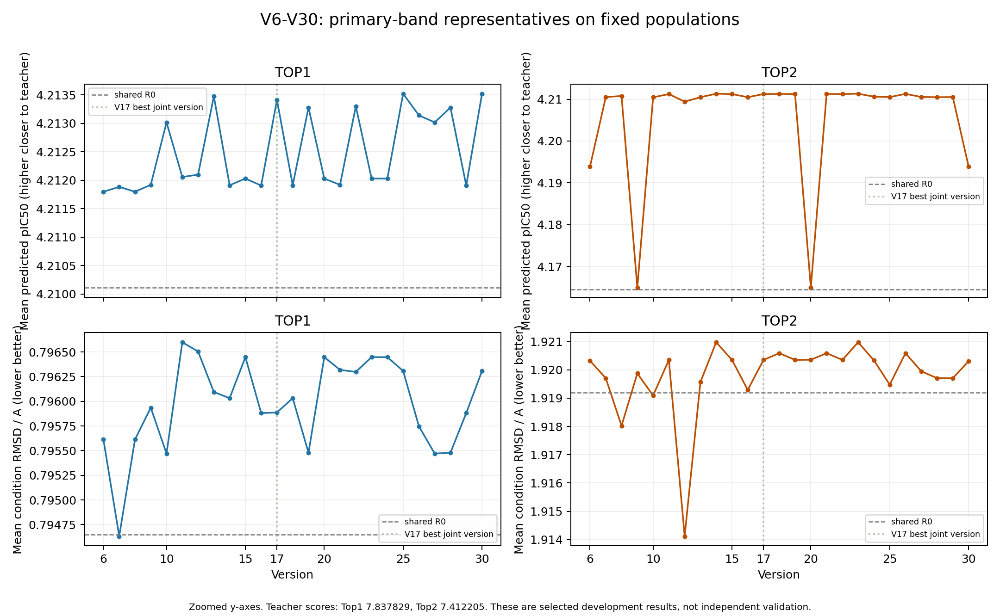

# V6–V30：LLM协助gradient guidance最终报告

实验已完成，**科学目标未达成**。25版均真实FINALIZED，每版两教师、五轮、1000条正式优化结果；共25,000条，加一次共享R0的50条，正式预算25,050条用完。V30质量、汇总、保留和清理完成，worker3745725已退出，没有启动后的新failure。

冻结评价下历史最好仍为 **V17**。V30 Top1改善、Top2退步，等权功能gap较V29增加0.007484970；连续第二次完整退步。按末版约束只报告恢复规则指向V17及其兼容来源，**没有执行新的回滚或追加采样**。不运行V31；任务到此收尾。

本报告汇总已完成版本的统计与来源；V30仅阅读两教师各自获胜轮的私有假设、同轮汇总和相关目标/动作/预算，共四上下文，结合40组聚合。`mode=best_round_strategy`，`full_review_completed=false`。没有重审旧版本会话、审计成功工具或补做V7已停止的全量审阅。

## 科学协议与解释范围

- 两教师来自同一5nn4目标，条件为核心加一跳邻域，分别2和8个原子；每调度25个候选，五固定种子各5槽。四共享调度组成batch100，使用共同随机流。共享R0在update10前恢复；R0本身是[5,5,5,5]指导基线，不是零指导。
- 100步采样，四控制窗口10–25、26–50、51–75、76–90。Endpoint坐标pseudo-Huber/Hungarian指导，单步原子位移上限0.025Å，无亲和力梯度。固定原v2模型和原Torch/DTK环境。
- 主条件误差C为真实终态、蛋白固定坐标框架下的逐分子局部RMSD再取组均值，不对配体独立拟合。每教师/版本全池最小C锚定0.02Å带内按绝对Mean–teacher差选共享调度；另报0.01/0.05Å敏感性。带宽是排序规则，不是成功阈值、统计噪声或化学身份恢复的证明。
- Mean接近教师是功能目标，Best超过教师为加分。亲和力为模型评分，不是实验测得亲和力。亲和力TOP1逐槽拼接用于保留结构，不是共享调度主代表。失败槽保留在分母；本次正式结果均有效。
- 最终政策U1/coarse0.2/q0.1/max_range_probes0/max_changed_intervals2；没有获得支持扩幅的交付、裁剪或容量证据。四私有各两案，第五汇总选四案；同波私有隔离，版间动态记忆清空。R5只归档，无R6。

## 历史最好与最终结果

教师评分Top1为7.837828636，Top2为7.412205219。下表均为冻结主带内共享调度代表，所有Mean仍远低于教师。

|版本/教师|代表|幅度ticks|C Å|Mean|绝对gap|Best|
|---|---|---|---:|---:|---:|---:|
|v17/top1|r04:G4_unselected|[8, 5, 5, 3]|0.795886259|4.213412151|3.624416485|7.213694572|
|v17/top2|r05:G1_unselected|[1, 3, 5, 3]|1.920351192|4.211230860|3.200974360|7.218332291|
|v30/top1|r05:G2_unselected|[8, 5, 5, 1]|0.796307812|4.213521013|3.624307623|7.213616371|
|v30/top2|r05:G2_unselected|[3, 5, 3, 1]|1.920304858|4.193931923|3.218273296|7.223948479|

V17等权gap为3.412695422，V30为3.421290460，最终比历史最好高0.008595037。V30相对V29的Mean变化为Top1 +0.001613617、Top2 −0.016583557；组均C分别增加0.000427354、0.000600714Å。规则计数为连续退步2，指向V17；末版不触发额外版本。

与共享R0相比，V17代表Mean增加0.003300190/0.046752367，配对胜率0.68/0.60，同时C增加0.001235683/0.001160058Å。V30对应Mean增加0.003409052/0.029453430、胜率0.68/0.56，C增加0.001657236/0.001113723Å。功能小幅改善伴随条件代价，不能写成两个目标均改善。配对结果仅适用于固定25槽；调度在这些槽上筛选，不能当独立验证或泛化收益。

V30代表q10为3.025602913/3.022195435，min为2.683369637/2.686536074，仍有明显低分尾部。Top1在V25和V30取得相同共享调度和结果，重复的是同一固定人口的观察，不增加独立样本量。

## 25版主代表轨迹

C和Mean按Top1/Top2并列；Δgap为两教师等权主代表gap相对前版的变化，负值表示功能更接近教师。本表来自各版锁定report及最终version_decisions；不把相邻变化解释为skills因果效应。

|版本|C1 Å|Mean1|C2 Å|Mean2|等权gap|Δgap|
|---|---:|---:|---:|---:|---:|---:|
|v6|0.795612933|4.211798344|1.920322325|4.193876619|3.422179446|—|
|v7|0.794632265|4.211884222|1.919704143|4.210515480|3.413817077|-0.008362370|
|v8|0.795612933|4.211798344|1.918024413|4.210770683|3.413732414|-0.000084662|
|v9|0.795935412|4.211919365|1.919873708|4.164911222|3.436601634|+0.022869220|
|v10|0.795470294|4.213018246|1.919092062|4.210453224|3.413281193|-0.023320441|
|v11|0.796598622|4.212057199|1.920351192|4.211230860|3.413372898|+0.000091705|
|v12|0.796505069|4.212099457|1.914119611|4.209410229|3.414262085|+0.000889187|
|v13|0.796094202|4.213476963|1.919568595|4.210478640|3.413039126|-0.001222959|
|v14|0.796031525|4.211912374|1.920975403|4.211311855|3.413404813|+0.000365686|
|v15|0.796447505|4.212030363|1.920351192|4.211230860|3.413386316|-0.000018497|
|v16|0.795880458|4.211907396|1.919290688|4.210484428|3.413821015|+0.000434699|
|v17|0.795886259|4.213412151|1.920351192|4.211230860|3.412695422|-0.001125593|
|v18|0.796031525|4.211912374|1.920589038|4.211272659|3.413424411|+0.000728989|
|v19|0.795478734|4.213278389|1.920351192|4.211230860|3.412762303|-0.000662107|
|v20|0.796447505|4.212030363|1.920356368|4.164918499|3.436542497|+0.023780193|
|v21|0.796318273|4.211919804|1.920589038|4.211272659|3.413420696|-0.023121800|
|v22|0.796297738|4.213300619|1.920351192|4.211230860|3.412751188|-0.000669508|
|v23|0.796447505|4.212030363|1.920975403|4.211311855|3.413345819|+0.000594630|
|v24|0.796447505|4.212030363|1.920333994|4.210610590|3.413696451|+0.000350633|
|v25|0.796307812|4.213521013|1.919475508|4.210505686|3.413003578|-0.000692873|
|v26|0.795746494|4.213140860|1.920589038|4.211272659|3.412810168|-0.000193410|
|v27|0.795470294|4.213018246|1.919950679|4.210535917|3.413239846|+0.000429678|
|v28|0.795478734|4.213278389|1.919705598|4.210481548|3.413136959|-0.000102887|
|v29|0.795880458|4.211907396|1.919704143|4.210515480|3.413805490|+0.000668530|
|v30|0.796307812|4.213521013|1.920304858|4.193931923|3.421290460|+0.007484970|

逐教师代表、主带数量、0.01/0.05Å敏感性、配对R0、分位数和固定commit见[teacher_representatives.csv](teacher_representatives.csv)；全部1000组的C/Mean/Best/质量与化学诊断见[group_metrics.csv](group_metrics.csv)。图中纵轴局部放大，以便观察微小版本差异，不表示已接近教师评分。

## 敏感性、Best与质量

V30双方20/20正式组在主带内。Top1在0.01/0.05Å下仍选R5G2；Top2在0.01Å下改选R2G1（C1.906037015、Mean4.157487688、gap3.254717531），0.05Å仍选R5G2。V17 Top2的0.01Å选R2G2，0.05Å选R5G4（C1.944389154、gap3.197704334），说明Top2的条件—功能取舍依赖排序带宽。敏感性不替换预设主带。

全程1000组×25槽均有效，PB通过25,000/25,000，严重clash记录为0。Top1全程最高正式Best为7.216002464（V16 R4G3），低于教师；Top2最高为7.481502533（V29 R4G4），超过教师，但该组C1.931226432出主带。全程Top2有11个正式组的Best超过教师，全部在各自版本主带外；其组别与带内标记保存在summary.json；这些现象不能替代Condition优先的主代表结论。V30最高Best为7.215728760/7.320987701，均低于各自教师。

化学子图合法映射诊断可用3,641/25,000（14.564%）：Top1 2,500/12,500，Top2 1,141/12,500；其余21,359条没有可用映射。这里是诊断可用性计数，不能把不可用者当作零误差，也不能把几何Hungarian匹配或PB通过解释为化学子图身份完全保留。共享R0历史记录未计算该化学诊断，不补采样。V30代表可用映射各5/25和2/25，唯一SMILES数16/25和15/25；相同固定人口的跨版结果不去重后冒充更多化学多样性。

作为附加诊断，V17代表PLIP恢复均值为0.48/0.24，V30为0.48/0.253333333；原核心RMSD在V30为0.882186482/2.085691912Å。这些不替代核心加一跳的主C，也不构成interaction条件的全面恢复。

## V30有限策略结论

1. **合并反证后的预测更新不稳定。** Top1第二窗口5→7在早段7背景Mean+0.000163527，转到早段8背景−0.000227394；汇总实质降低旧乐观迁移预测，四端点支持背景交互。Top2已有更近背景第二窗口5→3的Mean−0.000021219，却仍主要采用远背景+0.000220175预测归档案。私有未见当波兄弟合理；不足出现在汇总获得证据之后。没有把这种有限行为反证解释为底层pipeline故障。
2. **弱窗口收益真实可排序，曲率不能脱离步长和背景。** Top1同背景末段3→1的每tick收益约0.000058994，1→0约0.000058041，近似稳定；另一背景5→3/3→1有温和减弱。Top2末段3→1 Mean+0.000111952，代价C+0.000646950Å。两者都保留小正领先。宽边不足以确定未测内部斜率，零端和背景迁移仍有不确定性；原生松弛可为总幅度效应的中介，具体机理未识别。

双方剩余采样预算0，上述归档方案没有R6收益或损失。V30局部动作合法性表述较V29有改进，但早段未测方向的潜在收益未知，不从R5倒推此前供给原因。详细证据及两个能力假设见[V30有限评估](../v30_strategy_review/review.zh-CN.md)。最终不修改skills，不追加离线回放。

## 全程学习与恢复的边界

既有有限评估推动了弱响应保留、同波反证更新、匹配背景/新分段区分、补偿收益与成本同源配对、合法局部动作与扩幅配额区分等模块。V30呈现部分行为改善和持续反例，表现并未随版本稳定提高。只有两个同目标教师与固定种子/人口，且既有版本中工程修复、上下文和skills均有变化；没有未见目标、独立种子或随机化skills消融，因此不能证明LLM模块导致性能改善，也不能保证历史最佳在新人口上复现。

V13在V11/V12连续退步后恢复V10兼容基底；V25在V23/V24连续退步后恢复V17三份skills与完整U1政策。两次完成状态记录在version_decisions与原恢复收据。V25真实rollback_completed=true；随后V26–V30是选择性适配，不能称V17字节一致复制。

最终规则仍指向V17，历史skills提交为`a245eb0ac2ea4a7944d4fd7acfcd3491eaf5dbed`。兼容路径保留当前`prior_selected_schedules_v1`与已验证Python，差异和门槛见[V25恢复兼容说明](../v24_strategy_review/rollback_compatibility.zh-CN.md)及rollback_plan.json。终态仅归档该来源，当前科学运行源仍为d823ddf5；没有把启动或纸面计划写成新的rollback_completed。

## 基线与预算边界

共享R0各25条，Top1 C0.794650575、Mean4.210111961、Best7.212181091；Top2 C1.919191134、Mean4.164478493、Best7.153899193。各版报告重复展示同一R0，不产生额外采样计数。

历史unguided/steer各100条的描述性Mean为4.121296439/6.462713397，Best为7.708861351/7.837828636。这两个历史臂被两个教师上下文引用，并非每教师重新生成100条，也不是当前25槽的等预算Best或逐槽对照。历史steer Mean明显高于当前重构代表，当前实验没有实现功能保持目标；不能用历史样本量不同的Best来推断等预算胜负。基线原统计见[baseline_context.json](baseline_context.json)。

正式预算25,050条不包含历史已授权失败重跑所作废的2,000条。包含这些失败尝试的已记录物理候选总数为27,050，失败分数全部排除。原生验收与更早历史臂属于独立历史验证/背景，未冒充本次新增科学结果。

## 成本：provider ID全局去重

已将reports正式usage与operations中V6、V7、V10两次、V11、V21失败资源收据合并。1,638个provider ID唯一，正式与失败间交叉重复0，usage冲突0；现有正式缺失列表和六份失败未知列表均空。此为可见收据的完整性陈述，不是供应商货币账单。没有把失败分数合入性能。

|类别|调用|输入tokens|输出tokens|采样GPU秒|
|---|---:|---:|---:|---:|
|正式V6–V30|1,505|85,421,765|19,872,191|13108.947553|
|失败作废|133|5,691,570|1,468,491|1148.494768|
|LLM合计 / 正式+失败GPU|1,638|91,113,335|21,340,682|14257.442320|

共享R0采样GPU另计108.491767秒，一次计入后合计14365.934087秒（约3.990537小时）。这些是记录中的采样耗时，未包含CPU质量评估、LLM等待、审阅、部署/空闲或历史原生验收计算，不能称全部服务器计费时长。

|失败版本/事务|作废候选|调用|输入tokens|输出tokens|GPU秒|
|---|---:|---:|---:|---:|---:|
|v6 / 0513b30e|200|19|451683|105038|109.080092|
|v7 / 6fd8e80c|300|19|681131|238339|166.052053|
|v10 / 098467f5|400|26|1202309|332311|215.489767|
|v10 / c86706b5|100|10|188679|67889|55.487312|
|v11 / 07fa7423|500|33|1727076|343903|304.469406|
|v21 / bef16c4b|500|26|1440692|381011|297.916137|

从最早V6启动2026-10-22 17:41:45 UTC到V30完成2026-10-24 16:01:27 UTC历时46.328465小时，包含失败、审阅及等待，不能与GPU时间等同。每版正式调用与GPU见[version_summary.csv](version_summary.csv)；其中latest_launch_to_final_seconds仅指末次启动至完成，混源恢复版仍保留已完成教师，不代表该版完整成本。逐ID收据与来源见[cost_ledger.json](cost_ledger.json)。

## 完成、保留、来源与软件验证

25个FINALIZED均为五轮、1000正式结果；逐字节核对各report和review manifest SHA256。25份PIPELINE_COMPLETE与50个最终快照元数据齐全；250个正式wave清理收据记录删除30,750个结构载荷文件、34,210,367,715字节。该删除量不包括中间incumbent和失败事务另记的清理，不重复相加。最终50份TOP1快照每份25槽，共1,250结构槽；共享R0两份50槽另存。条件、评分、XML、质量、学习、prompt、失败、usage和固定来源证据保留。

本次核对已发布快照COMPLETE哈希与retention绑定，以及顶层文件清单，没有重跑全部结构载荷hash扫描；内容hash来自原子发布时的校验。历史完成标记、快照与清理元数据见[completion_and_retention.json](completion_and_retention.json)，源hash见[source_manifest.json](source_manifest.json)。最终实测健康收据确认V30所有阶段完成且无新failure；实时磁盘/GPU占用没有接口数据，仍为未知。

最终运行科学源`d823ddf53be9e38b2a26853a10a849410d24ad2d`，固定runtime `/opt/MolSteer/runtimes/agenticgen_d823ddf5`。当前代码、配置、skills与已执行源的对应hash见[protocol_and_final_sources.json](protocol_and_final_sources.json)。V7、V10、V11、V21为修复后保留已完成教师的混合运行来源，下面分列，不能全部归为最后一次启动commit。

|版本|Top1运行源|Top2运行源|
|---|---|---|
|v6|`0513b30e`|`0513b30e`|
|v7|`f8bb4ac6`|`6fd8e80c`|
|v8|`c83872e7`|`c83872e7`|
|v9|`c8671c29`|`c8671c29`|
|v10|`c86706b5`|`d1163b7e`|
|v11|`07fa7423`|`cea3611c`|
|v12|`e640a40e`|`e640a40e`|
|v13|`ab91ba50`|`ab91ba50`|
|v14|`962a2cac`|`962a2cac`|
|v15|`a942ab9e`|`a942ab9e`|
|v16|`64ede898`|`64ede898`|
|v17|`a245eb0a`|`a245eb0a`|
|v18|`1ff916e1`|`1ff916e1`|
|v19|`b5891239`|`b5891239`|
|v20|`1ef63971`|`1ef63971`|
|v21|`bef16c4b`|`4c4aa68f`|
|v22|`4139a5e9`|`4139a5e9`|
|v23|`2ae3fb00`|`2ae3fb00`|
|v24|`eef5519b`|`eef5519b`|
|v25|`5401fb41`|`5401fb41`|
|v26|`8b29d116`|`8b29d116`|
|v27|`3c473eed`|`3c473eed`|
|v28|`d7d35b13`|`d7d35b13`|
|v29|`929ca474`|`929ca474`|
|v30|`d823ddf5`|`d823ddf5`|

完整40位commit、binding/config/skills/R0/report/manifest哈希均在source_manifest.json。V21的`prior_selected_schedules_v1`只加入此前承诺且与job一致的数组和来源投影，仍不传同波兄弟结果；上下文改变行为，不能视为完全复制历史代码。失败修复原始证据和已执行定点验收继续保留。

末次V30部署相对V29仅skills/文档：两端未跑单元测试，`tests_receipt=not_run_skills_documents_only`、`passed=null`。传输前置验证仅复用相同源码hash和既有Junit，不称新跑。科学Python兼容、原生验收显式复用；根原生验收与后续适配的config hash不同，兼容性由既有部署链证明，不能只凭根验收hash相等推断。见[末次部署收据](../../deployments/d823ddf5/README.zh-CN.md)。本次最终报告工作也未运行本地自动化测试、远端单元测试或LLM离线回放。

V30 FINALIZED SHA256：`079d3b176667211c0d9134f61e8d7d2d8651ad45226f4bfd3acb73c6886f6e3e`；report：`83a82eeb2b2961cb5825faa936d7f3382b15294de9db7af6bb82ea9fe9d058e6`；review manifest：`1b813aa8fbc6e3a5006faaed812ec63a084b488f191286f4c0789e11cc9ee8b9`。

最终代码/配置/skills来源及本报告已随提交`04213ffd`推送保存；随后应用确认`agenticgen`定时任务已删除（deleteStatus=deleted）。实际收尾收据见[closeout.json](closeout.json)。当前无活动实验，无后续自动工作。
