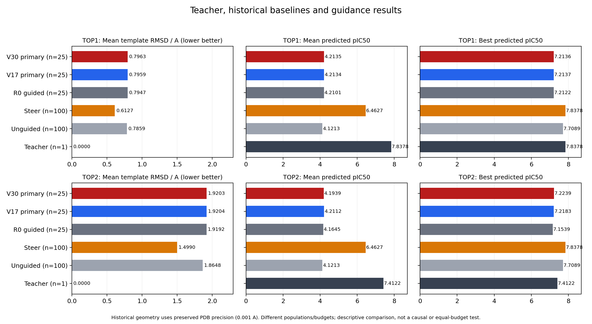

# V6–V30补充报告：逐轮改动效果、对照表现及远端资料保留

本次完成三项补充：25次版本迭代的问题—改动—后续实测台账、全部250个教师采样轮次的构象/pIC50聚合统计、当前远端工作目录的只读保留盘点。没有新生成、重评分、软件/skills变更或远端文件清理；原实验已结束，定时任务保持删除。

## 1. 每轮问题、改动与效果

完整逐版解释和R1–R5表在[逐轮复盘报告](iteration_retrospective.zh-CN.md)，机器可读台账为[iteration_ledger.json](iteration_ledger.json)，250个教师轮次、四调度动作、模板RMSD平均/最小及pIC50平均/最优在[round_metrics.csv](round_metrics.csv)。

每版skills/工程在R1–R5内冻结，因此改动发生在下一版；本次没有重读未授权的全量私有会话，其他轮次只给实际聚合结果，不编造内部诊断。下表快速索引数值效果，Δgap为下一版减前版的两教师等权主代表gap，负值为改善。详细报告同时列出ΔMean与ΔC并评价行为是否按预期改变；这些相邻变化不是单项skills的因果效应。

|识别版→实施/检验版|对应改动概述|后续Δ等权gap|
|---|---|---:|
|v6→v7|具体边/背景分维度学习、先闭环再发布记忆、按目标配置预算|-0.008362370|
|v7→v8|及时利用有效分支、补偿容量及剩余决策价值；改有限复盘门槛|-0.000084662|
|v8→v9|保留微小有符号顺序、反转后细化、核算共同外推风险|+0.022869220|
|v9→v10|有价值的单段探测与可信利用；固定人口效果不等同泛化|-0.023320441|
|v10→v11|内侧信息及时解决，区分条件前沿/补偿/功能利用|+0.000091705|
|v11→v12|交付→传播→终态框架及建立/维持/释放；不扩大动作空间|+0.000889187|
|v12→v13|恢复V10兼容skills和完整政策|-0.001222959|
|v13→v14|按单位幅度/同背景判断曲率，保留弱释放分支|+0.000365686|
|v14→v15|限定坏端点作用范围，保留合法内侧和背景迁移|-0.000018497|
|v15→v16|与缓存最好比较，分开预测失配和结果接受|+0.000434699|
|v16→v17|分开C带、gap和预测单位；按匹配等步边判断曲率/风险|-0.001125593|
|v17→v18|按剩余预算比较单改/联合与共同迁移风险|+0.000728989|
|v18→v19|数组差值先于窗口机制解释，限制不可达结论范围|-0.000662107|
|v19→v20|把共同风险用于实际提案比较，保留AB−A小正效应|+0.023780193|
|v20→v21|已测样本/推断区域/动作边界分开；反向差值取反|-0.023121800|
|v21→v22|精确端点反向、新分段与迁移分开；合并同波匹配事实|-0.000669508|
|v22→v23|绑定响应人口/估计量，重比主方向受阻后的弱方向|+0.000594630|
|v23→v24|修订已测/未知内侧/未知背景迁移的标签|+0.000350633|
|v24→v25|精确恢复V17三份skills与U1，不叠新模块|-0.000692873|
|v25→v26|保留弱响应；新反证修改实际预测|-0.000193410|
|v26→v27|合并后采用最近匹配边，区分私有未知与全局未知|+0.000429678|
|v27→v28|核对数组/人口/统计归属，弱窗口按当前尺度判断|-0.000102887|
|v28→v29|补偿成本收益同源；差分抵消需有识别条件|+0.000668530|
|v29→v30|区分局部合法性与扩幅；反向不越过端点|+0.007484970|
|v30→终态|只记录终态反证与V17兼容源；无下一版|未再实施/检验|

数值与行为必须分别看：V17解决早段合法内侧并成为全程最好；V25恢复后改善但没有超过V17；V28当前数组归属与部分预测更新改善，仍有补偿边混合；V30局部合法性部分改善，Top2仍忽略最近匹配反证，整体第二次退步。接口修复、额度变化和上下文变化单列于详细报告，不冒充纯skills效果。

## 2. Teacher、unguided与实验结果

模板为各teacher核心加一跳（Top1 2原子、Top2 8原子），蛋白固定框架，不对配体独立拟合。表中分别给平均RMSD和单分子最小RMSD；pIC50为已有模型重评分。teacher仅一分子，自身RMSD=0，均值与最优pIC50相同。

**2026-10-25比较口径补正：** 正式25条来自五个历史batch各前5槽。取对应历史unguided 25条后，Top1/Top2平均模板RMSD为0.8274/1.9508Å，平均/最优pIC50为4.217696476/7.221372604。V30相对此参照平均RMSD降低0.031069291/0.030485913Å（约3.76%/1.56%），平均pIC50降低0.004175463/0.023764553。因此不能用下面100/25表得出“guided误差更大”的结论。完整25/25表、源码解释与剩余可比性限制见[同初始槽位补正](slot_matched_comparison.zh-CN.md)；此为已有历史记录重新分组，未新增严格配对零指导实验。

|teacher|人口|n|模板RMSD平均/最小 Å|pIC50平均/最优|
|---|---|---:|---:|---:|
|top1|teacher|1|0.0000 / 0.0000|7.837829 / 7.837829|
|top1|unguided|100|0.7859 / 0.2531|4.121296 / 7.708861|
|top1|R0有指导|25|0.7947 / 0.3532|4.210112 / 7.212181|
|top1|V17主代表|25|0.7959 / 0.3294|4.213412 / 7.213695|
|top1|V30主代表|25|0.7963 / 0.3297|4.213521 / 7.213616|
|top2|teacher|1|0.0000 / 0.0000|7.412205 / 7.412205|
|top2|unguided|100|1.8648 / 0.3030|4.121296 / 7.708861|
|top2|R0有指导|25|1.9192 / 0.8780|4.164478 / 7.153899|
|top2|V17主代表|25|1.9204 / 0.8802|4.211231 / 7.218332|
|top2|V30主代表|25|1.9203 / 0.8797|4.193932 / 7.223948|

在历史全部100条的描述性口径下，V17相对unguided的Mean pIC50增加+0.092115712/+0.089934421，Best减少−0.495166779/−0.490529060，模板RMSD均值增大+0.009993854/+0.055548782Å；V30相应为Mean增加+0.092224574/+0.072635484、Best减少−0.495244980/−0.484912872、平均RMSD增大+0.010415406/+0.055502448Å。此口径不能判断guidance的方向。同初始槽位参照显示几何改善、平均功能略降；当前主代表仍没有同时改善两者，也没有接近teacher平均评分。

历史unguided和steer各为同一100条分别对两个template评价，不重复计样本；它们与搜索后的固定25槽不同，Best有样本数差异，以上是描述性比较。历史构象来自已存PDB（0.001Å量化），所有200个画像的protein SHA与teacher相同；正式值沿用native全精度。最小几何误差与最高pIC50未必是同一个分子；完整配对值、原核心区域误差、TOP1归档及历史steer对照见[性能对比报告](performance_comparison.zh-CN.md)。

主RMSD为几何匹配，不能解释为化学子图身份完全恢复。正式结果化学映射诊断仅3641/25000可用，PB全通过也不代替这一条件。未有完整化学映射的构象误差不填零。

## 3. 远端工作资料值得保留什么

本次通过限定层级SFTP盘点175个目录，没有远端写入或删除。`/opt/MolSteer/runtimes`实际为70个目录加21个文件，共91条目；`generated_datasets`有7个结果目录和1个scripts目录。三份Git bare缓存仍在。下表为最实用的保留顺序：

|优先级|资料|已确认范围及保留理由|
|---|---|---|
|P0|原模型与环境|v2 checkpoint 677,580,035字节；原Torch/DTK/Flowr与PLIP依赖/版本锁、外部路径关系|
|P0|正式结果根|V6–V30全部协议、FINALIZED/report/绑定、条件/评分/质量/学习/prompt/XML/usage；是主结论与后续再分析依据|
|P0|Teacher/蛋白/模板与基线|原teacher.sdf、prepared protein、原子/键映射、2/8原子区域、修正版baseline_profiles_graph_v2及各100条评分|
|P0|R0与最终结构|两teacher共50条完整R0；50份最终TOP1快照×25槽=1250结构槽；保存重启/RNG/checkpoint与hash|
|P0|固定源码/skills与失败链|优先V17、V25、V30及混合教师旧源；全部失败事务、删除/保护清单、部署/验收/启动收据、逐provider成本|
|P1|跨目标历史原始归档|unguided/steer各30个target tar.gz，分别约4.480/3.253GiB，配套hash、targets_resolved、results_summary与数据划分|
|P1|旧条件控制与机制分析|原PLIP guidance两目标实验、早期单教师与V1–V5协议、analysis_hiqbind样例/区域/轨迹与来源资料；分协议参考|
|P2|重复运行副本、Git对象缓存、下载/测试临时载荷|可重建性较高；仅在确认独立备份和链接/路径依赖后再决定整理，本次没有删除|

关键结果根引用外部teacher、PDB和依赖包，不能只保存一个新结果目录。非TOP1及R0的完整结构载荷已按既定保留策略清理，后续不能期待找回全部25000条SDF/PT/H5，但保留的逐结果JSON/评分/质量/端点和失败证据仍有价值。

路径级清单、保留内容、大小口径及后续归档建议见[远端资料保留报告](remote_retention_inventory.zh-CN.md)及[机器可读清单](remote_retention_inventory.json)。本次没有全盘du，目录stat字节不代表递归占用，空闲磁盘未知；没有把它们写成已测磁盘容量。

## 文件与来源

- [最佳V17：五轮guidance行为、实际效果与五套图表](../v17-round-by-round/report.zh-CN.md)
- [逐版问题、改动、效果与全部R1–R5聚合](iteration_retrospective.zh-CN.md)
- [模板构象与pIC50对照](performance_comparison.zh-CN.md)
- [远端资料保留路径清单](remote_retention_inventory.zh-CN.md)
- [原V6–V30最终报告与成本](../v6-v30-final/report.zh-CN.md)

来源和计算输入hash见analysis_sources.json；历史逐分子模板误差及原子坐标输入均随补充报告保存。未运行本地自动化测试、远端单元测试、LLM离线回放或新的原生验收。此为已完成实验的补充分析，不恢复自动任务或任何已撤回方向。
