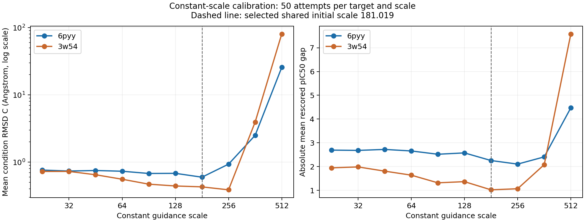

# UniGuide–FLOWR 运行结果阶段报告

数据截点：2026-10-26 21:29:00（Asia/Shanghai）。标定和UG01已经完成；UG02只报告截点前完成的14组6pyy结果，其第15组仍在执行，3w54尚无UG02完成组。本报告不替代UG02完成后的GPT主复盘。

当前最明确的结论是：标定支持将固定初值设为181.019，且各时间窗需要分别搜索；UG01在3w54上改善较清楚，在6pyy上变化很小；UG02的6pyy阶段结果在几何误差与模型重评分差距上均进一步改善。尺度越大并不保证效果越好，正式搜索上界也不代表已验证的稳定上界。

## 数据与比较口径

固定教师为6pyy_H7S_A_402 / single_b004_final_015（17个重原子，教师重评分pIC50=6.535594）和3w54_RNB_A_504 / single_b000_final_003（22个重原子，8.711633）。两者条件区域均为PLIP直接互作重原子并集，各9个原子，没有一跳扩展。使用指定flowr_root_v2.ckpt，仅坐标VJP引导。

C是最终结构中几何匹配到教师互作core的RMSD均值，单位Å，越低越好；不是整分子对齐RMSD，也不是化学有效率。gap为 abs(50个尝试的平均重评分pIC50 − 教师pIC50)，越低越好，不是逐分子绝对误差的平均值。pIC50均为模型重评分。评分包含所有具有有限坐标和评分的尝试，不能用构建成功子集替代原分母。

代表配置按既定规则选择：先取C不超过本集合最小C+0.02 Å的候选，再比较gap、C、best。故代表配置不一定是C绝对最小者。R0使用固定引导尺度[181.019]*4；它是有引导的固定尺度对照，本次没有完整零引导对照。下述改善支持“相对固定尺度R0的调度改善”，不能据此推断相对无引导模型的增益。

## 前期scale范围探索

| 阶段 | 每教师配置数 | 每配置尝试数 | 两教师总尝试 | 完成组 / 总组 | 未完成组 |
|---|---|---|---|---|---|
| 粗搜索 | 26 | 10 | 520 | 38 / 52 | 14个数值非有限 |
| 细搜索 | 12 | 20 | 480 | 20 / 24 | 4个数值非有限 |
| 单窗口扰动 | 24 | 25 | 1200 | 45 / 48 | 2个数值非有限、1个工程错误 |
| 每配置50次验证 | 20 | 50 | 2000 | 40 / 40 | 0 |
| 合计 | 82 | 分阶段 | 4200 | 143 / 164 | 21组；295次尝试计入账本 |

标定预算上限5000，实际使用4200。未完成组仍计预算，不补采；其中一个25次组为历史部分批元数据list index out of range工程错误，不能归因为该尺度数值不稳定。其余20组为非有限数值失败。全50次验证阶段40组均完成，不等于全部分子几何或化学质量合格。

粗搜索覆盖 {10^k, 3×10^k: k=-6,…,5} ∪ {50,10^6}，共26个常数。所有已测试的≥1000常数在两教师上均出现非有限坐标；小尺度整体引导较弱。10次小样本粗搜索中，6pyy的代表常数为300，3w54为100；这些结果只用于发现范围，不与后续50次结果直接作优劣比较。

细搜索实际测试12个常数：22.627、32、45.255、64、90.510、128、181.019、256、362.039、512、724.077、1024。724.077和1024的四窗口同值配置在两教师上均失败。单窗口搜索围绕181.019、512、362.039三个共同锚点，对四个窗口分别乘或除sqrt(2)，共24个配置。最后选择10个常数配置和10个窗口扰动配置，每教师每配置50次验证。

以下常数比较全部来自同一50次人口，按尺度升序排列：

| 常数scale | 6pyy C↓ | 6pyy gap↓ | 3w54 C↓ | 3w54 gap↓ |
|---|---|---|---|---|
| 22.627 | 0.761690 | 2.692112 | 0.726883 | 1.945110 |
| 32.000 | 0.737006 | 2.680374 | 0.727437 | 1.985185 |
| 45.255 | 0.750684 | 2.721168 | 0.649091 | 1.807691 |
| 64.000 | 0.732039 | 2.657279 | 0.556650 | 1.638665 |
| 90.510 | 0.678239 | 2.518302 | 0.470120 | 1.315924 |
| 128.000 | 0.681409 | 2.575179 | 0.442159 | 1.365392 |
| 181.019 | 0.597012 | 2.253831 | 0.428588 | 1.020806 |
| 256.000 | 0.933295 | 2.103741 | 0.387301 | 1.067013 |
| 362.039 | 2.503084 | 2.406905 | 3.942905 | 2.080042 |
| 512.000 | 25.629532 | 4.471721 | 80.482537 | 7.581101 |

181.019对应两教师等权平均C=0.512800、gap=1.637318。256虽改善3w54几何误差，却使6pyy C从0.597012升至0.933295；362.039和512在50次验证中仍可能得到有限终态，但平均几何误差严重恶化。由此选181.019作为共同常数初值，并不意味着两个靶点最优尺度相同。

正式域为2^(j/2)，j=11,…,19，即45.255、64、90.510、128、181.019、256、362.039、512、724.077。该域由两教师常数C–gap非支配区间并集向两侧各扩展一个octave得到，属于探索域；尤其724.077并非已通过四窗口常数稳定验证的值。粗调乘/除2，细调乘/除sqrt(2)，每次最多改变两个窗口。窗口依次为10–25、26–50、51–75、76–90，其他步引导为零。损失函数不随窗口更换。

## Guidance Agent已完成结果

UG01完成两教师各5轮、每轮3个配置、每配置50次，共30组1500次。三私有Agent分别增强、减弱、重分配，各提出两个合法方案，综合Agent每方向选一个；全部从共享R0的step10前状态开始。UG01已完成真实GPT主复盘并更新analysis、proposal、synthesis三个skills。

| 靶点 | 阶段 / 代表组 | scale四窗口 | C↓ | gap↓ | 均值pIC50 | best pIC50 | 构建数 |
|---|---|---|---|---|---|---|---|
| 6pyy | R0 | [181.019, 181.019, 181.019, 181.019] | 0.597012 | 2.253831 | 4.281763 | 6.359833 | 50/50 |
| 6pyy | UG01 R03/redistribute | [181.019, 181.019, 256, 128] | 0.585163 | 2.258944 | 4.276650 | 6.359839 | 50/50 |
| 3w54 | R0 | [181.019, 181.019, 181.019, 181.019] | 0.428588 | 1.020806 | 7.690827 | 8.924070 | 49/50 |
| 3w54 | UG01 R04/redistribute | [90.51, 256, 181.019, 256] | 0.337682 | 0.747575 | 7.964058 | 9.054249 | 50/50 |

UG01的6pyy：C降低1.98%，gap反而增加0.23%，尚无清楚的综合改善。3w54：C降低21.21%，gap降低26.77%，均值pIC50从7.690827升至7.964058。两教师代表配置等权平均C从0.512800降至0.461423，gap从1.637318降至1.503260。

若与前期每教师各自的50次标定代表比较，6pyy标定代表[181.019,256,181.019,181.019]为C=0.591633、gap=2.231633，UG01没有同时超过两指标；3w54标定代表[256]*4为C=0.387301、gap=1.067013，UG01同时改善两指标。因此，不能把UG01描述为在两个靶点上均超过前期标定。

UG01并非每轮单调改善。以下每行是该轮三个配置按同一规则选出的代表，不是累计最优：

| 轮次 | 6pyy分支 | 6pyy C | 6pyy gap | 3w54分支 | 3w54 C | 3w54 gap |
|---|---|---|---|---|---|---|
| 1 | decrease | 0.591051 | 2.260560 | redistribute | 0.403669 | 0.962195 |
| 2 | decrease | 0.597041 | 2.267277 | decrease | 0.385478 | 0.896910 |
| 3 | redistribute | 0.585163 | 2.258944 | increase | 0.388518 | 0.989754 |
| 4 | redistribute | 0.587753 | 2.263698 | redistribute | 0.337682 | 0.747575 |
| 5 | decrease | 0.603807 | 2.261858 | redistribute | 0.366862 | 0.831443 |

UG01复盘发现：6pyy增强分支曾持续继承较大的早期增量；3w54第五轮的窗口proxy loss更低，但最终C和gap均差于第四轮。因此UG02指引强调实际FLOWR时间系数与guidance/native比值、从当前版较优已测量锚点提出合法动作，以及逐轮用结果检验前一轮预测。未修改科学loss、VJP、窗口、随机流或预算。

## UG02阶段结果

截至本快照，6pyy完成14/15组、700次，最后一个重分配组在执行；3w54尚无UG02完成结果，整版未FINALIZED。不能据单教师中间结果宣布UG02整体优于UG01。

| 6pyy轮次 | 当轮暂选分支 | scale四窗口 | C↓ | gap↓ |
|---|---|---|---|---|
| 1 | increase | [181.019, 362.039, 181.019, 181.019] | 0.582676 | 2.160009 |
| 2 | increase | [181.019, 362.039, 256, 181.019] | 0.566857 | 2.155769 |
| 3 | increase | [181.019, 362.039, 362.039, 181.019] | 0.575248 | 2.221990 |
| 4 | increase | [181.019, 362.039, 256, 256] | 0.563670 | 2.152629 |
| 5 | increase | [181.019, 362.039, 256, 362.039] | 0.559206 | 2.149398 |

UG02当前代表R05/increase为[181.019,362.039,256,362.039]：C=0.559206、gap=2.149398、均值pIC50=4.386196、best=6.524174，构建50/50，36个唯一SMILES。相对R0，C降低6.33%、gap降低4.63%；相对UG01代表，C降低4.44%、gap降低4.85%。相对6pyy前期50次标定代表的两个指标也均改善。

可观察的调度模式是保留W1=181.019、提高W2至362.039，在W3/W4继续探索。W3从256加到362.039的第三轮反而变差，后续又回到256；说明有效的是窗口组合探索，并非所有窗口一律增强。该模式来自已完成结果，不是已验证的因果或统计显著性结论。五个固定随机种子作为共同随机数贯穿搜索，当前没有独立留出种子验证。

## 质量检查与执行状态

| 版本/教师 | 完成组 | 抽样槽位 | 未构建 | PB通过 | PB测量不通过 | PB无法评估 | PLIP可评估 | PLIP无法评估 |
|---|---|---|---|---|---|---|---|---|
| UG01/6pyy | 15 | 150 | 1 | 145 | 3 | 1 | 146 | 3 |
| UG01/3w54 | 15 | 150 | 9 | 131 | 10 | 0 | 141 | 0 |
| UG02/6pyy | 14 | 140 | 0 | 137 | 3 | 0 | 140 | 0 |

新组固定每种子logical_slot=0、1共10/50抽样；其余40个只做基础统计。PLIP可评估不等于互作成功恢复，抽样通过数不外推到全人口。UG01全部1500次中构建1484个；UG02已完成700次中构建698个。抽样队列与推理并行，不额外做全量慢检查。

截至截点，预算账本为标定4200、共享R0 100、正式2250：UG01完成1500，UG02完成700并已预留最后一组50。累计已预留6550次，包括失败尝试和在途组，不能等同于6550个有效生成分子。

UG02曾在6pyy第五轮Agent调用因输出额度耗尽停止，随后发现恢复缓存的JSON字段顺序问题；已按原提示、原模型及原额度恢复成功。12项远端工程测试通过，185个原有产物哈希一致，未重采已完成候选。GPU科学提交仍固定f649d9a3，CPU抽样提交3f07d1fa，独立恢复入口ce0ec57c。35分钟巡检继续ACTIVE，UG02完整结束后仍须主Agent实际复盘，不能自动跳过。

## 可追溯材料

- [同快照全部组指标CSV](20261026_uniguide_results_2129.csv)：164个标定组、2个R0组、44个已完成正式组；包含失败组错误字段。

- [远端结果快照](../evidence/uniguide/20261026_results_snapshot_2129.json)：原始聚合指标、抽样回执、尝试账本及标定源文件SHA256。

- [UG01实际主复盘](../reviews/20261026_UG01_review.zh-CN.md)。

- [恢复成功证据](../evidence/uniguide/20261026_UG02_recovery_confirmed.json)。

- 本快照文件SHA256：`80c61836c49dc29fbe1342d0883314a7295ab9645333eb8f70ae33d66dafdd5d`。
