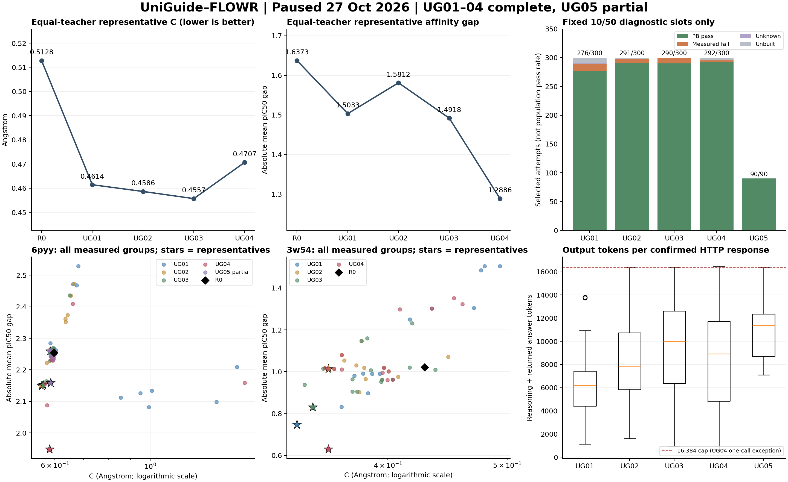

# UniGuide–FLOWR：UG01–UG05 暂停汇总与分析

数据截至 **2026-10-27 17:14:07（Asia/Shanghai）**。按用户“暂停任务，对当前的所有UG结果进行汇总分析”的指令，17:12:25 已确认推理进程退出、执行锁释放，并停止无积压的独立 CPU 检查进程；自动巡检为 **PAUSED**。本次仅整理既有结果，没有新增 LLM 调用、分子采样、补样或协议修改。

## 1. 当前结论与完成范围

**UG04 是按冻结排序规则选出的最佳完整版本；UG03 的平均几何误差 C 最低。UG05 只有第一教师前三轮结果，不能参与完整版本排名。** 指引迭代改善了部分配置的模型亲和力差距，但没有形成逐版单调改进，也没有解决推理输出截断和所有数值异常。

| 阶段 | 已完成尝试 | 完成情况 | 已完成慢检查 |
|---|---:|---|---:|
| 标定 | 4,200 / 上限 5,000 | 已完成并冻结可行域 | 不与正式版本混合统计 |
| 共享 R0 | 100 / 100 | 两教师各 1 组 | 2 组，各 10/50 |
| UG01 | 1,500 | 两教师各 5 轮，共 30 组；已复盘 | 30 组，各 10/50 |
| UG02 | 1,500 | 同上 | 30 组，各 10/50 |
| UG03 | 1,500 | 同上 | 30 组，各 10/50 |
| UG04 | 1,500 | 同上；混合提示协议版本 | 30 组，各 10/50 |
| UG05 | 450 | 第一教师 3 轮、9 组；第四轮建议失败后暂停 | 9 组，各 10/50 |
| UG06–UG20 | 0 | 未启动 | 0 |

正式累计 **6,450 / 30,000 次（21.5%）**，包含构建失败；连同标定及 R0 共 10,750 次。完整主版本为 4/20。129 组正式产物均有基础统计和抽样回执，暂停时 CPU 队列无积压。UG05 没有 FINALIZED、最终保留清单或完整主复盘，不能把本报告当成 UG05 的完成验收。

## 2. 指标含义与比较口径

两位教师固定为：

| 教师 | node_id | 重原子数 | 教师 pIC50 |
|---|---|---:|---:|
| 6pyy_H7S_A_402 | single_b004_final_015 | 17 | 6.535594 |
| 3w54_RNB_A_504 | single_b000_final_003 | 22 | 8.711633 |

每组使用固定五个种子 42、100045、200048、300051、400054，每种子 10 个逻辑槽位。科学实现保持指定 FLOWR checkpoint、PLIP 直接互作核心、坐标 condition map、VJP 和原生 FLOWR 适配；本报告不引入 V30 结果或策略。

- **C（Å）**：50 次尝试的最终核心条件 RMSD 均值，越低越好。它衡量指定核心的坐标匹配，不是整配体 RMSD，也不是化学有效率。
- **gap**：`abs(50 次模型重评分的平均 pIC50 − 教师 pIC50)`，越低越好；不是逐分子绝对差的平均值。原口径包含构建失败槽位的张量模型评分，不能把它解释成“50 个有效分子的实验活性”。
- **代表组**：每教师在该版已完成组中，先保留 `C ≤ 该版最小 C + 0.02` 的组，再按 gap、C、负 best、ID 排序。正式整体指标是两教师代表组的等权均值，**不是全版 1,500 次尝试的总均值**。0.02 是预设决策容差，不是显著性阈值。
- **best** 是单个候选的最高模型 pIC50，不等于总体平均表现。本报告不以 best 代替 gap，也不把模型分数称为实测亲和力。
- **R0 已有恒定引导**，四个窗口 scale 均为 181.01933598。因此下文改善是相对恒定 R0，不能据此声称优于未引导 FLOWR。

## 3. 完整版本比较

| 版本 | 平均 C ↓ | 平均 gap ↓ | 全版可构建数 / 尝试数 | 按既定规则的判断 |
|---|---:|---:|---:|---|
| R0 | 0.512800 | 1.637318 | 99 / 100 | 共享恒定引导基线 |
| UG01 | 0.461423 | 1.503260 | 1,484 / 1,500 | 建立首个完整参照 |
| UG02 | 0.458636 | 1.581187 | 1,486 / 1,500 | C 略降、gap 变差，记录一次下降 |
| UG03 | **0.455684** | 1.491819 | 1,486 / 1,500 | C 最低，下降计数归零 |
| UG04 | 0.470652 | **1.288607** | 1,486 / 1,500 | 当前最佳完整版本 |
| UG05（部分） | — | — | 450 / 450 | 缺少第二教师，暂不排名 |

UG04 相对 R0，平均 C 降低 **8.22%**，gap 降低 **21.30%**。相对 UG03，C 增加 0.014969 Å，gap 减少 0.203211；它仍处于完整版本最低 C 的 0.02 容差带内，因此按规则获选。这个结果说明存在几何约束与模型评分的取舍，不能描述为两项指标同时持续改善。

UG02 的整体下降没有连续出现两版；之后 UG03、UG04 按冻结规则改善，未触发“连续两版下降后回到最佳兼容 skills”的分支。

图中星号是代表组，普通点是全部已测组；下排 C 采用对数坐标，保留大误差组。UG05 仅在已有第一教师数据及局部质量/调用诊断中出现。

## 4. 两教师的表现差异

### 4.1 代表组的直接比较

| 教师 | 版本 | 代表组 | C ↓ | gap ↓ | 平均模型 pIC50 | 代表组唯一 SMILES |
|---|---|---|---:|---:|---:|---:|
| 6pyy | R0 | R0 | 0.597012 | 2.253831 | 4.281763 | 31 |
| 6pyy | UG01 | R03 redistribute | 0.585163 | 2.258944 | 4.276650 | 31 |
| 6pyy | UG02 | R05 increase | 0.559206 | 2.149398 | 4.386196 | 36 |
| 6pyy | UG03 | R05 increase | 0.563670 | 2.152629 | 4.382965 | 34 |
| 6pyy | UG04 | R05 redistribute | 0.583258 | **1.947856** | **4.587738** | 39 |
| 6pyy | UG05 部分 | R03 redistribute | 0.587059 | 2.158761 | 4.376833 | 35 |
| 3w54 | R0 | R0 | 0.428588 | 1.020806 | 7.690827 | 45 |
| 3w54 | UG01 | R04 redistribute | **0.337682** | 0.747575 | 7.964058 | 43 |
| 3w54 | UG02 | R04 increase | 0.358067 | 1.012976 | 7.698657 | 44 |
| 3w54 | UG03 | R05 redistribute | 0.347697 | 0.831009 | 7.880624 | 47 |
| 3w54 | UG04 | R05 decrease | 0.358047 | **0.629359** | **8.082274** | 45 |

6pyy 的 gap 一直大于 3w54，是当前更明显的约束瓶颈。UG02/UG03 主要降低其 C，UG04 才进一步拉近模型评分与教师评分。3w54 在 UG01 已有较低 C，UG02 的 gap 几乎回到 R0，之后恢复；UG04 的主要收益同样是 gap，而不是刷新最低 C。

UG04 代表组相对 R0 的五个配对种子块中：6pyy 的 C 在 4/5 块下降，平均 pIC50 在 5/5 块提高；3w54 的 C 在 5/5 块下降，平均 pIC50 在 4/5 块提高。改善不是每个块都一致。这里的组经过自适应选择，且使用共同随机数；这些计数仅是描述性诊断，不是独立验证或统计显著性结论。逐块差值见 [paired_seed_deltas.csv](paired_seed_deltas.csv)。

### 4.2 最终选择的窗口强度并不相同

窗口 W1–W4 分别对应第 10–25、26–50、51–75、76–90 步。下表仅为显示而四舍五入，归档保留完整浮点值。

| 配置 | W1 | W2 | W3 | W4 |
|---|---:|---:|---:|---:|
| 恒定 R0 | 181.019 | 181.019 | 181.019 | 181.019 |
| UG04 / 6pyy 代表组 | 181.019 | 724.077 | 181.019 | 64.000 |
| UG04 / 3w54 代表组 | 90.510 | 181.019 | 181.019 | 181.019 |
| UG05 / 6pyy 当前局部代表 | 181.019 | 362.039 | 181.019 | 90.510 |

这组证据不支持通用的“整体加大引导就更好”。两个教师选择了不同的窗口分配；raw scale 还需结合时间系数与实际梯度判断，不能直接等同于坐标位移。

### 4.3 代表组进步不等于全部探索组进步

3w54 全部 15 组的 C 中位数，UG03 为 0.384936，UG04 为 0.397178；6pyy 分别为 0.587217 和 0.591051。UG04 找到了更好的规则内代表组，但不能据此宣称整版探索分布都更好。

另做了不改变正式排名的事后敏感性检查：把 UG01–UG04 所有组放入同一个候选池，重新应用 0.02 带，会选择 6pyy 的 UG04/R04/redistribute 和 3w54 的 UG01/R04/redistribute。这与先在各版选代表再比较版本不完全相同，因为“最低 C + 容差”的参照集合变了。正式结论继续使用既定分层规则；不能把两种排名混写成唯一的、与候选集合无关的最优解。

## 5. UG05：已完成部分与准确停止点

UG05 第一教师前三轮 9 组均完成，450 次全部可构建；第二教师尚未开始。已有结果如下：

| 轮次 | 分支 | C | gap |
|---|---|---:|---:|
| R01 | increase | 0.584086 | 2.261409 |
| R01 | decrease | 0.599197 | 2.252233 |
| R01 | redistribute | 0.585163 | 2.258944 |
| R02 | increase | 0.590585 | 2.242706 |
| R02 | decrease | 0.599925 | 2.250673 |
| R02 | redistribute | 0.595740 | 2.233276 |
| R03 | increase | 0.587217 | 2.242855 |
| R03 | decrease | 0.600453 | 2.250540 |
| R03 | redistribute | 0.587059 | **2.158761** |

当前局部代表相对同教师 R0，C 减少 0.009953，gap 减少 0.095070；相对 UG04 的完整第一教师代表尚未更好。由于仅完成三轮，不能把这种局部比较登记成完整 UG05 的下降。

停止节点是 `UG05/6pyy_H7S_A_402/advice_R04/increase`。16:33:04 的首次请求和 16:56:04 的显式原配置恢复均输入 58,826 token、输出 16,384 token，全部输出用于 reasoning，正文为空，`finish_reason=length`。两次 wire 字节一致，无格式修正，无第四轮新候选。旧 execution_claim 和显式恢复 claim 均保留；本次暂停后没有第三次请求。

这属于 **LLM 建议阶段失败**。即使采样 FAILED、QUALITY_FAILED 均为零，也不能将任务描述为健康运行。完整链路与保护账本见 [UG05 第四轮恢复失败审计](../../evidence/uniguide/20261027_UG05_R04_recovery.json)。

## 6. 结构与质量：全量基础统计和抽样诊断分开看

### 6.1 全部尝试的基础统计

| 版本 | 尝试 | 可构建 | 连接为单片段 | 存在 <1.2 Å 蛋白近接触 | 近接触可评价分母 |
|---|---:|---:|---:|---:|---:|
| UG01 | 1,500 | 1,484 | 1,474 | 9 | 1,484 |
| UG02 | 1,500 | 1,486 | 1,475 | 11 | 1,486 |
| UG03 | 1,500 | 1,486 | 1,476 | 11 | 1,486 |
| UG04 | 1,500 | 1,486 | 1,477 | 11 | 1,486 |
| UG05 部分 | 450 | 450 | 450 | 0 | 450 |

正式 6,450 次中，可构建 6,392，构建失败 58。连接性和简化近接触是基础统计，不等于 PoseBusters 或 PLIP 通过；失败槽位没有补样，基础统计没有改变预算分母。

### 6.2 固定 10/50 的慢检查

每组预先选择五个种子的 logical_slot=0、1，构建失败也保留在抽样分母中。其余 40 槽未选，不追加慢检查。这是固定诊断子集，不是随机人口抽样，不能外推全量通过率。

| 版本 | 选中槽位 | PB 通过 | PB 测量不通过 | PB 已构建但未知 | 抽中未构建 | PLIP 可评价 | PLIP 已构建但无法评价 | 未选槽位 |
|---|---:|---:|---:|---:|---:|---:|---:|---:|
| UG01 | 300 | 276 | 13 | 1 | 10 | 287 | 3 | 1,200 |
| UG02 | 300 | 291 | 6 | 0 | 3 | 297 | 0 | 1,200 |
| UG03 | 300 | 290 | 10 | 0 | 0 | 300 | 0 | 1,200 |
| UG04 | 300 | 292 | 3 | 0 | 5 | 295 | 0 | 1,200 |
| UG05 部分 | 90 | 90 | 0 | 0 | 0 | 90 | 0 | 360 |
| 合计 | **1,290** | **1,239** | **32** | **1** | **18** | **1,269** | **3** | **5,160** |

UG01 的 1 个 PB 未知及 3 个 PLIP 无法评价仍保留为未知，不记作通过、分子失败或零互作。暂停时没有待处理组或 QUALITY_FAILED 工程失败组。UG05 的 90/90 只说明已检查第一教师槽位的结果，不能与双教师完整版本直接比较，更不代表 450/450 全量通过。

PLIP 恢复指标按教师指纹集合计算交集比例；指纹由互作类型、蛋白链、残基编号/类型和配体角色构成。仅在 PLIP 可评价且教师指纹非空时计算，不称为“PLIP 通过率”。四个完整版本在各自可评价抽样中的均值依次为 0.7471、0.7656、0.7705、0.7712；分母依次为 287、297、300、295。UG05 为 0.7206/90 槽，仅包含 6pyy；应与 6pyy 的 UG04 值 0.7400 比较，而不是完整版本两教师合并值。

### 6.3 保留产物

每个完整版本、每位教师均保留 50 个逻辑槽位的 TOP1 清单，以及单一代表组的终态和轨迹；TOP1 可以来自不同组，不能把它混作代表组的 50 个样本。清单中可构建条目如下：

| 版本 | 6pyy 保留槽位 / 可构建 | 3w54 保留槽位 / 可构建 |
|---|---:|---:|
| UG01 | 50 / 50 | 50 / 49 |
| UG02 | 50 / 50 | 50 / 48 |
| UG03 | 50 / 50 | 50 / 50 |
| UG04 | 50 / 49 | 50 / 50 |

缺少可构建 SDF 的槽位原状保留，没有补齐为 50 个分子。所有源结构继续保留在远端实验目录；本报告的证据包保存数据、身份及来源哈希，不冒充完整 SDF/轨迹备份。

## 7. Agent 运行成本与协议变化

### 7.1 实际回执统计

按真实 `provider_request_id` 去重，UG04 的响应别名不重复计为 HTTP。下表是有回执确认的响应数，不据此推断所有无回执的网络尝试。

| 版本 | 成功逻辑调用 | 已确认 HTTP 响应 | length 失败 | 格式/字段/行动无效回答 | 输入 token 中位数 | 输出 token 总计 | reasoning 占输出 |
|---|---:|---:|---:|---:|---:|---:|---:|
| UG01 | 48 | 51 | 0 | 3 | 102,575 | 324,751 | 71.1% |
| UG02 | 48 | 54 | 3 | 3 | 103,487.5 | 458,104 | 74.0% |
| UG03 | 48 | 59 | 4 | 7 | 103,539 | 549,441 | 86.5% |
| UG04 | 48 | 55 | 4 | 3 | 58,060 | 479,927 | 92.5% |
| UG05 部分 | 12 | 14 | 2 | 0 | 52,926.5 | 157,338 | 94.2% |
| 合计 | **204** | **233** | **13** | **16** | — | **1,969,561** | — |

累计回执输入 21,351,047 token，其中可能含缓存输入；输出 1,969,561，reasoning 1,636,707。这里不折算金额，也不把输入总量当作实际计费的新输入量。无效回答计入原回答和修正后仍无效的回答；UG04 的两次 v1 非法锚点回答均计入 3 次无效回答中。

### 7.2 变化带来的证据与尚未解决的问题

| 版本 | 主要指引或工程变化 | 本次观察 |
|---|---|---|
| UG01 | 从选定 V17 指引起步；后续复盘强调时间系数、VJP、局部对照和可证伪预测 | 3w54 已改善；6pyy 接近 R0，部分 increase 出现大位移 |
| UG02 | 强化窗口、原始 scale、实际锚点、整数格点邻居及紧凑综合决策 | 6pyy 的 C 改善，但 3w54 gap 回退；3 次长度失败 |
| UG03 | 继续明确指标分母、C 带内排序、窗口差分和单一完整 JSON | 平均 C 最低；仍有 4 次长度失败及 7 次无效回答 |
| UG04 | 中途经用户授权：单请求 24,576；随后无损压缩、角色路由、输出约束；再加入精确锚点枚举与 execution_contract | gap 最低；成功完成，但属于混合提示协议，不能把分子指标变化归因于某一修复 |
| UG05 | 全版统一 v2 表示、角色路由、严格输出、身份约束及已完成 proposal 证据；仍为 16,384 | 已成功 12 次建议调用；第四轮新请求连续两次全 reasoning 截断 |

UG04 同一第四轮 redistribute 的输入从 102,056 降到 53,697 token，减少 **47.38%**，随后该请求成功。它直接证明表示冗余减少；并不证明输出截断被消除。UG05 当前失败输入仅 58,826，仍耗尽输出上限。可见 JSON 的长度约束也没有阻止 reasoning 使用全部额度。回执提供了 token 计数，不足以判定模型内部具体在哪一步反复推理。

第二教师的锚点异常也应单独归类：旧 v1 回答把 `r80`、随后把标定 ID 当成执行 anchor，原行动校验正确拒绝。v2 从 history 提取实际 ID 枚举并显式提供执行契约后，对应调用通过；这不属于长度问题。追溯及修复代码见[提示冗余与锚点报告](../20261027_UG04_prompt_redundancy.zh-CN.md)。

UG04 的单请求 24,576 授权没有扩展至 UG05；本次没有再提额、改提示或尝试恢复。

## 8. 搜索效率和数值稳定性

### 8.1 跨版本重复配置占据了一部分预算

以“教师 + 四窗口整数格点向量”为键，129 组正式评价只有 **99 个不同配置**；30 组是此前已测配置，折合 1,500 次尝试，占正式组数 23.26%。

| 版本 | 已测组 | 与更早版本重复的组 |
|---|---:|---:|
| UG01 | 30 | 0 |
| UG02 | 30 | 1 |
| UG03 | 30 | 10 |
| UG04 | 30 | 13 |
| UG05 部分 | 9 | 6 |

这些同教师、同格点配置使用共同随机数，归档 C 和 gap 在各次评价间完全一致。它们不是恢复过程中重复生成已保存候选，而是不同版本独立搜索再次提出相同 schedule；仍按原计划计入预算。它们提供的新增配置信息有限，不能按独立重复实验放大证据强度。

UG05 前三轮只有 3 个此前未测配置，450 次中合并唯一 SMILES 为 69。这与“尝试数”不是同一量，不能把 450 次称为 450 种新分子。上述跨所有旧版本的重复统计也不等于原协议的相邻版本重复触发条件，不能据此倒推某个触发器被违反。

### 8.2 有限数值仍可能是严重位移

6pyy 在 UG01 已出现大位移；UG04/R05/increase 再次出现极端值：窗口诊断中的增量向量 RMS 最大 **16,210.31 Å**，单原子增量最大 **474,684.47 Å**，最终 C 为 **1.657741 Å**。这些是不同统计层次的量，不应互相替代；有限值或较低的相对增量比都不能证明绝对位移可接受。

原始异常组没有剔除、夹断或补样，本报告散点图和 CSV 均保留。UG02、UG03 以及 UG05 已测部分的 6pyy 最大窗口 RMS 约 0.3931 Å，说明极端位移不是所有组都出现；但也说明此前一次平稳版本不能保证下一版不会复发。暂停期间不修改科学算法或增加裁剪。

## 9. 对现有证据的判断

1. **有效性有局部证据。** 在当前两教师和共同随机数下，若按冻结选择规则评价，UG04 相对恒定 R0 的 C 和 gap 均改善；UG03 保留了更低的整体 C。证据支持继续研究窗口分配，但不支持“越迭代越好”。
2. **可靠性仍是主要工程问题。** 输入压缩和执行 ID 契约解决了具体冗余与身份错误；13 个长度失败回执及 UG05 的停机表明输出预算问题仍未闭环。需要把思考预算与最终 JSON 约束分别评估，不能只凭输入缩短或一次成功宣布解决。
3. **当前搜索没有充分利用跨版本已测配置。** 30 组重复配置在共同随机数下未增加 C/gap 信息。若未来讨论共享历史或跨版本复用，应作为协议变更单独设计和审计，不能追溯减少既有预算或悄悄改写本批结果。
4. **几何稳定性与分子质量须独立核查。** 大绝对位移、构建失败、PB 不通过、评价未知与未选槽位是不同状态；代表组指标不能覆盖这些问题。
5. **外推范围有限。** 只有两教师、五个固定种子块；配置经过自适应选择，且跨版共享随机数与重复 schedule。没有独立种子验证、留出教师或未引导控制。本报告不作显著性、泛化性、药效或修复因果归因结论。

上述是对现有数据的分析，尚未执行新实验计划。实验、CPU 检查与巡检继续暂停，需用户明确要求恢复后才推进。

## 10. 证据、复现与文件索引

本次逐条重算 **131 组**（129 正式 + 2 个 R0）各 50 次记录的 C、mean pIC50、gap、best、可构建数；均与 aggregate 一致。131 组固定抽样的 seed、slot、node_id 逐项验证通过，完整版本代表组与 FINALIZED 一致。原始导出包含 1,221 个来源文件的 SHA256、attempts 账本、各版本标记/skills、质量回执、模型回执及暂停审计。

| 文件 | 用途 |
|---|---|
| [overview.pdf](overview.pdf) / [overview.png](overview.png) | 可导出的六面板结果图 |
| [all_groups.csv](all_groups.csv) | 129 组全部指标、完整 scale 和窗口位移诊断 |
| [representatives.csv](representatives.csv) | 两教师 R0、各版代表及 UG05 局部代表 |
| [sampled_quality.csv](sampled_quality.csv) | 按版本及教师拆分的 10/50 检查计数 |
| [lightweight_quality.csv](lightweight_quality.csv) | 全量基础结构统计 |
| [paired_seed_deltas.csv](paired_seed_deltas.csv) | 与 R0 的配对种子块差值 |
| [llm_usage.csv](llm_usage.csv) | 去重后的调用、失败和 token 统计 |
| [retention.csv](retention.csv) | 保留清单的槽位及可构建条目数 |
| [summary.json](summary.json) | 完整数值、敏感性分析和校验信息 |
| [原始证据包](../../evidence/uniguide/20261027_UG01_UG05_pause_results.json.gz) | 无损压缩的原始汇总快照 |

证据包解压后的 JSON SHA256：`ce0737a7fdc4ae181ffe1b6f94da03ca628a44b485c7ee19ee7b92c3d94aec8b`。gzip 文件 SHA256：`a2de58388d68090064a69887e77ffca6d5575050ccdcc9fcbc6ebf5418e10297`。两者指向不同字节表示，不应混淆。

远端原始导出：`/workspace/agenticgen_uniguide_flowr_20261026/engineering_audits/UG01_UG05_pause_results_20261027.json`。暂停审计：同目录 `USER_PAUSED_20261027_171225.json`。科学及提示主目录保持 `8db4d968cd0164b4c7550c8c0cd561b152971776`；本报告不部署覆盖远端执行代码。

本地重算入口为 `agenticgen/scripts/analyze_uniguide_pause_results.py`，读取证据包，只生成本目录的描述性 JSON/CSV/图，不连接模型或启动采样。各版本原复盘、失败账本和所有远端源结构继续保留。
