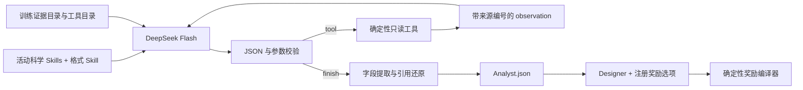

# 固定格式与证据工具 API 工作流

本接口为 `evidence-tools-json-v1`。研究 Skills 与格式 Skills 分开：前者决定分析
哪些科学问题，后者只规定如何请求工具、引用已读资料和交付结果。删除某个研究
模块后，公共接口不会要求模型重新执行被删除的功能。

## 故障成因与修复边界

旧接口一次传入完整证据、全部引用枚举和重复 schema，模型自行抄写表名与行号。
旧失败包括根字段 `design_recommendation`、假设引用不存在的
`survival_effects:579`、超过 12 条 findings，以及 Reviewer 改写引文。它们不能
单独证明某个科学模块必需，尤其失败也发生在 full 条件中。

新接口不猜测或自动改写错误编号，不丢弃多余 findings，不用保留 M2 假装成功。
主张是否受到科学证据支持仍须评估；格式通过只能证明可解析、来源存在和数据交接正确。

## 分步调用

这里使用 ReAct 的 action/observation 循环；不要求模型交付私人推理过程。
每次通过稳定的 Chat Completions JSON 模式发送 `action=tool` 或 `action=finish`，
服务端工具返回作为下一条观察消息。没有伪造原生 `tool_calls`。将来如改为原生
function calling，必须使用供应商真实返回的调用 ID，并单独升级接口版本。

DeepSeek 的 [JSON 文档](https://api-docs.deepseek.com/guides/json_mode/)
要求明确提示 JSON、设置 JSON 响应模式与足够输出预算；本实现三者均设置。
JSON 模式只约束 JSON 形态，不替代本地 schema 和来源校验。
工具机制参考 [DeepSeek 官方工具文档](https://api-docs.deepseek.com/guides/tool_calls/)
与 [ReAct 原文](https://arxiv.org/abs/2210.03629)。

## 六个工具

| 工具 | 输入 | 确定性输出 |
|---|---|---|
| query_evidence | 表、特征字符串、数值排序键、offset/limit | 真实记录、匹配总数、下一页位置 |
| get_evidence | 已知原始 source IDs | 真实记录与程序分配的引用 handle；不存在时明确报错 |
| get_curve | 真实 feature 名 | 完整观测节点、拟合参数、拟合诊断、支持范围 |
| read_metadata | 注册的元数据 section | 目标、时钟、限制或教师元数据 |
| read_definition | 注册的定义 key | 实际几何公式、单位和语义 |
| read_field | 已读 handle、字段路径和页码 | 大型嵌套记录的明确分页 |

所有弱证据、零效应、失败对照均可访问。没有默认 q 值截断或仅精英筛选。
每页最多 24 行，单条观察最多 48 KB；超限返回工具错误，要求更小页码，而非
偷偷截断。大容器明确标注 summary，不能把未读取的数值当作已获证据。
工具无任意路径、shell、网络或代码执行能力，也不读取当前生成 performance。

## 输入、提取与输出

证据目录需要 `packet.json`、`index.json`、`continuous_functions.json`、
`observable_definitions.json`，沿用现有精简统计存储格式。
`run_agent_workflow.py` 提供 `--role`、`--evidence-dir`、`--instructions`、
`--task`、`--output-dir`，Designer 另接 `--choices` 和 `--handoff-dir`。

Analyst 线格式固定为 `role/findings/hypotheses/limitations`。findings 用 `claim`
和 `evidence_refs`；hypotheses 用 `statement/evidence_refs`，其 observable、direction、
scope、falsifier 是可选信息。没有科学 findings 数量上限；总输出、上下文和调用轮数
有独立工程预算。程序分配 F/H 编号，并还原原始 `evidence_ids`。

Designer 从程序枚举的 `Cxxx` 选项中选择合法修改，或 retain/defer。
温度不在可改参数中；区域选项要求 Analyst 实际引用相关区域证据。
线格式的 `edit_choice` 由程序转换为既有 `edit.parameter/value`，然后使用现有
FLOWR 奖励编译器。模型生成的 Python 不会执行。

Reviewer 选择来自实际回答的 S 编号。程序按 chain、JSON pointer、字符串起止
位置提取逐字引文；不再让 Reviewer 重写引文。科学功能评分仍由 Reviewer 做，
引文来源真实并不自动意味着评分正确。

每次调用保存请求内容地址、供应商原始回答、提取后的 JSON、工具观察、来源
SHA256 与最终绑定。凭据不写入这些文件。缓存须重新通过 schema、原文校验值
和来源校验；改变请求或损坏缓存会失败。最多一次格式修复、有限网络重试；
重复工具请求、超预算、截断回答均明确失败，绝不产生伪造的成功奖励。

## 与消融队列集成

`ablation.agents.call_role` 和 `review` 支持
`interface_mode="evidence-tools-v1"`；科学实验 runner 配置支持
`agent_interface: "evidence-tools-v1"`。

已开始的实验接口不可中途切换。默认仍为 `direct-v4`，保持正在执行的 full/drop
条件一致。采用新接口须另建版本化 study，在 full 与 drop 两侧共同采用新接口，
不能将本次小规模格式测试冒充新的分子生成消融结果。

## 测试入口

`run_agent_interface_checks.py --output-dir <独立目录>` 使用三个小案例：完整科学
指引下的证据查询、14 条 findings 格式回归、删除 A1.1 的科学指引。另测试真实
Designer 交接、奖励编译与 Reviewer 引文提取。所有调用要求实际
`deepseek-flash`，沿用温度 0，不进行温度消融或分子生成。

通过这些案例不保证未来所有 LLM 回答无异常。其证明范围是本次真实 API 调用、
严格字段提取、合法引用、工具操作和确定性编译。生成质量与模块必要性仍应在
独立、接口一致的 full/drop 分子实验中评估。
