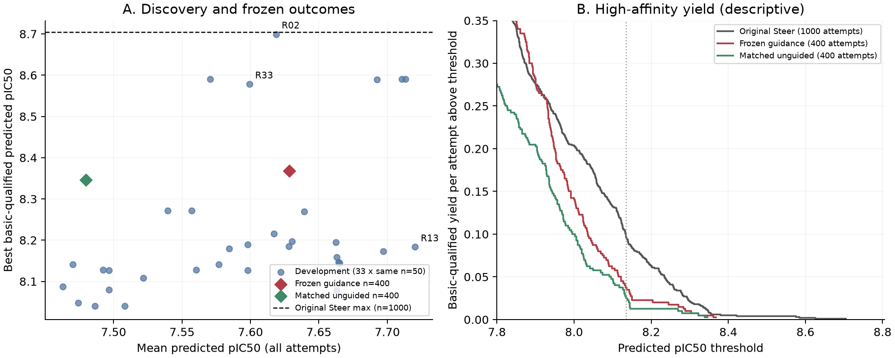

# v3 最终结果

完成 35 个条件：33 个开发条件及两个冻结确认池。确认严格复用冻结奖励，没有依据确认结果重新调参。

| 条件 | 尝试数 | 全部尝试平均 pIC50 | 基本合格最高 pIC50 | 高尾部效用 Uτ | 当前 PB 全通过 | MMFF 中位数 |
|---|---:|---:|---:|---:|---:|---:|
|original_Steer|1000|7.6515|8.7048|0.011360|945/1000|0.5303|
|R15_compatible_reused_development50|50|7.7108|8.5901|0.009102|48/50|0.5634|
|R02_v3__selected_development50|50|7.6187|8.6994|0.011287|46/50|0.5716|
|R34_v3__guidance|200|7.6590|8.3682|0.004214|186/200|0.5322|
|R34_v3__unguided|200|7.5107|8.3464|0.004530|186/200|0.5353|
|R35_v3__guidance|200|7.5975|8.3222|0.003240|188/200|0.5361|
|R35_v3__unguided|200|7.4491|8.1443|0.000081|187/200|0.5385|
|frozen_400__guidance|400|7.6283|8.3682|0.003727|374/400|0.5327|
|frozen_400__unguided|400|7.4799|8.3464|0.002305|373/400|0.5363|

合并确认的配对平均差：**0.1484 pIC50**，按八个初态批次 bootstrap 的 95% 区间 [0.1257, 0.1712]。Uτ 差 0.001422，区间 [-0.000620, 0.003463]。预定双池确认通过：**False**。

- R34_v3：平均差 0.1483，Uτ 差 -0.000316，预定标准通过=False。
- R35_v3：平均差 0.1485，Uτ 差 0.003159，预定标准通过=True。

本轮新增终态尝试共 2532，包含开发、匹配控制、冻结确认和冒烟/续生成诊断；原始 Steer 与继承参考只复用，没有重新生成。所有新增生成完整到 t=1；控制结束后走原生后缀。

PB 为同一当前 dock 检查；未解决不算通过。MMFF 为先松弛氢、再松弛全结构的局部能量下降/重原子，单位 kcal/mol/重原子，非结合能。失败、评分覆盖、基本合格条件均保留；详见 comparison.csv。

开发极值存在重复搜索偏差，Steer 的 1000 个谱系样本与确认的 400 个样本预算不同；固定 seed=42 的已知靶点/教师实验不是跨靶点泛化证据。历史基线保持不变。

[逐轮科学解读与奖励公式](../scientific_readout.zh-CN.md)
