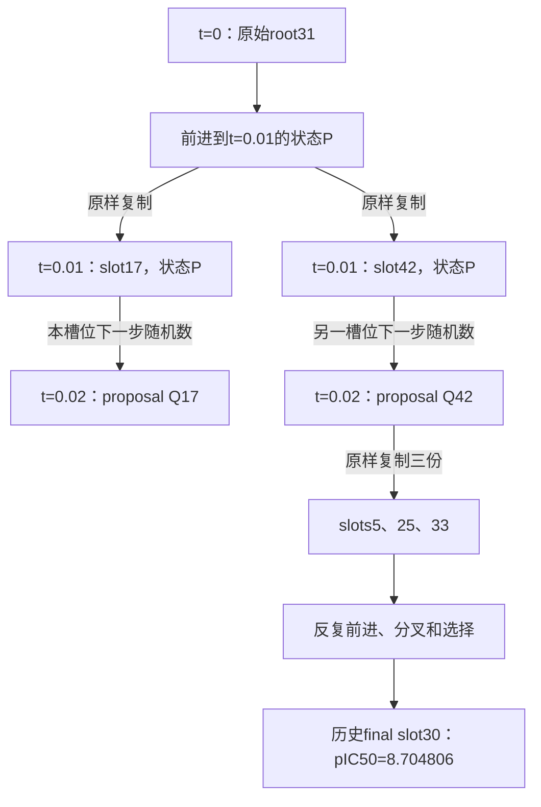

# 优质初态逐项核对，以及SMC路径为什么不能只靠起点重放

快照：2026-10-18 18:12:01，北京时间。下载并校验2810条完成结果，14个条件各200例，N/C R11有10例，另外两个条件尚无完成结果。本次仅分析已有数据，没有新调用LLM、FLOWR或affinity head，也没有修改正在运行的奖励和推理代码。

## 1. 先明确核对结论

**已经完成的2810例均绑定到原Steer优质终态对应的真实t=0祖先状态；未发现重新抽取随机初态、取错终态槽位或混入名单外起点。** 但**没有重放原Steer胜出谱系的后续随机数**。起始张量一致与随机路径一致，是两项独立要求。

核对不是只检查一个seed整数，执行了以下独立检查：

1. 从20批、1000个原始终态重新按`pic50_on_rescore`降序排序；同分依次按batch、slot排序；与冻结200席位名单逐项比较。
2. 沿每一步`selected_indices`反向追溯，独立计算每个终态真正的t=0 root，并与`final_records.root_slot`和逐步`root_slot`交叉核对。不能直接把final slot当作initial slot。
3. 对保存轨迹核对`current[k+1] == proposal[k][selected_indices[k]]`，坐标、原子类别、键、电荷均逐字节核对。
4. 核对原`initial_state.prior`、`restart_step_000.current`及轨迹t=0状态一致。
5. 将18份导出输入与原始祖先切片比较，包括prior全部字段、pocket全部字段、口袋COM和坐标尺度。坐标、原子类别、键、电荷、mask均保留精确字节身份。
6. 对全部完成记录核对冻结attempt身份、输入文件SHA、后缀随机流标识及输出文件SHA，并将worker记录的原生生成源代码SHA与本次从远端取得的源码核对。

证据边界：各次推理没有另外保存一个独立的“进入模型前t=0张量转储”。结论由原始/导出张量精确比较、实际加载代码和逐例输入绑定共同支持，不冒称另有未保存的运行时张量证据。

| 条件 | 前5%完成/50 | 前10%完成/100 | 前20%完成/200 | 已完成记录输入核对 |
|---|---:|---:|---:|---|
| 无引导 | 50 | 100 | 200 | 一致 |
| M2 | 50 | 100 | 200 | 一致 |
| Top10全局0–0.5 | 50 | 100 | 200 | 一致 |
| S3 | 50 | 100 | 200 | 一致 |
| 恒定混合λ=0.5 | 50 | 100 | 200 | 一致 |
| C3 | 50 | 100 | 200 | 一致 |
| 恒定混合λ=0.25 | 50 | 100 | 200 | 一致 |
| C2 | 50 | 100 | 200 | 一致 |
| W1 | 50 | 100 | 200 | 一致 |
| W3 | 50 | 100 | 200 | 一致 |
| S1 | 50 | 100 | 200 | 一致 |
| 线性衰减 | 50 | 100 | 200 | 一致 |
| Top10全局0.1–0.5 | 50 | 100 | 200 | 一致 |
| Top10局部0.1–0.5 | 50 | 100 | 200 | 一致 |
| N/C R11 | 8 | 9 | 10 | 这10例一致；其余未完成 |
| motif R15_v2 | 0 | 0 | 0 | 输入配置已核对，暂无实际完成记录 |
| ancestor R02_v3 | 0 | 0 | 0 | 输入配置已核对，暂无实际完成记录 |

后两个条件不能写成“已实际验证200例”。N/C先执行排名1、50、100、200的健康检查席位，随后补齐其余席位，所以10例部分结果不能视为随机抽样面板。

## 2. 前5%、前10%的样本数与重复祖先

| 集合 | 原始终态席位数/新生成数 | 不同t=0祖先数 | 其中原终态有效连通数 | pIC50截断值 |
|---|---:|---:|---:|---:|
| 前5% | 50 | 11 | 47 | 8.2387142181 |
| 前10% | 100 | 14 | 96 | 8.1359500885 |
| 前20% | 200 | 18 | 188 | 8.0270271301 |

筛选定义沿用此前约定：按全部1000个有限head分数排序，没有悄悄增加终态有效性筛选。因此存在少数原终态结构失败的席位，表中明确保留。若以后改成“有效分子中的前5%”，需要登记为另一套名单和实验。

三组嵌套：每方法只生成200席位的并集，前5%统计只读取排名1–50的50个结果，前10%只读取1–100的100个结果；不是各组再随机补满200，更不是350个独立样本。重复祖先是原SMC复制形成的事实：多个优秀终态可能出自同一初态。保留这些终态席位时，同根席位加载相同t=0张量，但使用不同的新后缀随机流；各方法对同一席位使用相同的新随机流。

“输入相同”具体对应：`worker.py`从已验证的压缩状态文件切出`prior`和`pocket_target`，直接传入`model._generate(prior, pocket, ...)`。原生`_generate`以clone(prior)建立current，不在这里重新抽一个prior。

## 3. M2是否因为使用优质起点而变差

必须把绝对分数与相对本池无引导的增益分开。

| 起点池 | N | 无引导均值 | M2均值 | M2相对无引导增益 | M2有效最高 |
|---|---:|---:|---:|---:|---:|
| 历史报告冻结普通起点池 | 3000 | 7.47852 | 7.67159 | +0.19307 | 8.88164 |
| 历史固定对照池，batch6376–6383 | 400 | 7.49508 | 7.70475 | +0.20967 | 8.34576 |
| 本轮前5%祖先 | 50 | 7.52726 | 7.66918 | +0.14192 | 8.13509 |
| 本轮前10%祖先 | 100 | 7.47802 | 7.61969 | +0.14167 | 8.13509 |
| 本轮前20%祖先 | 200 | 7.44458 | 7.63356 | +0.18898 | 8.17798 |

本轮前20%的M2较历史固定400池低0.07119，但无引导本身也低0.05050；引导增益差是-0.02068。相对冻结3000池，引导增益仅差约-0.00408。前5%的M2均值又与历史3000池接近。因此，不能笼统归纳为“选优质初态使M2失效”。历史3000次的8.8816与本次50/100/200次的Best，也不是等发现机会比较。

本次可恢复运输表去重后还组成另一份3400席位的历史文件合集，其M2/无引导均值约7.67549/7.48047。它与上述冻结3000报告不是同一统计池，另外记录在`M2_pool_sizes.csv`，没有覆盖旧报告。

### 多数方法是否出现类似下降

| 方法 | 旧普通池N | 旧均值 | 本轮200均值 | 旧池相对无引导增益 | 本轮相对无引导增益 |
|---|---:|---:|---:|---:|---:|
| M2 | 400 | 7.70475 | 7.63356 | 0.20967 | 0.18898 |
| λ=0.5 | 400 | 7.72459 | 7.64680 | 0.22951 | 0.20223 |
| λ=0.25 | 400 | 7.71382 | 7.63169 | 0.21874 | 0.18711 |
| 线性衰减 | 400 | 7.59693 | 7.52064 | 0.10185 | 0.07606 |
| S3 | 400 | 7.73650 | 7.63765 | 0.24142 | 0.19307 |
| C3 | 400 | 7.71553 | 7.63674 | 0.22045 | 0.19216 |
| C2 | 400 | 7.70617 | 7.63506 | 0.21109 | 0.19048 |
| S1 | 200 | 7.62407 | 7.67524 | 0.13284 | 0.23066 |
| W1 | 200 | 7.65899 | 7.62890 | 0.16776 | 0.18432 |
| W3 | 200 | 7.71624 | 7.61291 | 0.22501 | 0.16834 |
| Top10全局0–0.5 | 400 | 7.74304 | 7.68887 | 0.24795 | 0.24429 |
| Top10全局0.1–0.5 | 400 | 7.65092 | 7.58404 | 0.15584 | 0.13946 |
| Top10局部0.1–0.5 | 400 | 7.51082 | 7.51775 | 0.01574 | 0.07318 |

13个可比较的完整引导条件中，11个绝对均值下降、10个本池增益下降。S1和局部延迟在两个口径都提高；W1绝对均值下降但增益提高。Top10全局增益基本保持（0.24795→0.24429）。

这些是描述性跨池差异，不是“优质起点选择的因果效应”：旧批量B50与本轮B1不同，初态组成、后缀随机流和有效独立根数也不同。本次仅18个独立根，并非200个独立初态。需要保持同一种执行与噪声协议，才可进一步隔离起点筛选的影响。

## 4. SMC究竟做了什么

把每个candidate想成一个正在拼装中的分子，每一小步都根据当前状态、口袋、自条件信息和本步随机数继续拼装。

SMC周期重复：**各自前进 → 评分 → 按分数抽取下一轮名单 → 复制被多次抽中的状态 → 各后代继续独立前进**。复制的是完整状态及相关模型上下文，不是不同分子的坐标平均，不是片段交叉。

在本项目保存的单目标实验中，评分来自target的模型预测，概率为target分数的softmax；采样有放回，总数保持B。原上游selective函数通常组合on/off权重，本次`single`捕获代码明确将抽样权重替换成target权重。不能把双目标混合公式冒充本次单目标公式。

这些操作对应标准粒子方法的传播和重采样；重采样会把更多计算机会分配给当前高权重区域，并不保证保留未来真正最优的分支。[Doucet与Johansen教程，§3.4–3.5](https://www.stats.ox.ac.uk/~doucet/doucet_johansen_tutorialPF2011.pdf)。

用户关于“不会被其他分子状态混入”的理解是正确的，但要区分：

- **传播不混合状态：** 给定自己的完整状态、口袋和随机数，一个后代按模型独立更新。不存在把另一候选坐标平均到它身上的步骤。
- **繁殖概率依赖同批其他分数：** 它的softmax权重需要同批分母，因此竞争会影响获得0、1或多个后代。
- **槽位不是固定的分子身份：** slot只是数组位置，下一轮可以被另一个父本填入。要沿父子索引才能识别同一条谱系。

实际函数通过`value[selected_ids]`复制current、prior、self-conditioning和口袋上下文；不是从头再初始化被复制的分子。[FLOWR源码](https://github.com/jule-c/flowr_root/blob/main/flowr/models/fm_pocket.py)。本次审计也已用历史轨迹逐字节验证该索引关系。

## 5. 用真实最优候选说明分叉

历史`F_b011_s030`的t=0祖先是**batch11、root31**，不是slot30。本轮正确加载的正是root31。该历史最优谱系最初几步为：

第一轮两个复制后代坐标完全相同；下一步两个proposal的坐标RMS已相差约**0.107911 Å**。这是原数据中的实际差异，不是虚构分数示例。36个步骤上，该胜出谱系的当步父本拥有多个后代；到t=0.24时，该批当前50个候选已经全是root31的不同后代。终态最优是这些分叉之后的一条结果，而不是t=0时就已经藏好、只需读取的唯一分子。

此图没有给slot17分支虚构失败标签；它仅说明相同复制状态如何在后续随机传播中分开。完整100步父子表见`best_original_lineage.csv`，精确复制与下一步差异见`best_original_clone_examples.json`。

## 6. “未继承选择和噪声历史”应如何准确表达

需要纠正过强的说法：**原Steer噪声并非原则上不能复现；当前实验只是没有实施这项重放。** 在完整状态、实际随机输入、数值设置及执行环境相同的条件下，原生轨迹原则上可重放；位级一致仍需实测。

当前明确区别如下：

| 内容 | 原Steer | 本轮对齐实验 |
|---|---|---|
| 初始分子状态 | 保存的batch50先验 | 从该先验精确取出真正祖先；一致 |
| 后续随机数 | 原全批量共享生成器继续抽样 | 每个终态席位重新设定后缀流 |
| 同根分叉 | 中途复制，子代继续探索 | 每席位从t=0独立续推 |
| 繁殖/筛选 | 在窗口内反复执行 | 禁用SMC |
| 坐标更新 | 原生更新 | 原生更新加奖励位移 |

对`F_b011_s030`，原batch的整数seed为`42 + 100003×11 = 1100075`；本轮后缀标识为`3766927489`。这两个值控制的是不同调用形状与序列，后一个不用于生成初态。

更关键的是，原生成器按全批量张量抽取连续坐标噪声，并对原子、键和电荷进行类别抽样；重采样本身还调用`torch.multinomial`消耗随机数。复制后，后代换到不同槽位，获得该槽位下一轮的随机输入；没有随候选复制一个私有RNG。[FLOWR积分器](https://github.com/jule-c/flowr_root/blob/main/flowr/models/integrator.py)。因此，即使改用同一个整数seed，只要删掉重采样、改变B或抽样调用顺序，也不能保证拿到胜出后代当年的逐步随机数。

把随机数看成连续抽取的一叠卡片：原来50个位置每轮各领卡，复制会把候选放入不同位置；现在只有1个位置，发牌顺序已经不同。保留出发点不等于保留沿路每张卡。

模型本身采用flow matching，不意味着本次采样完全确定。额外读取checkpoint元数据（CPU的meta/mmap模式，未运行模型）确认其保存的坐标噪声默认值为0、SDE默认值为false；但原实验脚本明确把SDE设为true、坐标噪声设为0.2，本轮冻结配置也使用这两个值。不能用训练checkpoint的默认值推断这次推理没有后续噪声。`checkpoint_metadata.json`保留了读取值，实际执行覆盖值见冻结config及逐方法`source_audit.json`。

“选择影响路径”应表述为：选择不修改一条已存在路径的历史状态，不把其他分子的几何混入；它改变哪些后缀分支继续计算、复制次数及有限计算预算的分配。在实现中也会改变随机数消耗与槽位归属。若人为固定完整父链的随机输入，一条已胜出的谱系不需要其他候选的坐标才能继续。

另外，即使重放相同随机输入，开启非零gradient guidance也会改变更新和之后的模型预测，所以“引导比无引导是否更好”是配对干预问题，不应要求引导结果逐坐标等于原Steer。

## 7. 为什么好祖先不能保证好后代，以及后续如何验证

原Steer选出来的是**完整随机路径的幸存者**。只按终态成功回溯t=0，会把后续好运、复制后多次尝试和中途选择带来的成功也归到同一个root；root本身不一定有稳定的高成功概率。当前无引导中，历史最优席位的新后缀得到7.493682，M2得到8.016077，Top10全局得到6.854220，S1得到7.387886；这些都正确从同一个root31开始，却不是原历史路径。

M2的奖励则是几何教师相似性代理，不是“此状态最终产生高亲和力分子的条件成功概率”。即使输入初态正确，错误的教师适配或全局牵引也会改变原本可能较好的局部接触；此前保存的正反例仍成立。多数条件的绝对均值下降，不能单独证明初态错误、SMC存在候选间几何互作，或原先M2高分不真实。

本次还发现一个边界差异需要保留：原Steer按评分时钟使用`0<=t<=0.5`，实际有51次重采样，最后一次选择的是积分后t=0.51状态；当前全窗口gradient guidance注入前50步并停在状态t=0.5。它不影响本次t=0一致性结论，但说明本实验也不是原算法完全相同的路径重放。

若要进一步隔离原因，建议按顺序设计，尚未在本次启动：

1. **历史路径重放检查：** 先取原最优所在批的保存RNG与完整上下文，使用冻结旧执行设置验证原SMC轨迹/锚点可复现，控制关闭；若不一致，定位最早分歧。
2. **胜出父链原生重放：** 沿真实谱系记录实际逐步连续噪声和类别随机输入，关闭SMC、关闭gradient，只跟随这条已知路径。应先验证能重现历史锚点，才可称“历史噪声对齐”。原有RNG锚点支持全批量重放，但不是已经保存好的单候选私有噪声带。
3. **同噪声的guidance干预：** 在已验证的父链噪声带上加入奖励，与其零引导配对比较，检验奖励是否损害原本成功的方向。
4. **条件成功率：** 每个独立root和中间状态重复多条新噪声续推，分别估计无引导与不同局部奖励的收益，而不是把同根的多个历史优秀终态当成独立好起点。

这些实验分别回答“能否重放”“奖励是否改善已成功方向”“是否提高新噪声下成功率”。当前对齐实验主要回答最后一项的单后缀、回溯席位版本，不能替代前两项。

## 8. 可复核数据和入口

- `audit.json`、`conditions.csv`：总体与逐条件输入核对。
- `initial_roots.csv`：18个祖先的精确张量、口袋及文件身份。
- `elite_attempts.csv`：200席位、独立反向root、阈值归属和随机流。
- `receipt_inputs.csv`：2810条完成记录的输入绑定。
- `current_performance.csv`：本次快照的三个阈值组评分汇总。
- `historical_pool_comparison.csv`：13个完整引导条件的旧池与新池比较。
- `pool_comparison_audit.json`：比较源文件SHA和解释限制。
- `best_original_lineage.csv`、`best_original_clone_examples.json`：原最优谱系与复制后分叉证据。

设置`PYTHONPATH=src`，使用`python -m evomolsteer.elite_alignment.initial_audit`及`python -m evomolsteer.elite_alignment.pool_comparison`；二者均提供repo/config/work/output接口。前者可额外输入从远端取得的`fm_pocket.py`，核对已运行worker的原生源码SHA。无新推理、无新head调用。
