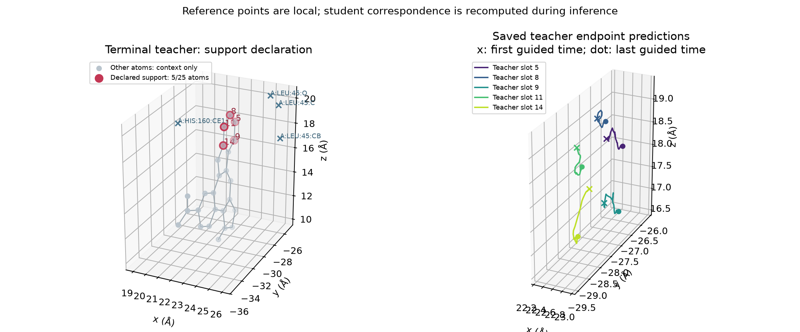

# 本轮局部奖励的证据与实际执行

## 具体参考了哪些点

首轮真实DeepSeek Analyst从54个候选区域的6个初筛区域中，选择F_b011_s030教师的槽位[5,8,9,11,14]。这5点在教师终态均为芳香碳，对应一段局部芳香骨架。附近口袋背景包括LEU45与HIS160；本轮没有启用显式口袋相互作用或化学类型奖励。

图中灰点仅用于展示教师完整结构，不进入新奖励。左图是教师真实终态；右图是本轮实际使用的教师预测端点随forward时间的变化，两种表示不能混为一谈。点号是教师槽位；生成分子的对应点在每步重新匹配，并非固定生成原子编号。

实测高质量终态与其余已观察终态的对比，排除教师整条root后，保留60个高质量结果和860个其它结果，按root平衡、按来源批次bootstrap：

|误差指标|其它组减高质量组，Å|探索性95%区间|
|---|---:|---:|
|局部逐点误差|0.10273|[0.03399,0.16757]|
|局部内部距离误差|0.19725|[0.06735,0.32360]|
|局部口袋距离误差|0.04147|[0.01099,0.07453]|
|扣除整体误差的增量|0.06512|[-0.04497,0.17426]|

前几项正向关联不能证明超出整体相似度的独立作用；最后一项区间跨零。区间未作多重比较调整，教师也是事后选择，因此只用于提出可检验假设。其它终态不是谱系灭绝分支的失败真值。

## 两个Agent分别做了什么

首轮Analyst的三次实际查询全部调用`local_support_evidence`，每轮读取两个不同区域，合计六区；没有把未调用的ancestor或selection_trend工具写成已经调用。终态对比和单条教师51个时刻的趋势拟合通过该工具交付。父程序的评分和控制响应由工作流直接提供。

Analyst输出选区、`controlled_feature=point_error_A`、证据引用、支持理由和否证条件。Designer必须选择同一个科学组内的注册选项；编译器将选项变成真实`mode_specs.atom_slots`和算子。区域、算子、时钟、有效项及覆盖预算再次确定性校验，不能靠自由文字偷偷扩大成原20点支持。

后续有真实推理反馈时，Analyst和Designer都必须引用实际父程序的控制响应及评分；Designer只能引用实际交付给它的证据ID。该约束已加入本地校验和模块测试。不能仅把教师统计复制给Designer，而不告知上一轮是否形成、保持及带来亲和力收益。

## 实际奖励和梯度

设当前生成状态为x，生成器本次预测端点为y=F(x,pocket,t)。教师q(t)是同一forward时刻保存的预测端点，仅取所选5点。使用停止梯度的匹配A，把生成点对应到这些教师点；保留R02的元素感知匹配代价0.5，但没有直接的原子类型或电荷奖励。

逐点位置奖励为：

\[
R=-\frac{1}{k}\sum_{i=1}^{k}\delta^2\left(\sqrt{1+\|y_{A_i}-q_i(t)\|^2/\delta^2}-1\right),\quad k=5,\ \delta=1\;\text{Å}.
\]

实际回传为本次真实FLOWR生成器的坐标VJP：

\[
\nabla_xR=J_F(x,t)^T\nabla_yR.
\]

这不是对affinity head求导，也不是对剩余全部随机生成路径求导。函数只参考5个教师点；模型的坐标耦合仍可让其余生成原子收到间接梯度。不能把“局部奖励支持”误写成“只有5个输入坐标能移动”。

控制器按原生坐标更新的RMS归一化梯度，使用0.66的原生更新比例，每原子每步最多0.15 Å、累计RMS预算6 Å；40个控制步后继续原生后缀到1.0。时间范围和参数读取冻结程序。本轮保留这些R02参数用于支持对照，而非声明它们是局部最优剂量。

## 需要用结果区分的解释

1. **局部信息是否具有价值。** 5点位置更像教师但pIC50下降，不能证明该区域足以优化亲和力；还可能缺少元素布局或其它区域的兼容性信息。
2. **位置是否约束过强。** 逐点奖励同时约束局部位置和形状。内部距离奖励允许局部整体平移/旋转由原生口袋条件决定；口袋距离奖励则明确约束区域相对口袋的位置。两者应独立测试，不在文字中混同为已激活。
3. **剂量是否被集中。** 相同全分子RMS预算在小支持上可能产生更大的局部位移；必须读取实际位移和裁剪，而非只比较共同的0.66。共同乘reward的正系数会被归一化抵消，因此后续校准的是归一化后的请求位移比例。
4. **低阶段教师是否可靠。** 成功终态的早期预测端点也可能不稳定。局部轨迹拟合仅是诊断，不能把时间导数当成坐标奖励梯度。
5. **形成是否保持。** 实际奖励匹配槽位和观察性半程几何匹配分别保存；半程比较半程教师，终态比较真实终态教师，不能把教师正常演化误当失配。固定槽位追踪与终态重新识别空间模式同时报告：前者看同一批点的去向，后者看空间模式是否仍存在，两者不能相互替代。端点预测的最后一步误差是更新前的forward读数，并非更新后的半程结构误差。

所有结论优先使用当前GPU重新计算的配对对照。严格历史回放失败及硬件差异单列，不因均值接近而忽略逐路径差异。50例探索不直接推断全1000例或其它靶标。
