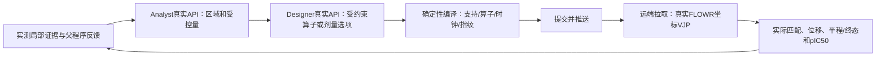

# 少量局部特征的实际推理探索：完成报告

日期：2026-10-19。远端：ksai.scnet.cn:50258。

本轮已经完成清理、局部特征挖掘、真实 Analyst/Designer 调用、奖励编译、远端完整推理和本地校验。**局部特征确实进入了奖励与梯度计算，但目前没有取得高于配对无引导或历史 Steer 最优值的结果。** 不将失败的新程序替换为默认最优 checkpoint。

## 1. 清理及实验边界

远端旧产物先流式归档到本地，逐文件验证后移除8份重复归档，实际释放155,468,991字节，约148.27 MiB。目录和校验值见 [cleanup_receipt.json](cleanup_receipt.json)。原 Steer、模型、教师、报告、起始张量、随机输入回放材料、FLOWR源码与共享依赖保留；没有删除整个 experiments 根目录。

全部正式比较使用相同50条历史路径，执行批量B50：来自历史前20%路径清单的第一组，按来源批次/终态槽位排序，涉及7个原来源批次。**它不是全局前5%，也不是50个独立随机起点。** 初始张量直接读原文件，每步按原保存RNG状态、原始调用形状及谱系槽位重建随机输入，当前各方法共享这些输入。

100步推理至t=1；局部引导沿用R02配置中的0.1–0.5，共40个控制步，之后原生无引导完成。配置读取窗口，算法没有将0.1或0.5写成通用固定边界。关闭SMC，无affinity-head导数，无每步额外affinity推理；保留模型原生参数requires_grad标志，参数未更新。坐标VJP来自真实FLOWR生成模型。

### 跨设备严格回放未通过

当前设备为K500SM_AI，历史为K100_AI。零引导对历史最大中间坐标误差0.007971 Å、终态0.001068 Å、终态pIC50误差0.00029564，超过原1e-5要求。终态离散类别一致，中途有2项键类别差异。去掉内存包装的完整零引导重复得到逐元素相同的状态；high/highest矩阵精度探针也相同。

因此没有放宽严格门槛：另立 `current_runtime_paired_diagnostic`，重新计算当前环境的No guidance与冻结R02对照。其后经输入、程序、教师、执行源码、设备/库及产物指纹校验复用，未反复生成。历史RNG状态匹配不等于已经单独证明跨GPU随机浮点原语逐元素相同。本文是当前环境配对诊断，不能写成跨GPU精确历史复现通过。

## 2. 实际挖掘和使用的区域

确定性工具从教师终态的图邻域、空间邻域和口袋邻近区域提出候选。覆盖规则由配置给定：最少2点、最多占分子32%；对25原子教师，上限为8点，对100原子教师则为32点，没有固定20点规则。本次产生54个区域，6个进入探索短名单。

Analyst实际选择教师 `F_b011_s030` 的 **[5,8,9,11,14]，5/25点=20%**，来自深度2的图邻域。它们在教师终态均为芳香碳。原冻结R02使用另外20点，本轮并非仅修改解释文字后继续使用那20点。

静态终态差异在排除教师整个根谱系后计算，剩余60个Quality67阳性、860个其他有效终态、22个根、19个原批次。先按根汇总，按原来源批次bootstrap，避免克隆数被当作独立证据。

|局部量|其他组误差减高质量组误差，Å|探索性95%区间|
|---|---:|---|
|逐点位置误差|0.10273|[0.03399,0.16757]|
|内部距离误差|0.19725|[0.06735,0.32360]|
|相对口袋距离误差|0.04147|[0.01099,0.07453]|
|相对整体相似度的增量|0.06512|[-0.04497,0.17426]|

前三项支持局部描述性关联，**最后一项跨零，不能证明其超出整体相似度提供额外信息**。六个短名单区域的该增量区间全部跨零。区间未经多重比较校正，区域也未经独立留出验证，不能当作确定的亲和力原因。

Quality67不是纯亲和力标签。原生成脚本 `outputs/ck2_original_steer_analysis_20261013/scripts/analyze_ck2.py` 定义为：有效连通、有效分子pIC50前10%、完整PB通过、能量收敛、单位重原子应变不超过有效分子P75。这个复合标签适合研究质量兼顾的终态，却可能稀释当前“亲和力优先”的选区目标。

单条教师的全学习窗口轨迹另作多项式拟合及时间变化率分析；没有把单条教师曲线称为群体富集，也没有把时间导数冒充空间奖励梯度。静态证据测量真实终态坐标、采用纯几何对应；运行时控制模型预测端点、采用带元素停梯度代价的对应。这是明确的表示/匹配转移假设。

## 3. Analyst、Designer和推理怎样接通

两角色均使用真实 `deepseek-flash` API，温度0。本地保存请求/响应、工具查询、技能快照、证据来源、简洁设计理由和交接哈希；远端不调用LLM。它们的权限不同：Analyst选择已经测量的区域和可控制特征；Designer在注册的受约束程序中选择算子或实际剂量。**这是受约束的程序设计，不是LLM自由编写任意Python奖励。**

- L01：Analyst选择5点；Designer确认位置误差，由编译器生成逐点奖励，其他数学设置保持R02。
- L02：读入L01的真实评分、位移、半程/后缀数据；固定5点，Designer改为内部距离奖励。
- L03：读入L02自身反馈；固定教师、5点、内部距离算子、时钟和窗口，仅调节归一化之后的请求位移比例。

`controlled_feature`、实际算子和 `local_feature_binding` 必须一致；Designer不能增加点或引用未交付证据。实际日志证明每条路径每个控制forward使用5个教师点，未回退到全点云。点匹配每步重新求解，不要求生成分子的原子序号/化学图等于教师。

元数据里的方向三元组和口袋位点不等于已激活对应力。本次L01只激活位置项，L02/L03只激活内部距离项，元素/电荷空间场权重为零。元素预测仅以停梯度代价0.5参与匹配，不是直接N/C布局奖励。真实模型坐标VJP会耦合其他原子，因此“直接奖励5点”不等于其余原子完全不动。

## 4. 实际奖励与强度

令 `y=FLOWR_endpoint(x_t,pocket,t)`，`q_t`为同forward时刻保存的教师端点预测，`π_t`为当前预测点与所选教师点的对应，S为5点支持。

L01沿用平滑位置势：

\[
R_1=-\frac{1}{|S|}\sum_{i\in S}\delta^2
\left(\sqrt{1+\|y_{\pi_t(i)}-q_{t,i}\|^2/\delta^2}-1\right),\quad\delta=1\,\mathrm{Å}.
\]

L02/L03使用内部距离带宽势：

\[
R_{2,3}=-\operatorname{mean}_{i<j\in S}
\left[\max\left(\left|\|y_{\pi_t(i)}-y_{\pi_t(j)}\|
-\|q_{t,i}-q_{t,j}\|\right|-b,0\right)\right]^2,
\quad b=0.348288449\,\mathrm{Å}.
\]

带宽由配置的0.25×教师中位键长得出，未将这个分子的数值写入通用Skills。条件固定对应下，该内部距离势不直接钉住区域质心；但整个控制器的动态对应仍依赖空间位置，不能声称整个算法完全平移不变。

对当前坐标求 `∇x R`，包含真实生成端点对输入坐标的VJP。更新方向经控制器归一化后注入。请求强度为相对原生坐标步的 `native_rms_ratio`：L01/L02为0.66，L03为0.369499507。单原子步上限0.15 Å、累计RMS上限6 Å，三轮均未触发这两项裁剪；调度均为constant。

共同乘奖励正系数可能在归一化时抵消，因此L03改变实际请求位移比例，而非只将奖励公式乘较小常数。名义参数相同也不能保证实际剂量相同。

|程序|实际支持|非零seed更新/全部|全体原子平均注入RMS Å|支持内平均RMS Å|仅非零更新的支持内RMS Å|
|---|---:|---:|---:|---:|---:|
|R02|20|2000/2000|0.029899|0.030136|0.030136|
|L01逐点|5|2000/2000|0.029524|0.047177|0.047177|
|L02内部距离|5|1117/2000|0.016429|0.030064|0.053829|
|L03降低剂量|5|1205/2000|0.009890|0.018556|0.030799|

内部距离带内不施力，所以1117/2000不代表少执行了控制步。L01局部位移约为R02的1.565倍；L02仅非零更新时为1.786倍。L03确实将这一条件剂量降至接近R02，证明强度改动实际生效。

## 5. 完整终态结果

以下各行均为相同50条路径。全部50条有有限pIC50，结构失败另报，未从均值中暗中剔除。高分阈值为冻结协议的8.25890198，**不是按这次重评分重新计算的P95**。应变为MMFF缓解能量/重原子，仅在可计算结构中统计。

|条件|均值|中位数|P90|P95|P99|Best/有效Best|高分数|有效连通|应变中位数|
|---|---:|---:|---:|---:|---:|---:|---:|---:|---:|
|原Steer匹配50路径|8.172205|8.134970|8.342219|8.365504|8.525717|8.625889|13|48|未在此表载入|
|当前环境无引导回放|8.172212|8.135003|8.342233|8.365427|8.525700|8.625954|13|48|0.695977|
|冻结R02|7.743585|7.920019|8.119040|8.154546|8.288716|8.326154|1|47|0.789488|
|L01：5点位置|7.420226|7.581181|8.077122|8.238876|8.285972|8.286546|3|49|0.715201|
|L02：5点内部距离|7.811585|7.904467|8.072307|8.108669|8.219952|8.273472|1|47|0.784257|
|L03：同距离、降低剂量|7.490459|7.505737|8.054140|8.069279|8.266774|8.268435|2|47|0.705625|

有效分子的PB通过数分别为当前无引导47/48、R02为47/47、L01为49/49、L02及L03均47/47。局部程序没有超过原Steer全1000条最高值 **8.704806**。原Steer全1000条均值7.651480、P95 8.238437与本次优质路径小池的抽样范围不同，不能拿小池较高均值宣称整体胜出。

配对均值差按7个原来源批次聚类bootstrap 10,000次：

|条件－对照|均值差|95%探索区间|
|---|---:|---|
|L01－无引导|-0.751986|[-1.493754,-0.190368]|
|L02－无引导|-0.360627|[-0.536031,-0.217578]|
|L03－无引导|-0.681753|[-0.939450,-0.191972]|
|L02－R02|+0.068000|[-0.207323,+0.312615]|
|L03－L02|-0.321127|[-0.649983,+0.076138]|

L02对R02只有未确认的均值改善，Best下降；L03不能支持“减小剂量即可解决问题”。小池、少批次、重复开发比较均限制推断，不将上述区间当作独立确认结果。

也存在个体改善：L01的路径F_b002_s001由配对无引导8.049973提高到8.286546（+0.236572），但只占少数，不能抵消总体下降或证明稳定的路由规则。

## 6. 形成、保持、价值分别发生了什么

使用最后实际奖励匹配的槽位追踪，真实半程对应真实半程教师、真实终态对应真实终态教师，另报终态重新空间匹配，避免时刻混用。

|程序|半程内部距离误差 Å|终态追踪内部距离误差 Å|终态追踪位置误差 Å|终态空间重匹配位置误差 Å|
|---|---:|---:|---:|---:|
|L01|0.203044|0.119150|0.502717|0.496290|
|L02|0.121339|0.180291|0.735922|0.669820|
|L03|0.132318|0.258110|0.761594|0.731889|

L01形成了较接近教师的局部空间模式，却得到更低亲和力。L02半程内部距离误差更小，终态有所回升；L03剂量减小后终态内部形状保持更弱。真实教师本身在半程到终态也变化，不能把不同时间的差值简单解释成纯粹的保持损失。

这些结果排除了“局部特征根本没有进入推理”这一解释，但没有证明某一结构机制是唯一原因。

## 7. 未达到目标的主要原因与下一步区分实验

1. **优势识别尚弱。** 5点的局部关联存在，但超出整体相似度的信息没有成立；复合Quality67标签还混合了能量和PB目标。下一步应以连续终态pIC50为主，分别控制整体相似度、原批次/根及结构质量，再在留出根/批次上评估局部增量，允许“本轮没有可靠区域”。
2. **静态终态关联没有证明适合在线端点引导。** 当前把终态几何优势迁移到同钟教师端点；未证明那个阶段的局部量预示同一路径的终态增益。下一步对每个拟控制量直接测量相应表示、同时刻的成功/对照差异，并用少量完整续生成区分可控性与价值。
3. **选中的是5个芳香碳的形状，没有直接控制关键化学互作。** 方向三元组、口袋位点和N/C标签目前只是背景。下一轮应让Analyst比较小型界面锚点/必要邻居与同大小几何对照，Designer明确启用相应口袋距离/方向或已验证的软类型场；不能仅修改选区解释。当前没有测试口袋算子，不声称它必然更好。
4. **几何服从性不是亲和力方向。** L01位置更接近教师而平均分更差，真实VJP只保证所选局部势的上升。下一步筛选的是“对该控制响应后，终态是否改善”的区域/路径组合，不能按大梯度或小loss自动分配模式。
5. **剂量集中是真实风险，但不是单一原因。** 支持减少后单点位移增加；L03校准后仍差，因此后续不能只重复加强/减弱同一代理，应先改善局部量的终态价值证据。不同剂量也可能改变离散结果和后缀，效果无需单调。
6. **历史成功路径本身已很强。** 无引导重放几乎保留原Steer这50条的质量，给每条施加同一教师局部模式可能扰动已成功的其他解。下一步应将保留原解与自由随机探索分开报告，并用真实反馈检验seed/模式兼容性，而不是强制所有seed向同一模式靠近。

不加入同图gate，不把化学图变化本身当作失败原因。本轮有限三种局部程序已完成，不扩大至1000例来追逐未经确认的极值；冻结R02及历史各checkpoint均保留。

## 8. 事实判读与工作流修正的验证

原L03 Analyst曾把“beyond-global区间跨零”写成支持额外信息，属于错误解读。原响应和冻结奖励不改写。新增确定性区间判读工具字段，并同时更新Analyst和Designer Skills，后者也必须核对该增量，不能照单接受上游宣称。

随后用相同真实证据、原错误句及实际终态数据进行两角色真实API小测试：两者均正确返回“增量未证实”“引导收益未建立”，并引用原错误句和正确比较量。8项定向检查通过，见 [validation.json](evidence_reading_verification_v2/validation.json)。这只验证该项指引被读取并改变了相应判断，不证明全部自由文字无误或生成性能得到提升。最初的小测试因解释字段超出长度约束失败，记录保留；随后缩小输入提取范围并重新调用，没有修改模型答案来伪造通过。

此前部分工具引用被误拒绝，原因是同一父程序反馈经controller_response交付，却被要求重复引用另一种固定ID拼写；已改为校验实际交付内容及父程序身份。接口失败均记录为未执行，不当作科学负结果。

## 9. 可复现入口和提交记录

- 挖掘：`evomolsteer.ancestral_modes.support_mining`。
- 实验准备：`scripts/prepare_local_feature_research.py`，本地真实API及受约束奖励编译。
- 派发/状态/收集：`scripts/deploy_local_feature_research.py`。
- 有限顺序队列：`scripts/run_local_feature_followups.py`，异常记录、恢复、数值相同程序复用。
- 当前结果分析：`evomolsteer.path_replay.local_research analyze`。
- 跨轮汇总：`evomolsteer.path_replay.local_summary --input MANIFEST WORK`，允许重复输入参数；验证完成记录/产物、相同有序路径和执行证据，共用对照只计一次。
- 区间指引小测试：`scripts/audit_local_contrast_reading.py`，真实API，不启动FLOWR。

跨轮CSV与全部来源见 [combined/summary.json](combined/summary.json)、[performance.csv](combined/performance.csv)、[paired.csv](combined/paired.csv)。共250次独立当前环境正式比较推理：2个对照各50、3个新局部程序各50；跨设备零回放/重复诊断和精度探针另外保留，未混入效果统计。

真实执行代码：L01为 `9d4678e203b2`，L02为 `23f7dc9b2594`，L03为 `209e395e8cd7`。各轮在本地提交/push后，远端拉取并从对应commit创建不可变runtime。后续分析/指引修正不覆盖已运行程序，最终提交见Git历史。

收集时逐项校验结构、评分、失败、状态、控制记录及完成收据。远端三组队列均已退出，当前显存2/65520 MiB，记录见 [final_remote_state.json](final_remote_state.json)。新结果远端保留独立目录 `experiments/evomolsteer_local_feature_research_20261019`，本地位于 `data/generated/local_feature_research_20261019`；无重复后台生成任务。

最终定向回归测试154项通过；两份Skills结构校验通过。测试覆盖局部支持实际改变可微奖励、数值梯度、真实端点导数路径、时钟、谱系/输入指纹、对照复用、受约束API提取和区间判读。单元测试不是亲和力有效性的替代证据；真实生成效果以上述250例正式比较为准。
