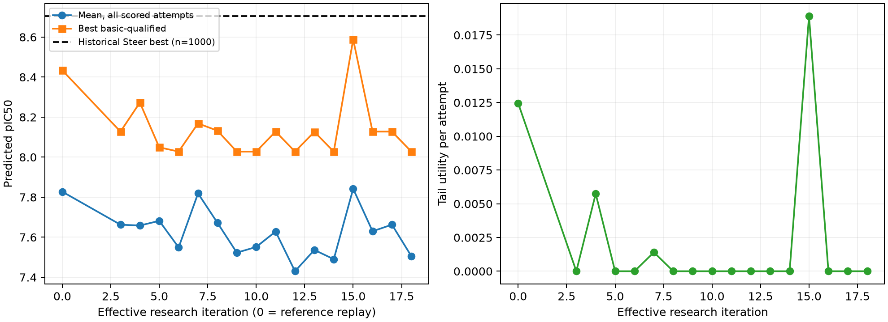

# 局部 motif auto-research v2：最终证据报告

已完成 18/20 个有效研究条件；另有 8 个相同函数提案复用已有结果，未重复生成。
原始 Steer 最优预测 pIC50 为 **8.704806**。本轮新生成从头条件（含S0参考重放及冻结确认）中的最高基本合格分数为 **8.588829**（R15_v2）；新探索程序最高为 **8.588829**（R15_v2）。
活动保留程序为 **R15_v2**。冻结确认是否通过：**否/尚未通过**。所有亲和力均为同一模型的预测，不能表述为实验结合亲和力。

## 1. 真实完成的条件

|有效轮|原始记录标识|阶段|单项改变|支持点数|平均 pIC50|最高合格|Uτ|合格/尝试|回滚|
|---:|---|---|---|---:|---:|---:|---:|---|---|
|1|R01|suffix|band_multiplier|20|8.112375|8.218711|0.026946|6/6|False|
|2|R02|suffix|local_intervention|3|8.017984|8.265260|0.042997|4/6|False|
|3|R03|from_zero|region|3|7.662645|8.127753|0.000000|24/24|False|
|4|R04|from_zero|region|6|7.658509|8.272830|0.005741|23/24|True|
|5|R05|from_zero|operator|20|7.681792|8.049043|0.000000|24/24|False|
|6|R07|from_zero|operator|20|7.548984|8.028064|0.000000|22/24|True|
|7|R07_v2|from_zero|dose.pointcloud_delta_A|20|7.818996|8.168766|0.001405|21/24|False|
|8|R08_v2|from_zero|target_schedule|20|7.672199|8.132326|0.000000|24/24|True|
|9|R09_v2|from_zero|region|4|7.522814|8.027836|0.000000|23/24|False|
|10|R10_v2|from_zero|dose.native_rms_ratio|4|7.551496|8.027851|0.000000|24/24|True|
|11|R11_v2|from_zero|region|6|7.628183|8.128208|0.000000|24/24|False|
|12|R12_v2|from_zero|operator|6|7.430089|8.027891|0.000000|24/24|True|
|13|R13_v2|from_zero|region|6|7.536414|8.126762|0.000000|24/24|False|
|14|R14_v2|from_zero|operator|6|7.490150|8.027524|0.000000|24/24|True|
|15|R15_v2|from_zero|assignment_element_cost|20|7.842058|8.588829|0.018908|23/24|False|
|16|R16_v2|from_zero|region|3|7.629772|8.127753|0.000000|24/24|False|
|17|R17_v2|from_zero|assignment_element_cost|3|7.662745|8.127753|0.000000|24/24|True|
|18|R18_v2|from_zero|region|4|7.505463|8.027836|0.000000|23/24|False|

前两轮从同一历史状态续生成，仅用于机制诊断；其绝对分数不能与从头生成的效应比较。原始 R06、R08–R14 的重复提案及提交均保留，重编号映射见 `novelty_budget_revision.json`。

## 2. 对照、统计和质量

冻结阈值 τ=8.135048866，来自原始基本合格 Steer 分数的90%分位。Uτ=每次尝试中基本合格分子的 max(pIC50−τ,0) 的平均值，失败贡献0。晋升同时要求U增加超过数值容差且均值损失不超过配置容忍。最高分不单独决定晋升。

|条件|n|均值|最高合格|Uτ|基本合格|MMFF重原子松弛/原子中位数|p90|
|---|---:|---:|---:|---:|---|---:|---:|
|S0_REFERENCE_REPLAY|24|7.827489|8.434024|0.012457|22/24|0.5602|0.6989|
|UNGUIDED_b0_n24|24|7.567899|8.027933|0.000000|24/24|0.5627|2.1091|
|R01_stream0|3|8.059208|8.202852|0.022601|3/3|0.5491|2.3029|
|R01_stream1|3|8.165542|8.218711|0.031292|3/3|0.6015|0.6718|
|R02_stream0|3|8.154422|8.265260|0.043404|2/3|1.5056|2.3771|
|R02_stream1|3|7.881546|8.262818|0.042590|2/3|0.4752|0.5795|
|R03|24|7.662645|8.127753|0.000000|24/24|0.5846|1.1968|
|R04|24|7.658509|8.272830|0.005741|23/24|0.5527|1.3417|
|R05|24|7.681792|8.049043|0.000000|24/24|0.5539|1.0793|
|R07|24|7.548984|8.028064|0.000000|22/24|0.5614|1.3114|
|R07_v2|24|7.818996|8.168766|0.001405|21/24|0.5388|0.6829|
|R08_v2|24|7.672199|8.132326|0.000000|24/24|0.5150|0.7674|
|R09_v2|24|7.522814|8.027836|0.000000|23/24|0.5678|1.7845|
|R10_v2|24|7.551496|8.027851|0.000000|24/24|0.6022|1.3836|
|R11_v2|24|7.628183|8.128208|0.000000|24/24|0.5860|1.4771|
|R12_v2|24|7.430089|8.027891|0.000000|24/24|0.5461|0.9870|
|R13_v2|24|7.536414|8.126762|0.000000|24/24|0.5672|1.3484|
|R14_v2|24|7.490150|8.027524|0.000000|24/24|0.5513|0.8749|
|R15_v2|24|7.842058|8.588829|0.018908|23/24|0.5516|1.8671|
|R16_v2|24|7.629772|8.127753|0.000000|24/24|0.5846|1.2095|
|R17_v2|24|7.662745|8.127753|0.000000|24/24|0.5846|1.2092|
|R18_v2|24|7.505463|8.027836|0.000000|23/24|0.5678|1.7845|
|REUSED_UNGUIDED_b0_n50|50|7.487535|8.027975|0.000000|49/50|0.5550|1.6791|

MMFF值采用固定重原子先优化H，再释放全分子的两阶段差值；是局部松弛代理，不是结合能。基本合格仅指可解码、连接、最小蛋白距离≥0.8Å。PoseBusters若另有结果单独保存，不悄悄加入晋升gate。

配对区间为固定初态池内bootstrap，未校正自适应搜索。调参池和新引导终态留出池分开；历史Steer教师先验并未对留出池屏蔽。旧对照若缺原生参数元数据，明确标记为有限元数据比较。原始Steer有1000次终态尝试及克隆依赖，本轮小样本最大值不构成等预算优越性检验。

## 3. Analyst与Designer实际如何工作

Analyst通过最多3轮、每轮最多2个确定性工具查询读取合法N/C条件交换、角色/口袋场、完整选择窗口轨迹、实测控制响应和完整历史。新增空间区域使用同图或同根对照的、扣除整体位移的描述性局部场差异；不能当成显著性富集结果。全窗口拟合给出线性/二次系数、变化率和残差，不再拆小时间箱。

Designer读取同一不可变证据包、Analyst区域与可执行observable、父程序、确切数值选项、实际算子源码及父响应，只能编译Analyst绑定的支持与单项变化。确定性校验约束证据ID、区域、时间、有效参数路径、数值去重。两角色使用真实 deepseek-flash API、温度0，调用与审阅副本都有请求哈希和响应receipt。

接入正确不等于科学推断正确：自由文本仍可能混淆历史Steer、旧guidance实验与当前父程序，或把匹配变化归因过强。报告以实际程序、数据及执行记录为准；保留语义审阅和逐轮解释修正，不能声称已证明LLM优于确定性搜索。

## 4. 奖励与真实坐标梯度

固定桥接：z_h=((1−h)/(1−t))x_t+((h−t)/(1−t))yθ(x_t,t,p)。点式奖励为局部Hungarian匹配后的负pseudo-Huber距离均值。其它注册算子包含坐标目标带、口袋距离带、邻接方向、局部成对距离、质心与协方差匹配；实际执行的算子以逐轮程序为准。原子标签可用于脱离梯度的匹配代价，不直接求类别梯度。

历史路径策略：q̂(u)=q_h+b₁(u−h)+b₂(u−h)²，使用整个学习窗口真实祖先坐标拟合且锚定q_h；h(t)=min(h,t+η×学习窗口宽度)，桥接状态与目标同时使用h(t)。这是一个新的时变目标策略，不是精确后续随机路径导数或成功概率模型。

每步只使用当前FLOWR前向的真实坐标VJP；不对affinity head求导，不额外调用head，不做SMC。注入强度相对于原生预测步RMS，并记录逐原子/累计裁剪、匹配切换及实际位移。引导止于配置窗口，剩余推理原生完成到t=1，化学图自由变化。

所有逐轮可复现选择依据、启用参数和否证条件见 `scientific_decisions.json`，程序见 `executable_programs.json`；这是可审核决策记录，不是内部思维链转录。

## 5. 形成、保持与亲和力的区别

额外诊断以纯几何Hungarian评估每种元素的空间实现率，同时跟踪边界实际被控制的生成槽位。终态重新匹配和同槽位保持分开，避免把换了原子对应的高匹配率解释为保留。元素准确不等于芳香/受体角色已形成。逐样本精简表见 `elemental_diagnostics.parquet`。

本轮代码和结果提交可逐轮回溯；新结构下载后逐文件校验，再删除远端派生结构。原始Steer与模型checkpoint保留。新增API功能验证、相同程序提案以及修复接口的失败调用均单列，不伪装成新生成收益。

## 轮次 1（R01）的实际选择

父程序：`S0_REFERENCE_REPLAY`；因素：`band_multiplier`；区域：`F_b011_s030__reference`。

Analyst假设（保留原文，属于待验证解释）：

Tightening the pocket_distance band on the fixed local support will change the realized local point-to-pocket-site distances toward the source distances, and this realized geometric change is the observable to be tested. Formation of the tightened band is a mechanism question, not terminal success. The parent regional_trajectories show the contrast fits for signed_dx_A, signed_dy_A, signed_dz_A and spatial_mass are small in magnitude (contrast net_rate magnitudes 0.0609, 0.0142, 0.1052, 0.0351 respectively) relative to the ancestor fits, so the parent run did not strongly move these local coordinates; a tightened band is a bounded way to test whether the local pocket-distance observable is responsive at all.

Designer映射：

The Analyst hypothesis is bound to the implemented pocket_distance operator on the fixed 20-slot local support and 6 supplied pocket_sites, with the parent local Hungarian assignment, bridge representation, window [0.1,0.5], teacher_time 0.5, and parent dose. Only band_multiplier is changed, so this is a single principal experimental change. The parent regional_trajectories contrast fits for signed_dx_A, signed_dy_A, signed_dz_A and spatial_mass are small in magnitude (net_rate 0.0609, 0.0142, 0.1052, 0.0351), so the parent run did not strongly move these local coordinates; a tightened band is a bounded test of whether the local pocket-distance observable is responsive at all. The parent control_response is the matched reference record for this region and program. Formation of the tightened band is a mechanism question, not terminal success; no terminal-affinity benefit is predicted, and the source layout score is not a forecast for generated samples.

实际变化：`None`。结果与配对区间见本轮results.json；回滚：False。

## 轮次 2（R02）的实际选择

父程序：`S0_REFERENCE_REPLAY`；因素：`local_intervention`；区域：`F_b011_s030__NC`。

Analyst假设（保留原文，属于待验证解释）：

The source terminal layout F_b011_s030__NC places the aromatic N at atom_index 22 at 2.96 A from A:VAL:116:N (idx178) and 3.23 A from A:VAL:116:O (idx181), while same-root controls sit at mean 3.28 A and 3.17 A respectively; the candidate is at or below the control interquartile band for these two sites. A local pocket_distance potential on the N22 support should therefore pull the guided trajectory toward the source N22-to-pocket-site distances and retain that geometry to the terminal state, whereas the unguided parent does not. The competing explanation is that the observed source distances are a terminal-chemistry association of the source layout only and carry no coordinate-intervention value, in which case the local potential will not move the assigned distances beyond the unguided parent.

Designer映射：

V00 binds the Analyst hypothesis to the single implemented operator pocket_distance on the N22 support (slots 6,13,22), with the six supplied fixed pocket sites and local Hungarian assignment. The active term is the assigned N22-to-pocket-site distance compared to the source value, not to zero; the source N_acceptor rows give N22-idx178 = 2.961 A and N22-idx181 = 3.228 A against same-root control means 3.279 A and 3.174 A (F_b011_s030__NC/regional_context). This is a geometric coordinate hypothesis only: no chemical-role, interaction-energy, or affinity claim is made, and the source layout score is not a generated-score forecast (report/limits). The comparison is local-potential-vs-unguided at the same restored parent state S0_REFERENCE_REPLAY, region F_b011_s030__NC, window [0.1,0.5], steps 100, representation bridge, operator pointwise; it is not a parameter change of the parent controller and not a comparison against historical Steer ancestors. Historical trajectory curves are retrospective pocket-fixed fields and do not measure the current gradient-guided parent run (F_b011_s030__NO/regional_trajectories). The NO conditional layout shows no identifiable interactions and is used only as context, not as an energy claim.

实际变化：`None`。结果与配对区间见本轮results.json；回滚：False。

## 轮次 3（R03）的实际选择

父程序：`S0_REFERENCE_REPLAY`；因素：`region`；区域：`F_b011_s030__NC`。

Analyst假设（保留原文，属于待验证解释）：

Restricting the local pointwise coordinate intervention to the NC region (F_b011_s030__NC) rather than the reference region changes the retained local geometry and the terminal affinity distribution relative to the matched parent control. The NC regional trajectory fits show a signed_dx_A contrast net rate of -0.141 A per window versus an ancestor net rate of -0.388 A, and a signed_dz_A contrast net rate of -0.410 A versus ancestor -0.761 A, i.e. the NC contrast field moves less in x and z than the ancestor field; spatial_mass contrast net rate is +0.0069 versus ancestor +0.0754. The hypothesis is that this smaller, region-localized displacement is the actionable observable, and that the NC arm's observed terminal pool (mean_all_pic50 8.018, best_qualified_pic50 8.265, U_tau 0.0430) is a conditional response to that region change rather than to a change in operator, dose, or controller.

Designer映射：

Single-factor region swap against the matched parent S0_REFERENCE_REPLAY: operator (pointwise), representation (bridge), controller (unit_rms), dose (native_rms_ratio 0.66, max_atom_step_A 0.15, max_cumulative_rms_A 6.0), window [0.1,0.5], and teacher_time 0.5 are held fixed; only region_id changes from F_b011_s030__reference to F_b011_s030__NC, with controlled_atom_slots [6,13,22] and orientation_triplets [[22,6,13]]. The NC regional trajectory fits are retrospective pocket-fixed fields over [0.0,0.5] and are used only to motivate the local support, not as a spatial reward gradient; their temporal slopes are not interpreted as spatial gradients. The pointwise operator is the smallest implemented operator that can test the region-localization claim; no band, orientation, or pocket-distance term is enabled, so no direct type or geometric force is claimed.

实际变化：`None`。结果与配对区间见本轮results.json；回滚：False。

## 轮次 4（R04）的实际选择

父程序：`S0_REFERENCE_REPLAY`；因素：`region`；区域：`F_b011_s030__G17`。

Analyst假设（保留原文，属于待验证解释）：

On the same chemical graph and restored parent state, restricting the pointwise coordinate intervention to the G17 local support [2,3,6,17,21,22] will change the terminal from-zero pool relative to the parent pool. The G17 regional context shows the candidate's local point centroid at [23.36428465942542, -31.13391996671756, 12.600626135865847] with principal spreads [0.005602736255428172, 0.43455741247234303, 0.7812520131353592] A, and the untyped spatial contrast ranks the focal descriptor at rank 1.9966012408679175 with bulk-adjusted delta [0.012361181008301081, 0.005589155327801132, -0.013136290416934815, -0.15614251431035175] against 40 same-root controls. This is a geometric, role-conditioned local-support proposal; it is not an interaction energy, not a hydrogen-bond claim, and not a forecast that the source layout score transfers to generated samples.

Designer映射：

Single-factor region contrast against the selected parent S0_REFERENCE_REPLAY: identical program except region_id (F_b011_s030__reference -> F_b011_s030__G17) and the corresponding atom_slots restriction to the G17 support [2,3,6,17,21,22]. The executed operator is pointwise only: local Hungarian assignment of generated points to observed teacher coordinates at teacher_time 0.5, robust per-point distance in Angstrom. No band, pocket-distance, orientation, pair, type, affinity-head, or categorical-logit term is enabled; the parent band is not used by pointwise. The G17 regional context supplies the local point centroid and principal spreads and an untyped spatial contrast rank, but that is source terminal chemistry, not a proven contact or energy, and the source layout score is not a generated score forecast. The hypothesis is a geometric, role-conditioned local-support proposal, not an interaction energy and not a hydrogen-bond claim.

实际变化：`[{'new': 'F_b011_s030__G17', 'parent': 'F_b011_s030__reference', 'path': 'region_id'}, {'new': [2, 3, 6, 17, 21, 22], 'parent': [0, 1, 2, 3, 4, 6, 7, 10, 12, 13, 15, 16, 17, 18, 19, 20, 21, 22, 23, 24], 'path': 'atom_slots'}]`。结果与配对区间见本轮results.json；回滚：True。

## 轮次 5（R05）的实际选择

父程序：`S0_REFERENCE_REPLAY`；因素：`operator`；区域：`F_b011_s030__reference`。

Analyst假设（保留原文，属于待验证解释）：

Under the shared matching, dose, and window, replacing the per-point pseudo-Huber operator with a collective local-shape operator (local_moments) will change the realized local geometry in a way that is distinguishable from the parent: the parent's per-point force drives each matched atom toward its teacher coordinate, whereas local_moments constrains only the local centroid and covariance, leaving individual matched-point residuals free. Two plausible explanations are contrasted: (H1) the parent's residual point_rms_A is dominated by collective rigid/rotational mismatch of the local support, so a centroid+covariance operator reduces target_error at comparable injected RMS; (H2) the parent's residual is dominated by per-point scatter that a collective operator cannot correct, so local_moments leaves target_error at or above the parent level. The observable that distinguishes them is the measured target_error / point_rms_A trajectory at matched injected_rms_A_mean.

Designer映射：

Single-factor operator swap against selected parent S0_REFERENCE_REPLAY at the same restored state, region, representation 'bridge', window [0.1,0.5], dose (native_rms_ratio 0.66, pointcloud_delta_A 1.0, max_atom_step_A 0.15, max_cumulative_rms_A 6.0), native_options, controller unit_rms, and steps 100. Only 'operator' changes: pointwise -> local_moments. The parent's per-point pseudo-Huber force drives each matched atom toward its teacher coordinate; local_moments constrains only the local centroid and covariance, leaving individual matched-point residuals free. This is a mechanistic same-restored-state comparison; absolute suffix affinity is not compared with from-zero pools. The observable distinguishing H1 (residual dominated by collective rigid/rotational mismatch) from H2 (residual dominated by per-point scatter) is the measured target_error / point_rms_A trajectory at matched injected_rms_A_mean. Evidence clock domain is the full learning_window [0.0,0.5], distinct from the control window [0.1,0.5]. Parent response is a measured current-program response with no terminal-affinity gradient; parent/outcomes (mean_all_pic50 7.827, best_qualified_pic50 8.434, U_tau 0.0125, n=24) are source scores, not forecasts for new samples.

实际变化：`[{'new': 'local_moments', 'parent': 'pointwise', 'path': 'operator'}]`。结果与配对区间见本轮results.json；回滚：False。

## 轮次 6（R07）的实际选择

父程序：`S0_REFERENCE_REPLAY`；因素：`operator`；区域：`F_b011_s030__reference`。

Analyst假设（保留原文，属于待验证解释）：

On region F_b011_s030__reference, the parent program's own history shows that pointwise and local_moments operators both fail to reach the target (U_tau 0.0, hit_fraction 0.0, n_above_target 0) while the reference region retains high native_element_fraction at final (0.84375 for local_moments, 0.9 for the suffix pointwise runs). The reference region contains the six supplied pocket sites (A:VAL:116:N, A:ASP:175:N, A:LYS:68:NZ, A:GLU:114:O, A:VAL:116:O, A:HIS:160:NE2). A pocket_distance observable on the same local support should therefore produce a different execution response than pointwise, because it explicitly compares matched local ligand points to those fixed pocket coordinates within a tolerance band rather than to teacher coordinates alone. This is a geometric hypothesis about coordinate intervention, not a claim of interaction energy or of terminal affinity benefit.

Designer映射：

Single-factor contrast on the same restored parent S0_REFERENCE_REPLAY, region F_b011_s030__reference, window [0.1,0.5], and dose (native_rms_ratio 0.66, pointcloud_delta_A 1.0, max_atom_step_A 0.15, max_cumulative_rms_A 6.0), changing only operator pointwise -> pocket_distance. The parent's own history on this region shows pointwise and local_moments both fail to reach target (U_tau 0.0, hit_fraction 0.0, n_above_target 0) while retaining high native_element_fraction at final (0.84375 local_moments; 0.9 suffix pointwise). pocket_distance compares each matched local ligand point to the six supplied fixed pocket sites within the calibrated band, so it is a distinct geometric intervention on the same local support rather than teacher-coordinate imitation. This is a coordinate-intervention hypothesis; no interaction energy, H-bond, or terminal affinity benefit is claimed. The reference history is historical teacher ancestry, not a measurement of the current guided parent, and is used only to motivate the observable.

实际变化：`[{'new': 'pocket_distance', 'parent': 'pointwise', 'path': 'operator'}]`。结果与配对区间见本轮results.json；回滚：True。

## 轮次 7（R07_v2）的实际选择

父程序：`S0_REFERENCE_REPLAY`；因素：`dose.pointcloud_delta_A`；区域：`F_b011_s030__reference`。

Analyst假设（保留原文，属于待验证解释）：

The pointwise pseudo-Huber curvature scale dose.pointcloud_delta_A is the only free parameter of the parent's local pointwise observable that has not been varied in the current campaign, and it controls how strongly the robust loss penalizes matched-point displacements beyond the small-displacement quadratic regime. At the parent value 1.0 A the mean matched-point displacement is small (mean point_rms_A 0.1692 A, mean target_error 0.1692 A), so the loss is effectively quadratic over the observed range and the parent's local support is driven almost entirely by the Hungarian-matched point distances. Lowering the scale to 0.5 A makes the loss more nearly linear in displacement for the same matched points, which should redistribute the per-step coordinate update across the local support rather than concentrating it on the largest matched-point residuals, without changing the assignment rule, the region, the native RMS ratio, or the graph. The competing explanation is that the parent's local pointwise response is already saturated by the native RMS ratio and the assignment, so changing only the curvature scale should leave the measured injected RMS, point_rms_A and terminal pool essentially unchanged.

Designer映射：

The parent pointwise operator is the implemented pseudo-Huber robust per-point distance to Hungarian-matched teacher coordinates, with dose.pointcloud_delta_A as its spatial curvature scale. In the parent program the matched-point displacement is small (mean point_rms_A 0.1692 A, mean target_error 0.1692 A) relative to the parent scale 1.0 A, so the robust loss is effectively quadratic over the observed range and the local support is driven almost entirely by matched-point distances. Lowering the scale to 0.5 A makes the loss more nearly linear in displacement for the same matched points, redistributing the per-step coordinate update across the local support rather than concentrating it on the largest matched-point residuals, while leaving the assignment rule, region, representation, window, controller, native RMS ratio and graph free. The competing explanation is that the parent response is already saturated by the native RMS ratio and the assignment, so changing only the curvature scale leaves injected RMS, point_rms_A and the terminal pool essentially unchanged. This is a single-factor from-zero contrast with matched saved priors, random streams, checkpoint and native protocol; historical suffix score levels are teacher-ancestry evidence and are not from-zero treatment effects.

实际变化：`[{'new': 0.5, 'parent': 1.0, 'path': 'dose.pointcloud_delta_A'}]`。结果与配对区间见本轮results.json；回滚：False。

## 轮次 8（R08_v2）的实际选择

父程序：`S0_REFERENCE_REPLAY`；因素：`target_schedule`；区域：`F_b011_s030__reference`。

Analyst假设（保留原文，属于待验证解释）：

Replacing the fixed terminal teacher target with the fitted historical-path moving-horizon target (h(t)=min(0.5, t+0.2*0.5)) changes the pointwise robust per-point distance field so that early states are pulled toward intermediate fitted coordinates rather than one fixed later cloud. Two plausible explanations are contrasted: (a) the moving horizon reduces early target_error and injected displacement, letting the parent controller retain a native-like local layout longer, which could improve terminal affinity; (b) the historical path is a single retrospective fit whose intermediate coordinates are not a valid teacher for new priors, so the changed target merely perturbs the trajectory without terminal benefit. The discriminating observable is the measured pointwise target_error_mean and point_rms_A trajectory plus the terminal U_tau and best_qualified_pic50 relative to the parent.

Designer映射：

Single registered factor: target_schedule fixed -> historical_path, with all other parent fields (operator pointwise, controller unit_rms, dose native_rms_ratio 0.66 and pointcloud_delta_A 1.0, assignment_element_cost 0.0, band_multiplier 1.0, window [0.1,0.5], teacher_time 0.5, representation bridge, scope local, coordinate_updates_only) unchanged. The pointwise operator is the smallest implemented term that can test the hypothesis: it is a robust per-point distance to observed teacher coordinates under local Hungarian assignment, with no chemical-role or energy assumption, so the only active change is which coordinates the target clock selects. The historical_path target uses h(t)=min(teacher_time, t+lookahead_fraction*learning_width) with fitted degree-2 coordinates at exactly h(t); this changes horizon and target together as one strategy, not an isolated clock or polynomial effect. The historical path is a retrospective single-path fit (fit_rms_A 0.252, interleaved_prediction_rms_A 0.193 over 51 times) and is not a future-success probability, not a spatial reward gradient, and not an independent-path-validated teacher. Two explanations remain open: (a) the moving horizon reduces early target_error and injected displacement, letting the parent controller retain a native-like local layout longer; (b) the fitted intermediate coordinates are not a valid teacher for new priors, so the changed target merely perturbs the trajectory. The discriminating observables are the measured pointwise target_error_mean and point_rms_A trajectory plus terminal U_tau and best_qualified_pic50 relative to the parent. No terminal-affinity gradient is claimed; the pointwise term is a coordinate reward only, and generated chemical graphs remain free.

实际变化：`[{'new': 'historical_path', 'parent': None, 'path': 'target_schedule'}]`。结果与配对区间见本轮results.json；回滚：True。

## 轮次 9（R09_v2）的实际选择

父程序：`S0_REFERENCE_REPLAY`；因素：`region`；区域：`F_b011_s030__O`。

Analyst假设（保留原文，属于待验证解释）：

Changing only the region from F_b011_s030__reference to F_b011_s030__O while keeping the parent pointwise operator will produce a measurable, region-specific change in the local pointwise target error and point_rms_A over the complete learning window [0.0,0.5], because the O region selects a different local support (atoms 1,16,18,19) and a different set of pocket-site distances than the reference region. This is a geometric hypothesis about local coordinate observables, not a claim that O fields carry established actionable reward: report/O-intervention shows carboxyl O-only torsion interventions were not significant (family_adjusted_p=0.02532, significant_carboxyl_intervention=false) and drop_O_R2=0.2473 with heldout_full_R2=0.3435, so any terminal benefit remains unproven.

Designer映射：

Single-factor from-zero contrast: only region_id changes (F_b011_s030__reference -> F_b011_s030__O) and atom_slots changes to the four-atom O support [1,16,18,19]; operator stays pointwise, dose, controller, native_options, steps, window and teacher_time are inherited unchanged from S0_REFERENCE_REPLAY. F_b011_s030__O/regional_context supplies the local support (atoms 1,16,18,19; elements C,O,C,O) and the six pocket sites with source distances; these are direct support for the local direction, not a proven contact or energy. The hypothesis is geometric: a different local support and different pocket-site distance set should change the local pointwise target_error and point_rms_A trajectory over [0.0,0.5]. No affinity claim is made: report/O-intervention shows carboxyl O-only torsion interventions were not significant (family_adjusted_p=0.02532, significant_carboxyl_intervention=false; drop_O_R2=0.2473, heldout_full_R2=0.3435), and report/limits states source layout score is not a generated score forecast and no universal Top10 motif survived full feature correction. F_b011_s030__NO/conditional_layout reports n_identifiable_interactions=0 over 10 measured layouts, so no signed interaction is claimed. F_b011_s030__NO/history is cited only as prior same-candidate rounds, not as evidence for this region.

实际变化：`[{'new': 'F_b011_s030__O', 'parent': 'F_b011_s030__reference', 'path': 'region_id'}, {'new': [1, 16, 18, 19], 'parent': [0, 1, 2, 3, 4, 6, 7, 10, 12, 13, 15, 16, 17, 18, 19, 20, 21, 22, 23, 24], 'path': 'atom_slots'}]`。结果与配对区间见本轮results.json；回滚：False。

## 轮次 10（R10_v2）的实际选择

父程序：`R09_v2`；因素：`dose.native_rms_ratio`；区域：`F_b011_s030__O`。

Analyst假设（保留原文，属于待验证解释）：

The O-region pointwise intervention at native_rms_ratio 0.66 (R09_v2) produced a measured execution response with mean injected_rms_A 0.0295 A and mean point_rms_A 0.0516 A, but its terminal metrics (mean_all_pic50 7.5228, best_qualified_pic50 8.0278, U_tau 0.0, hit_fraction 0.0) did not exceed the S0_REFERENCE_REPLAY parent (mean_all_pic50 7.8275, best_qualified_pic50 8.4340, U_tau 0.01246, hit_fraction 0.04167). A plausible explanation is that the O-region pointwise displacement is over-dosed relative to the local support, so the retained geometry is not the geometry that would improve terminal affinity. Reducing dose.native_rms_ratio to 0.33 is proposed to test whether a smaller local displacement in the same O region yields a different terminal response. This is a geometric dose hypothesis, not a claim of a physical interaction energy or a proven O reward.

Designer映射：

Analyst hypothesis H_O_region_pointwise_dose_ratio_033_from_zero is bound to the implemented pointwise operator on region F_b011_s030__O (slots [1,16,18,19], native elements C,O,C,O). The parent R09_v2 measured a real execution response (mean injected_rms_A 0.0295 A, mean point_rms_A 0.0516 A, active_updates 40, zero clipping) but its terminal metrics (mean_all_pic50 7.5228, best_qualified_pic50 8.0278, U_tau 0.0, hit_fraction 0.0) did not exceed the S0_REFERENCE_REPLAY parent (mean_all_pic50 7.8275, best_qualified_pic50 8.4340, U_tau 0.01246, hit_fraction 0.04167). The proposed single-factor change is dose.native_rms_ratio 0.66 -> 0.33, which per parameter_path_semantics scales physical displacement RMS relative to the native predictive step without changing robust-loss curvature. This is a geometric dose hypothesis, not a claim of a physical interaction energy or a proven O reward; report/O-intervention records that O-only carboxyl torsion interventions were not significant and that source layout scores are not generated-score forecasts. The operator is the smallest implemented term that can test the hypothesis; no pocket-distance, orientation, pair-distance, local_moments, type, affinity-head, or categorical-logit term is enabled.

实际变化：`[{'new': 0.33, 'parent': 0.66, 'path': 'dose.native_rms_ratio'}]`。结果与配对区间见本轮results.json；回滚：True。

## 轮次 11（R11_v2）的实际选择

父程序：`S0_REFERENCE_REPLAY`；因素：`region`；区域：`F_b011_s030__NO`。

Analyst假设（保留原文，属于待验证解释）：

Selecting the NO region (terminal N/O role sites) as the local support for the unchanged pointwise operator will change the from-zero terminal outcome relative to the reference region, because the NO support concentrates the matched local point-distance objective on the terminal N/O role positions rather than the reference support. This is a geometric-support hypothesis only: it does not assert that generated atoms acquire N/O identity, that the listed pocket sites are contacts or hydrogen bonds, or that any source layout score forecasts a generated score.

Designer映射：

Single-factor region-support test: keep the parent pointwise operator, dose, window [0.1,0.5], 100 steps, bridge representation, teacher_time 0.5, and native protocol; change only region_id from F_b011_s030__reference to F_b011_s030__NO and the corresponding atom_slots from the parent 20-slot set to the 6-slot NO support [1,6,13,16,19,22]. The NO support is the source terminal N/O role selection at node single_b011_final_030; generated graphs stay free and generated atom identities are not forced to N or O. This is a geometric-support hypothesis only. Regional_context distances are source terminal geometry associations, not proven contacts or interaction energies; same-root controls (n=40) are dependent and n_same_graph=0. Regional_trajectories are retrospective historical-steer pocket-fixed fields, not the current gradient-guided parent run, and their temporal slopes are not spatial reward gradients. The parent measured response (mean point_rms_A 0.169, injected_rms_A_mean 0.0301, no atom or cumulative clipping) is the reference for the expected execution response; no terminal-affinity gradient is implied.

实际变化：`[{'new': 'F_b011_s030__NO', 'parent': 'F_b011_s030__reference', 'path': 'region_id'}, {'new': [1, 6, 13, 16, 19, 22], 'parent': [0, 1, 2, 3, 4, 6, 7, 10, 12, 13, 15, 16, 17, 18, 19, 20, 21, 22, 23, 24], 'path': 'atom_slots'}]`。结果与配对区间见本轮results.json；回滚：False。

## 轮次 12（R12_v2）的实际选择

父程序：`R11_v2`；因素：`operator`；区域：`F_b011_s030__NO`。

Analyst假设（保留原文，属于待验证解释）：

Replacing the unbounded pointwise pseudo-Huber pull with a band-limited squared-excess objective on the same NO-region support will change the local displacement distribution: matched local points will be driven to within the calibrated tolerance band rather than continuing to contract toward exact teacher coordinates. Because the band removes residual inward force once a point is inside tolerance, the retained local geometry should be less over-contracted at the terminal state, and the terminal affinity mean guard may improve relative to R11_v2 without changing the region or dose.

Designer映射：

Single-factor operator swap on the same NO-region support, dose, controller, representation, target_schedule and window as parent R11_v2. The implemented point_band branch computes distance=delta.norm(dim=-1), excess=(distance-band).clamp_min(0), value=-(excess**2).mean(1), so once a matched local point is inside band=band_multiplier*base_band_A=1.0*0.32668022810262165 A the squared-excess term and its coordinate gradient are exactly zero, whereas the parent pointwise pseudo-Huber pull keeps contracting toward exact teacher coordinates. This is a coordinate-only intervention: assignment_element_cost stays 0.0, affinity_head_gradient stays false, and no type, affinity or categorical-logit gradient is introduced. The band value is a proposed calibration (quarter source local covalent-length median), not a proven success tolerance, and the hypothesis is a proposed coordinate effect, not an established affinity rule.

实际变化：`[{'new': 'point_band', 'parent': 'pointwise', 'path': 'operator'}]`。结果与配对区间见本轮results.json；回滚：True。

## 轮次 13（R13_v2）的实际选择

父程序：`S0_REFERENCE_REPLAY`；因素：`region`；区域：`F_b011_s030__N22`。

Analyst假设（保留原文，属于待验证解释）：

Re-anchoring the local pointwise support to the native N22 region (F_b011_s030__N22) rather than the reference region will change the local Hungarian assignment and per-point distance trajectory in a measurable way, and may improve terminal affinity relative to the parent, because the N22 site is the native terminal N position and the regional context shows candidate distances to pocket O/N acceptors that differ from same-root controls. This is a geometric hypothesis only; it does not assert an interaction energy, a hydrogen-bond role, or that the source layout score forecasts generated outcomes.

Designer映射：

Single-factor from-zero contrast: only region_id and atom_slots change relative to parent S0_REFERENCE_REPLAY; operator stays pointwise, representation stays bridge, window [0.1,0.5], dose, controller unit_rms, assignment_element_cost 0.0, band_multiplier 1.0, orientation_band 0.05, native_options and steps 100 are unchanged. The N22 region selects native N22 (atom_index 22, aromatic N, acceptor, degree 2) plus aromatic carbons 0,3,6,13 and donor N17 as the local support anchor; the Hungarian assignment maps generated points to teacher ligand points, not to pocket sites, so no role or energy is asserted. Regional context shows candidate distances to pocket O/N acceptors that differ from same-root controls, and conditional_layout reports native_score 8.704859 with native_minus_alternate_mean 0.07634588888888949 over 10 measured layouts, but n_identifiable_interactions is 0 and the layout is a fixed-geometry source input, not a generated-outcome forecast. Historical trajectory fits are retrospective pocket-fixed fields over the complete learning window and do not measure the current gradient-guided parent; temporal slopes are not spatial gradients. The hypothesis is geometric only: re-anchoring the local pointwise support to the N22 region should change the local Hungarian assignment and per-point distance trajectory, and may improve terminal affinity relative to the parent.

实际变化：`[{'new': 'F_b011_s030__N22', 'parent': 'F_b011_s030__reference', 'path': 'region_id'}, {'new': [0, 3, 6, 13, 17, 22], 'parent': [0, 1, 2, 3, 4, 6, 7, 10, 12, 13, 15, 16, 17, 18, 19, 20, 21, 22, 23, 24], 'path': 'atom_slots'}]`。结果与配对区间见本轮results.json；回滚：False。

## 轮次 14（R14_v2）的实际选择

父程序：`R13_v2`；因素：`operator`；区域：`F_b011_s030__N22`。

Analyst假设（保留原文，属于待验证解释）：

Within the N22 local support, the parent pointwise robust per-point distance to observed teacher coordinates is not the only geometric observable that can be formed and retained. Replacing it with a banded local point-distance observable (point_band) on the same six-slot support, same pocket_sites, same bridge representation and same dose should still form and retain a local geometric match to the teacher coordinates, but with a different terminal affinity profile than the parent pointwise run. The two competing explanations are: (i) the parent pointwise curvature is the operative geometric channel and any banded variant will degrade terminal affinity; (ii) the parent pointwise curvature is not uniquely required, and a banded tolerance around the same local target coordinates can preserve formation/retention while changing terminal affinity. The discriminating observable is the paired from-zero terminal affinity distribution and the measured formation/retention statistics under the banded operator versus the parent pointwise run.

Designer映射：

Single-factor from-zero contrast on the same N22 six-slot support, same pocket_sites, same bridge representation, same dose, same saved prior/RNG/checkpoint/native protocol as parent R13_v2; only the operator changes pointwise -> point_band. The parent pointwise observable is a robust per-point distance to observed teacher coordinates; point_band replaces it with squared excess outside a calibrated tolerance band, so the two hypotheses (parent curvature uniquely required vs. banded tolerance sufficient for formation/retention) are discriminated by the paired from-zero terminal affinity distribution plus measured formation/retention statistics. The band basis (quarter source local covalent-length median, base_band_A 0.3478160934503709) is a proposed calibration, not a proven success tolerance; band_multiplier stays at the parent value 1.0 so the band is not co-varied with the operator change. Historical suffix levels and source layout score are not from-zero treatment effects and are not used to forecast terminal affinity.

实际变化：`[{'new': 'point_band', 'parent': 'pointwise', 'path': 'operator'}]`。结果与配对区间见本轮results.json；回滚：True。

## 轮次 15（R15_v2）的实际选择

父程序：`S0_REFERENCE_REPLAY`；因素：`assignment_element_cost`；区域：`F_b011_s030__reference`。

Analyst假设（保留原文，属于待验证解释）：

The parent's Hungarian correspondence is purely geometric (assignment_element_cost=0.0), so matched local points can be assigned to teacher points of the wrong element identity. Raising the detached correspondence cost to 0.5 should shift the local assignment toward element-consistent teacher points, changing which local coordinates the pointwise pseudo-Huber term pulls. This is a correspondence-mechanism hypothesis, not an elemental force: the cost is detached and does not add a direct elemental gradient. It is distinct from the region-only and operator-only families already tried, which left the correspondence rule unchanged.

Designer映射：

The parent program S0_REFERENCE_REPLAY runs the implemented pointwise operator with assignment_element_cost=0.0, so its local Hungarian correspondence is purely geometric and can match a generated local point to a teacher point of a different element identity. The implemented evaluate() subtracts p['assignment_element_cost']*probabilities[b,ids][:,self.labels] from the squared-distance cost before linear_sum_assignment, so raising this coefficient changes which teacher point each generated local point is pulled toward. This is a correspondence-mechanism hypothesis: the cost is detached (computed under torch.no_grad() from detached logits) and enters only the assignment, not the differentiable value, so it adds no direct elemental force and no affinity-head or categorical-logit gradient. It is distinct from the region-only and operator-only families in campaign/experiment_families, all of which left assignment_element_cost at 0.0. The selected region F_b011_s030__reference is a frozen broad proper-subset coordinate reference (20 of 25 atoms) with a proposed quarter-covalent-length band that is not a proven success tolerance; the source layout score 8.704859 is not a generated-score forecast.

实际变化：`[{'new': 0.5, 'parent': 0.0, 'path': 'assignment_element_cost'}]`。结果与配对区间见本轮results.json；回滚：False。

## 轮次 16（R16_v2）的实际选择

父程序：`R15_v2`；因素：`region`；区域：`F_b011_s030__NC`。

Analyst假设（保留原文，属于待验证解释）：

Re-targeting the pointwise local Hungarian assignment to the F_b011_s030__NC support (source N22 plus neighbors 6 and 13) changes which local teacher coordinates the robust per-point term pulls toward, without changing operator, dose or controller. The conditional_layout record shows the source N22 site is not uniquely optimal: single legal N exchanges at the same fixed geometry span delta_score from -0.441 (to N8) to +0.207 (to N12), and native_minus_alternate_mean is +0.076 over 10 measured layouts. This is a fixed-geometry label counterfactual, not a generated-outcome effect, so it motivates a bounded from-zero test of whether the NC support yields a different terminal tail than the reference support under the identical parent program.

Designer映射：

Single-factor region change on parent R15_v2: operator pointwise, controller unit_rms, representation bridge, window [0.1,0.5], dose native_rms_ratio 0.66, pointcloud_delta_A 1.0, assignment_element_cost 0.5, fixed target_schedule, constant time_schedule. Only region_id and atom_slots change: reference slots [0,1,2,3,4,6,7,10,12,13,15,16,17,18,19,20,21,22,23,24] -> NC support [6,13,22] (source N22 aromatic acceptor, degree 2, plus neighbors 6 and 13). The conditional_layout record shows the source N22 site is not uniquely optimal: single legal N exchanges at fixed geometry span delta_score -0.441 (to N8) to +0.207 (to N12), native_minus_alternate_mean +0.076 over 10 measured layouts. This is a fixed-geometry label counterfactual, not a generated-outcome effect, so it motivates a bounded from-zero test of whether the NC support yields a different terminal tail than the reference support under the identical parent program. The pointwise term is the smallest implemented operator that can test this: it changes which local teacher coordinates the robust per-point term pulls toward without changing operator, dose, or controller. No type, affinity, or categorical-logit gradient is introduced; matching remains a detached Hungarian correspondence cost, not a direct elemental force.

实际变化：`[{'new': 'F_b011_s030__NC', 'parent': 'F_b011_s030__reference', 'path': 'region_id'}, {'new': [6, 13, 22], 'parent': [0, 1, 2, 3, 4, 6, 7, 10, 12, 13, 15, 16, 17, 18, 19, 20, 21, 22, 23, 24], 'path': 'atom_slots'}]`。结果与配对区间见本轮results.json；回滚：False。

## 轮次 17（R17_v2）的实际选择

父程序：`R16_v2`；因素：`assignment_element_cost`；区域：`F_b011_s030__NC`。

Analyst假设（保留原文，属于待验证解释）：

In the NC region, lowering the detached correspondence cost coefficient (assignment_element_cost 0.5 -> 0.2) changes which generated atoms are matched to the three teacher slots [6,13,22], so the pointwise robust per-point distance is applied to a different local support. The proposed mechanism is a correspondence/assignment change, not a stronger spatial force: the pointwise pseudo-Huber curvature (pointcloud_delta_A 1.0) and the native RMS ratio (0.66) are unchanged, so any measured difference in injected_rms_A_mean, assignment_switch_fraction, or point_rms_A is attributable to the assignment rule rather than to dose. This is a conditional geometric hypothesis about which local atoms receive the coordinate update; it does not assert a chemical-role or interaction-energy rule.

Designer映射：

Single registered change: assignment_element_cost 0.5 -> 0.2 on the NC-region pointwise program R16_v2, all other factors, saved priors, random streams, checkpoint and native protocol held fixed. The implemented operator uses a detached element-likelihood cost inside the Hungarian assignment; changing that coefficient changes which generated atoms are matched to teacher slots [6,13,22], i.e. which local support receives the robust per-point distance. It is not a direct elemental force and not a dose change: pointcloud_delta_A (1.0) and native_rms_ratio (0.66) are unchanged, so any difference in injected_rms_A_mean or requested_rms_A_mean would indicate a dose-like effect rather than the correspondence channel. The NC conditional_layout record (10 measured layouts, native_score 8.704859, n_identifiable_interactions 0) is used only as fixed-geometry conditioning context for the region, not as a generated-outcome forecast. The regional_trajectories record is historical_steer_not_current_guidance and is not used to attribute current parent behavior. Prior from-zero rollbacks (R04, R08_v2, R10_v2, R12_v2, R14_v2) changed region, target_schedule, dose.native_rms_ratio, and operator (point_band); none changed assignment_element_cost, and R15_v2 (assignment_element_cost on the reference region) is a different region, so this proposal tests the assignment-cost channel within NC rather than repeating a failed region or operator change.

实际变化：`[{'new': 0.2, 'parent': 0.5, 'path': 'assignment_element_cost'}]`。结果与配对区间见本轮results.json；回滚：True。

## 轮次 18（R18_v2）的实际选择

父程序：`R15_v2`；因素：`region`；区域：`F_b011_s030__O`。

Analyst假设（保留原文，属于待验证解释）：

Holding the R15_v2 program fixed and changing only the local region to F_b011_s030__O will change the pointwise local-assignment geometry response and the terminal tail utility relative to the same-prior reference replay. Two plausible explanations are contrasted: (a) the O-region support changes which local teacher coordinates are matched and thereby the realized local displacement, versus (b) the effect is a generic consequence of any region change on the reused prior pool, independent of the O-region support. The discriminating observable is the paired from-zero tail utility U_tau and mean_all_pic50 of the O-region run against S0_REFERENCE_REPLAY under matched priors and streams, together with the measured point_rms_A and target_error_mean trajectory.

Designer映射：

Single registered change versus parent R15_v2: region_id F_b011_s030__reference -> F_b011_s030__O, with atom_slots narrowed to the O-region support [1,16,18,19] (C,O,C,O per F_b011_s030__NO/regional_context support). Operator, controller (unit_rms), dose, window [0.1,0.5], steps 100, teacher_time 0.5, representation bridge, and free chemical graphs are unchanged. The pointwise operator is the smallest implemented term that tests the hypothesis: it matches generated points to teacher ligand coordinates by local Hungarian assignment and applies a robust per-point distance, so changing the region changes which teacher coordinates are matched and the realized local displacement. No type, affinity, orientation, or categorical-logit gradient is enabled; assignment_element_cost remains a detached correspondence cost, not a direct elemental force. The discriminating observable is the paired from-zero tail utility U_tau and mean_all_pic50 of the O-region run against S0_REFERENCE_REPLAY under matched saved priors, streams, checkpoint and native protocol, together with measured point_rms_A and target_error_mean. Source layout score 8.704859 (F_b011_s030__O/conditional_layout) is a fixed-geometry legal-layout input, not a generated-score forecast or coordinate-intervention effect. Prior region changes on this reused prior pool were heterogeneous and mostly lower-tail than reference (campaign/experiment_families: pointwise/fixed, 10 conditions, 6 regions, 9 lower tail), so they do not establish a universal region effect; the O-region change is a distinct condition whose informativeness rests on the conditional difference in local support.

实际变化：`[{'new': 'F_b011_s030__O', 'parent': 'F_b011_s030__reference', 'path': 'region_id'}, {'new': [1, 16, 18, 19], 'parent': [0, 1, 2, 3, 4, 6, 7, 10, 12, 13, 15, 16, 17, 18, 19, 20, 21, 22, 23, 24], 'path': 'atom_slots'}]`。结果与配对区间见本轮results.json；回滚：False。

## 附：PoseBusters dock诊断

|条件|总尝试|可评估|全部检查通过|
|---|---:|---:|---:|
|R15_v2|24|23|23|
|S0_REFERENCE_REPLAY|24|22|22|
|UNGUIDED_b0_n24|24|24|24|

以上采用同一蛋白、标准dock检查，无参考化学图限制。失败与不可解码均保留在总尝试分母中。

## 附：匹配代价的数值对应对照

|条件|代价0对照|支持数|元素匹配代价|平均分差|尾部产出差|
|---|---|---:|---:|---:|---:|
|R15_v2|S0_REFERENCE_REPLAY|20|0.5|0.014569|0.006450|
|R16_v2|R03|3|0.5|-0.032872|0.000000|
|R17_v2|R03|3|0.2|0.000100|0.000000|
|R18_v2|R09_v2|4|0.5|-0.017351|0.000000|

对照必须通过去除匹配代价后的数值签名、初态及原生协议检查；区间保存在matching_cost_counterparts.json。它们仍来自反复使用的调参池，不能作为独立证实。

图中的最大值来自不同的小样本池；原始Steer水平线是目标参考，不是等预算显著性比较。
