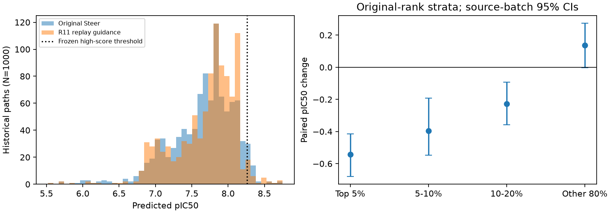

# N/C R11：B50历史路径回放1000例完成与比较

2026-10-19，独立扩展的20个B50批次全部完成，1000条均有终态状态和预测评分，评分失败0、批次失败0、跳过0；953条可导出有效连通分子，47条保留为结构失败。累计用时11206.56秒，约3小时6分47秒。完整结果已下载并校验，定时巡检在本报告保存后停止。

**本次R11的均值和最高预测pIC50略高于原Steer，但尚不能称为全面优于Steer。** 均值为7.691717、最高8.750523；原Steer为7.651480、8.704806。R11的P95及既定阈值下高分数量下降，原本最好的历史路径大多退化。它发现了两个超过原最高分且通过PoseBusters的新候选，但对高分群体的保留较弱。

原200条R11没有成功结果，故本次实际重新补齐全部1000条；没有把旧失败记录当成可复用成功样本，也没有改变原Steer数据。

## 输入与执行核验

- 沿用全部1000条原Steer终态谱系，20个共同B50分组；Top5/10/20%只在统计阶段按原终态排名提取，不重新按新结果排名。
- 逐一核对1000个终态路径ID、初始根槽位、原批次、每一步祖先映射及指纹；20份随机输入tape与原实验一致，100步均覆盖一次连续噪声和三次离散随机变量。离散输出由当前概率产生，没有复制原离散结果。
- 所有批次完成至t=1；冻结引导窗口为[0.1,0.5]，实际第10–49步生效。每个生效步50条均有非零坐标注入，之后继续无引导推理。
- 原200条零引导回放门槛通过：中间及终态坐标逐位一致，离散状态一致，最大pIC50误差为9.5367e-7。不能把该门槛表述为额外生成了1000条No guidance。
- 保留原B50口袋编码及终态评分上下文；权重版本不变，914个原生parameter autograd标志保留，未积累参数梯度。没有SMC或affinity head梯度。
- 实际生成runtime固定为`bd106a7855a4094f51c26971b12464d631849617`。CPU保存反向张量解决B50显存问题，没有改成小批量、半精度或近似梯度。

机器核验见[completion_audit.json](final_analysis/completion_audit.json)。该任务属于已知历史路径条件下的反事实回放；原生随机起点的泛化能力不能从此直接推出。

## 完整1000例分布

|方法|均值|中位数|P90|P95|P99|最高|高分数量|
|---|---:|---:|---:|---:|---:|---:|---:|
|原Steer|7.651480|7.730254|8.135139|8.238437|8.349334|8.704806|40|
|N/C R11|7.691717|7.803243|8.134534|8.154314|8.470528|8.750523|29|
|祖先模板R02_v3|7.667281|7.711170|8.122300|8.218267|8.620434|8.855781|45|
|R15_v2 / R15 B50扩展|7.632607|7.716545|8.119439|8.249182|8.351658|8.719067|45|
|历史原生无引导，非配对参考|7.455771|7.525645|8.024362|8.072865|8.192319|8.529457|6|

高分沿用冻结阈值`pIC50 >= 8.258901977539063`，没有将它重新定义为当前各组的P95。主要分布包含全部生成尝试的评分；有效结构及PB通过子集另外报告。R15两个历史名称共享等价结果，不是两次独立重复。

R11相对原Steer的配对均值变化为+0.040237，按原20个来源批次聚类、10000次bootstrap、seed=42得到95%区间[-0.096646,+0.178239]，覆盖0。因此均值只能描述为本次点估计略高。R11有56%的配对路径评分提高，但高分数量由40降到29；有效连通高分数量由37降到25。

R11的P99更高，同时P95更低，表示它得到少数更高的极端值，却没有稳定扩大整个高分群体。R02在本轮的最高值、P99、高分数量和PB通过数量上更强；R11均值更高，但与R02的配对均值差区间也覆盖0。当前没有一个条件在所有指标上同时最优。



## 固定优质历史路径的配对结果

下表始终使用原Steer前5%、10%、20%对应的相同路径，不是重新选择各条件自己的优质分子。

|原Steer路径范围|N|原Steer均值|R11均值|M2均值|R11减原Steer|95%来源批次区间|
|---|---:|---:|---:|---:|---:|---|
|前5%|50|8.334787|7.793017|7.645878|-0.541770|[-0.680297,-0.414444]|
|前10%|100|8.259447|7.791047|7.539233|-0.468400|[-0.586790,-0.328595]|
|前20%|200|8.171840|7.824130|7.611594|-0.347710|[-0.473561,-0.199812]|

这200条No guidance精确重现相应原Steer路径，所以R11相对No guidance的均值差也分别约为-0.541770、-0.468400、-0.347710。原前5%、10%、20%路径中，仅4%、8%、19.5%在R11下得到更高评分。

R11在同池200条上比M2均值高0.212535；区间[-0.079796,+0.491191]覆盖0，不能宣称已稳定胜出。M2与配对No guidance都只生成了200条，不能将其均值与R11全部1000条直接作为同总体比较。历史原生无引导1000条另列为非配对参考，其随机输入和路径筛选条件不同。

原排名201–1000的800条路径，均值由7.521390升到7.658614，变化+0.137224，区间[-0.003587,+0.273815]仍覆盖0。整体均值略高来自“原前20%下降、其余80%上升”的加权结果：`0.2×(-0.347710)+0.8×0.137224=0.040237`。这与前几批观察到下降并不矛盾。

## 结构与应变

|条件及范围|有效连通/计划|PB通过/已评估|PB通过/计划|MMFF代理中位数|MMFF代理P90|
|---|---:|---:|---:|---:|---:|
|R11，全部1000|953/1000|866/953|86.6%|0.825191|4.699787|
|R02，全部1000|952/1000|915/952|91.5%|0.822139|2.966672|
|R15，全部1000|952/1000|883/952|88.3%|0.832792|4.460907|
|R11，原前20%|186/200|163/186|81.5%|0.842287|5.500233|
|配对No guidance，原前20%|188/200|160/188|80.0%|0.829329|7.711261|
|M2，同200条|194/200|194/194|97.0%|0.795355|1.270643|

应变沿用既有`mmff_relief_per_heavy`定义：加氢后MMFF94s最小化最多500次，取`(初始能量−最小化后能量)/重原子数`，单位为kcal/mol/重原子。它是构象松弛代理，不是结合能。R11的953条能量计算全部收敛；47条未解码，不将其能量填零。

原Steer整体有961条有效连通分子，但旧final_records没有整池PB及MMFF数据；不能把缺失PB标签的汇总计数0解释成0%通过。统计代码已补充PB评估覆盖、通过率分母和质量合格高分计数，44项相关测试通过。原前20%的No guidance状态与原Steer逐位相同，因此其质量复核可以作为这个子集的结构对照。不能把该子集应变当成整池1000条的应变。

R11相对同池无引导的应变中位数略高、P90较低，PB通过数增加3，但有效连通数减少2；不存在全方位质量改善。相比R02，R11的整体应变尾部和PB通过率更差。

R11的29个高分中，25个为有效连通分子，20个通过PB；R02分别为45、43、32，R15为45、40、35。应同时考察高分与质量交集。

## 两个超过原最高分的新候选

|起源历史路径ID|原排名|原预测pIC50|新预测pIC50|PB|MMFF代理|
|---|---:|---:|---:|---|---:|
|F_b017_s038|256|7.951554|8.750523|通过|1.458263|
|F_b015_s024|157|8.071674|8.728050|通过|3.247429|

这些ID表示起源历史路径，不表示新输出仍是原来的分子。具体结构分别见[最高分SDF](final_analysis/best_candidates/F_b017_s038.sdf)和[第二高分SDF](final_analysis/best_candidates/F_b015_s024.sdf)；SMILES及更多候选见[top_candidates.csv](final_analysis/top_candidates.csv)。

原最高分F_b011_s030在配对No guidance复核中没有通过PB，其MMFF代理为1601.101918。R11这两个新候选既超过其预测分数又通过PB，具有进一步验证价值，但没有因此消除整池高分富集及原优质路径保留不足的问题。

## 为什么几何目标实现了，亲和力仍可能变差

**首先，本次冻结的“N/C R11”实际只启用half几何项。** 程序权重为half=1、endpoint=0、type=0、orientation=0；assignment_type_cost=0。它没有直接奖励N/C布局。本轮结果不能当成N/C化学身份引导的消融证据。教师为F_b011_s030的t=0.5状态，使用25个点中的20个局部点，匹配不固定跨分子的原子编号。

R11先通过真实FLOWR端点预测，把当前状态线性桥接到教师时钟，计算局部点云的Hungarian匹配距离，再通过FLOWR坐标Jacobian回传梯度。其几何奖励为`-δ²(√(1+q/δ²)−1)`，δ=1 Å，q是匹配点平均平方距离。实际坐标注入按原生预测流步幅RMS的0.66倍校准，单原子每步上限0.15 Å、累计RMS上限6 Å。

**几何靠拢有直接数据支持。** 在相同200条路径的真实t=0.5状态上，按相同教师的20点区域计算无刚体对齐的Hungarian RMS：无引导均值0.328784 Å，R11为0.035073 Å；98%的路径更接近教师，但78.5%的路径同时出现终态亲和力下降。该诊断衡量实际边界状态，低t执行奖励衡量桥接预测，两者不是同一个observable，不能混称为逐步奖励值。

**剂量机制可能扰动已经适配的路径。** 代码先做unit-RMS梯度平衡，再根据原生流步幅指定注入大小，非零梯度的大小并不会直接决定最终剂量，也没有随目标误差变小而衰减的显式机制。所有1000条在40个生效步都获得了非零注入。原教师自身路径在无引导t=0.5时距教师区域只有约9.22e-7 Å，R11后反而为0.022713 Å，其终态评分由8.704806降至7.499705。这说明“同一路径已适配”不等于归一化引导会自动保持不动。该机制解释有代码和个例支持，尚不能在没有剂量消融时断言它是唯一原因。

**固定单教师、较大的局部支持和目标替代共同限制了保留能力。** 20/25点覆盖80%的原子槽位，许多路径被拉向同一几何模式；几何误差与最终亲和力不是同一目标，t=0.5之后仍有真实模型演化和原生随机输入。这些事实可以解释中低分路径受益、原优势路径退化的组合。化学图变化本身不是失败判据；本轮允许图变化，没有增加限制其变化的gate。

低t的线性端点桥接也不等于教师真实的祖先轨迹。即使回放同一条历史路径，桥接的未来估计仍可能偏离该条SDE实际到达的t=0.5状态；固定终点模板可能在早期触发不必要校正。这个方向需要与剂量机制分别验证。在单一half项且梯度被归一化的情况下，单纯缩放奖励数值也未必改变实际注入强度，后续应读取真实位移和响应，而不只比较奖励值。

若后续继续研究，优先验证“已经靠近时剂量衰减”“更小且药化意义明确的局部支持”“为不同路径匹配不同教师模式”等独立因素，以PB通过的高分富集与原高分路径保留共同评价。本任务保持冻结，没有据当前结果追加调参或分子生成。

## 数据与复现

本地完整快照：`data/archives/path_replay_r11_extension_20261019/snapshot_20261019_111528.tar.gz`；SHA-256：`65491691e12c5a3597ca766610e2de847b95fd35212baaf33dc9bec5dc0919ff`。115个归档成员通过校验，解包至`data/generated/path_replay_r11_extension_20261019`。原Steer、对照、教师和共享依赖均保留。

可在本地重新统计和验证，无需再加载生成模型：

```powershell
$env:PYTHONPATH=(Resolve-Path src).Path
.venv/Scripts/python.exe -m evomolsteer.path_replay.extension analyze --repo . --manifest configs/experiments/path_replay_r11_extension_20261019/extension.json --work data/generated/path_replay_r11_extension_20261019 --base-work data/generated/path_replay_b50_20261018
.venv/Scripts/python.exe scripts/report_path_replay_extension.py --repo . --manifest configs/experiments/path_replay_r11_extension_20261019/extension.json --work data/generated/path_replay_r11_extension_20261019 --base-work data/generated/path_replay_b50_20261018 --output docs/experiments/path_replay_r11_extension_20261019/final_analysis
```

完整数值表见[performance.csv](final_analysis/performance.csv)、[paired.csv](final_analysis/paired.csv)；互斥排名分层见[rank_strata.csv](final_analysis/rank_strata.csv)；几何与亲和力的配对诊断见[geometry_affinity_pairs.csv](final_analysis/geometry_affinity_pairs.csv)。脚本和输入指纹见[inputs.json](final_analysis/inputs.json)。
